# 计算机视觉基础：从像素感知到视觉理解与生成

整套 PPT 建议围绕下面一条学习主线展开：

```text
机器看到了什么
      ↓
机器需要完成哪些视觉任务
      ↓
为什么视觉理解很困难
      ↓
CNN 如何从像素中提取特征
      ↓
分类、检测等任务如何实现
      ↓
Transformer 与 Diffusion 如何改变 CV
```

一句话总结：

> 计算机视觉的发展，本质上是机器从“读取像素”，逐步走向“提取特征、理解内容和生成图像”的过程。

---

# 第一部分：计算机如何“看”世界

## 1. 什么是计算机视觉

计算机视觉（Computer Vision，CV）是一门研究如何让计算机从图像、视频以及其他视觉数据中提取信息、理解内容并完成任务的技术领域。

人类看到一张图片时，可以直接理解其中的物体、人物、位置关系和事件；计算机最初获得的却只是像素数值。计算机视觉要做的，就是建立从像素到语义的映射。

```text
图像或视频
    ↓
像素与帧序列
    ↓
特征提取
    ↓
目标、位置、关系与语义
    ↓
识别、分析、判断或生成
```

> 计算机视觉的核心目标：让机器获得从视觉数据中“感知、理解和生成”信息的能力。

### 概念说明

计算机视觉与机器视觉关系紧密，但并不完全等同：

- **计算机视觉**更强调通用的视觉感知、理解与生成技术；
- **机器视觉**通常更偏向工业场景中的相机、光源、算法和控制系统的整体应用。

### 推荐配图

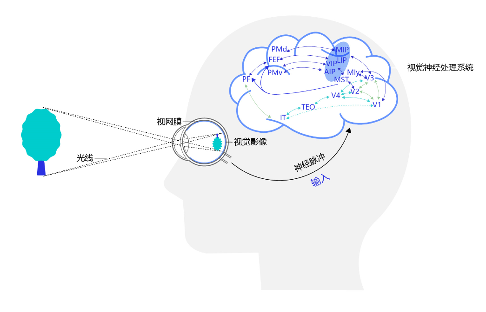

---

## 2. 计算机眼中的图像

一张数字图像可以表示为一个多维数组。

对于彩色图像，通常包含红、绿、蓝三个通道：

$$
X\in\mathbb{R}^{C\times H\times W}
$$

其中：

- $C$：通道数，例如 RGB 图像的 $C=3$；
- $H$：图像高度；
- $W$：图像宽度。

在人类眼中，图像是一只猫、一辆车或者一张人脸；在计算机眼中，它首先是一组按空间位置排列的数字。

PPT 页面可以采用左右对照：

| 人类看到的内容 | 计算机获得的内容 |
| --- | --- |
| 猫、汽车、道路、行人 | RGB 像素矩阵 |
| 物体之间的空间关系 | 不同位置和通道上的数值 |
| 场景的整体含义 | 尚未被解释的数值模式 |

---

## 3. 计算机视觉的主要任务

计算机视觉任务可以按照“机器需要回答什么问题”来理解。

| 视觉任务 | 核心问题 | 典型输出 | 应用举例 |
| --- | --- | --- | --- |
| 图像分类 | 这张图是什么？ | 一个或多个类别 | 商品识别、医学影像分类 |
| 目标检测 | 有什么？在哪里？ | 类别、置信度、边界框 | 行人检测、安全帽检测 |
| 图像分割 | 每个像素属于什么？ | 像素级掩码 | 人像抠图、车道线识别 |
| OCR | 图中写了什么？ | 文本位置与文字内容 | 票据、证件、文档识别 |
| 视频分析 | 发生了什么？ | 动作、事件、轨迹 | 行为识别、视频监控 |
| 图像生成 | 能否生成或编辑图像？ | 新图像或编辑结果 | 文生图、修复、风格迁移 |

### 图像分类

图像分类为整张图像分配类别标签。


### 目标检测

目标检测不仅要识别物体类别，还要确定物体在图像中的位置。

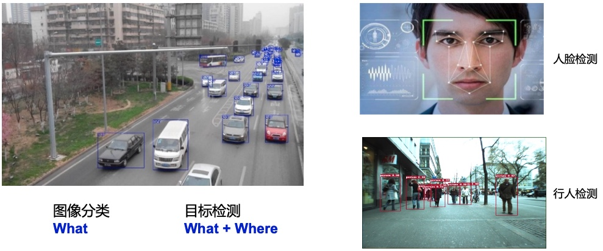

### 图像分割

图像分割对每个像素进行分类，能够获得比边界框更精细的物体轮廓。

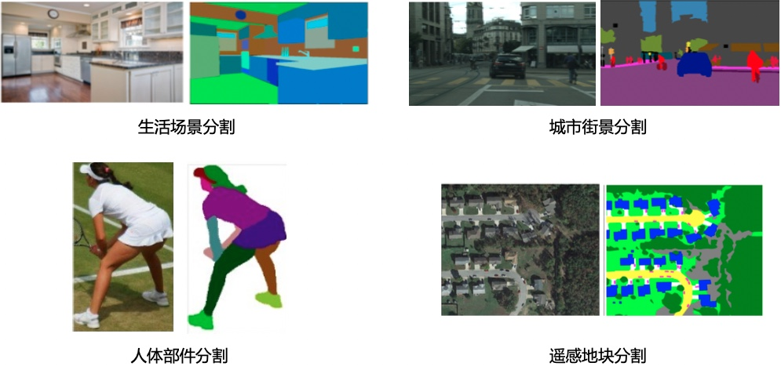

### OCR

OCR（Optical Character Recognition，光学字符识别）用于检测并识别图像中的文字。

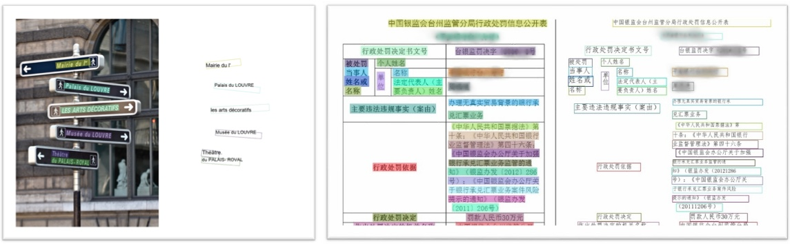

### 视频分析

视频可以看成按照时间排列的图像序列。视频分析不仅需要理解单帧画面，还要建模帧与帧之间的时间关系。


### 图像生成

图像生成关注如何根据噪声、文本、参考图像或其他条件生成新的视觉内容。

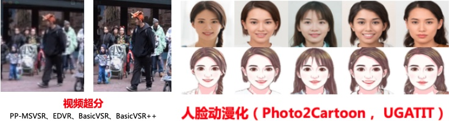

---

## 4. 为什么计算机视觉很困难

同一个物体在不同环境中可能呈现出完全不同的像素分布。

主要挑战包括：

| 挑战 | 具体表现 |
| --- | --- |
| 光照变化 | 白天、夜间和阴影会改变颜色与亮度 |
| 视角变化 | 同一物体从不同角度看起来差异很大 |
| 尺度变化 | 物体可能离相机很近，也可能非常远 |
| 遮挡 | 物体的一部分可能被其他物体挡住 |
| 形变 | 人体、动物和柔性物体的外形不断变化 |
| 背景干扰 | 目标可能与复杂背景混在一起 |
| 数据问题 | 标注成本高，类别分布可能不均衡 |
| 工程约束 | 实际系统通常还有实时性、功耗和算力限制 |

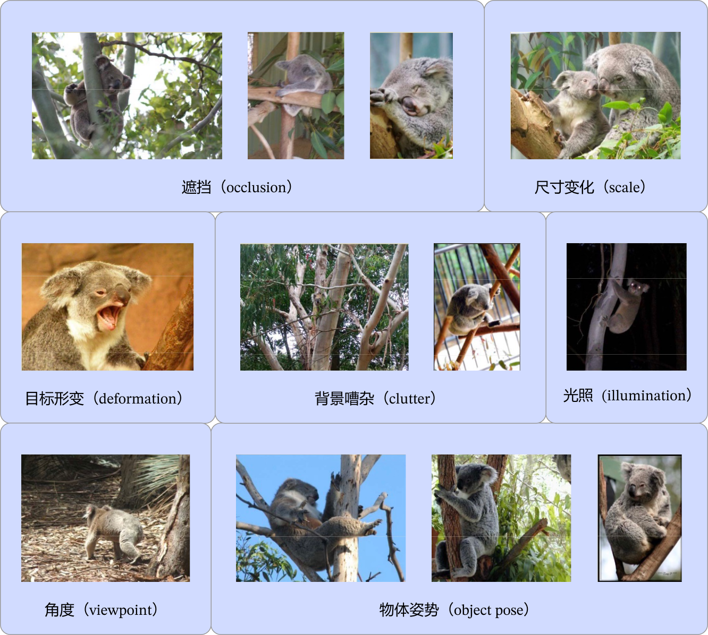

> CV 模型需要学习的不是某一张图片，而是在各种变化条件下仍然稳定存在的视觉特征。

---

## 5. 计算机视觉的应用场景

| 行业 | 典型场景 |
| --- | --- |
| 安防 | 人脸识别、人员检测、异常行为分析 |
| 交通 | 车牌识别、车辆检测、自动驾驶感知 |
| 工业 | 缺陷检测、尺寸测量、机器人定位 |
| 医疗 | 医学影像分类、病灶检测、器官分割 |
| 金融 | 刷脸支付、票据识别、证件审核 |
| 互联网 | 图像搜索、内容审核、商品识别 |
| 内容创作 | 文生图、图像编辑、视频生成 |


---

# 第二部分：从手工特征到深度学习

## 6. 视觉算法的技术演进

计算机视觉的技术演进，可以从“特征由谁来设计”这一角度理解。

```text
传统视觉
人工设计 SIFT、HOG 等特征
            ↓
卷积神经网络
从训练数据中自动学习局部与层级特征
            ↓
Vision Transformer
使用注意力机制建模图像块之间的全局关系
            ↓
视觉预训练与多模态模型
通过大规模数据学习可迁移的通用视觉表示
            ↓
Diffusion / DiT
视觉模型由理解任务进一步扩展到内容生成
```

### 传统方法示例：HOG + SVM 行人检测

传统行人检测流程通常包括：

1. 使用滑动窗口遍历图像；
2. 提取候选区域的 HOG 特征；
3. 使用 SVM 判断候选区域是否包含行人；
4. 使用 NMS 去除重复检测框。


传统方法的主要限制是：模型效果高度依赖人工设计的特征，跨场景迁移能力有限。

### 深度学习带来的变化

卷积神经网络将“特征提取”和“任务预测”放入同一个可训练网络中：

```text
传统视觉：图像 → 人工特征 → 分类器 → 结果

深度学习：图像 → 神经网络自动学习特征 → 结果
```

---

# 第三部分：CNN 如何理解图像

## 7. 为什么图像需要卷积神经网络

如果直接把图像展开为一维向量，再输入全连接网络，会遇到两个问题。

### 问题一：参数数量过多

全连接层中的每个神经元都与上一层所有输入相连。随着图像尺寸和隐藏层规模增大，参数量会迅速增长。

### 问题二：图像空间结构被破坏

图像中相邻像素通常存在密切联系。将图像直接展开后，原有的上下、左右和局部邻域关系不再明显。

### CNN 的解决思路

| CNN 特性 | 作用 |
| --- | --- |
| 局部连接 | 每次只观察一个局部区域 |
| 权重共享 | 同一个卷积核在整张图像上重复使用 |
| 层级提取 | 逐层组合边缘、纹理、部件和语义特征 |
| 平移等变 | 物体位置变化时，相应特征也随位置移动 |


---

## 8. 卷积：使用一个小窗口扫描图像

卷积核可以理解为一个小型特征探测器。它在图像上滑动，每次取出一个局部区域，进行对应位置相乘再求和。

设输入局部区域为 $X$，卷积核为 $K$，输出位置的计算可以写为：

$$
y=\sum_i\sum_j X_{i,j}K_{i,j}+b
$$

例如，输入区域与卷积核均为 $3\times3$：

$$
X=
\left[
\begin{array}{ccc}
x_{11} & x_{12} & x_{13} \cr
x_{21} & x_{22} & x_{23} \cr
x_{31} & x_{32} & x_{33}
\end{array}
\right]
$$

$$
K=
\left[
\begin{array}{ccc}
k_{11} & k_{12} & k_{13} \cr
k_{21} & k_{22} & k_{23} \cr
k_{31} & k_{32} & k_{33}
\end{array}
\right]
$$

则一次卷积计算为：

$$
y=x_{11}k_{11}+x_{12}k_{12}+\cdots+x_{33}k_{33}+b
$$

> 卷积核中的参数决定了它会对哪一种局部图案产生较强响应。

---

## 9. 卷积算子应用举例

### 案例一：检测黑白边界

设置水平方向的卷积核：

$$
K=
\left[
\begin{array}{ccc}
1 & 0 & -1
\end{array}
\right]
$$

该卷积核计算左右像素之间的差值：

$$
y=x_{\mathrm{left}}-x_{\mathrm{right}}
$$

在亮度相同的区域，左右像素差接近 0；当卷积核跨越明暗边界时，输出的绝对值会明显增大。


### 案例二：检测物体轮廓

可以使用下面的拉普拉斯卷积核突出图像中的边缘：

$$
K=
\left[
\begin{array}{ccc}
-1 & -1 & -1 \cr
-1 &  8 & -1 \cr
-1 & -1 & -1
\end{array}
\right]
$$

它会计算中心像素与周围八个像素之间的差异：

$$
y=8x_{\mathrm{center}}-\sum_{i=1}^{8}x_{\mathrm{neighbor},i}
$$

平坦区域的输出接近 0，亮度变化明显的边缘区域会产生较强响应。

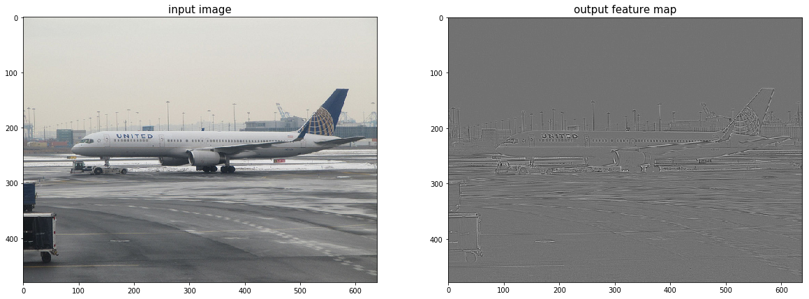

### 案例三：均值模糊

使用 $5\times5$ 均值卷积核：

$$
K=\frac{1}{25}
\left[
\begin{array}{ccccc}
1 & 1 & 1 & 1 & 1 \cr
1 & 1 & 1 & 1 & 1 \cr
1 & 1 & 1 & 1 & 1 \cr
1 & 1 & 1 & 1 & 1 \cr
1 & 1 & 1 & 1 & 1
\end{array}
\right]
$$

输出像素等于邻域内 25 个像素的平均值：

$$
y=\frac{1}{25}\sum_{i=1}^{25}x_i
$$

均值卷积能够降低局部噪声，但也会模糊边缘与细节。


---

## 10. Padding、Stride 与输出尺寸

### Padding：是否在图像周围补像素

如果卷积核不超出图像边界，卷积后特征图通常会变小。Padding 通过在输入边缘补充像素控制输出尺寸，并减少边缘信息损失。

### Stride：卷积核每次移动多远

- Stride 较小：采样更密集，输出特征图更大；
- Stride 较大：采样更稀疏，输出特征图更小。

对于输入高度 $H$、卷积核高度 $K_h$、上下总填充量 $P_h$ 和步幅 $S_h$：

$$
H_{out}=\left\lfloor\frac{H+P_h-K_h}{S_h}\right\rfloor+1
$$

宽度方向同理：

$$
W_{out}=\left\lfloor\frac{W+P_w-K_w}{S_w}\right\rfloor+1
$$

---

## 11. 感受野：一个神经元能够“看到”多大范围

感受野（Receptive Field）表示特征图上的一个神经元，对应输入图像上的区域范围。

- 浅层特征感受野较小，通常关注边缘和纹理；
- 随着网络加深，感受野逐渐扩大；
- 深层特征能够综合更大范围的信息，形成部件和对象级语义。

```text
像素
 ↓
边缘与方向
 ↓
纹理与局部形状
 ↓
物体部件
 ↓
完整对象与场景语义
```

> CNN 的“深度”不仅意味着更多计算层，也意味着模型可以在更大范围内组合视觉信息。

---

## 12. 多通道与多卷积核

彩色图像包含多个输入通道，一个卷积层通常也会输出多个通道。

如果输入维度为：

$$
N\times C_{in}\times H\times W
$$

卷积核参数维度通常为：

$$
C_{out}\times C_{in}\times K_h\times K_w
$$

输出维度为：

$$
N\times C_{out}\times H_{out}\times W_{out}
$$

其中：

- $N$：批量大小；
- $C_{in}$：输入通道数；
- $C_{out}$：输出通道数，也可以理解为卷积核的个数；
- 每个输出通道可以学习关注不同的特征模式。


---

## 13. CNN 的其他基础模块

### 池化：压缩空间信息

池化使用局部区域的统计值替代原始像素或特征值。

| 池化方法 | 计算方式 | 主要特点 |
| --- | --- | --- |
| 最大池化 | 取窗口内最大值 | 保留最强特征响应 |
| 平均池化 | 取窗口内平均值 | 保留区域整体统计信息 |
| 全局平均池化 | 对整张特征图求平均 | 将每个通道压缩为一个数值 |

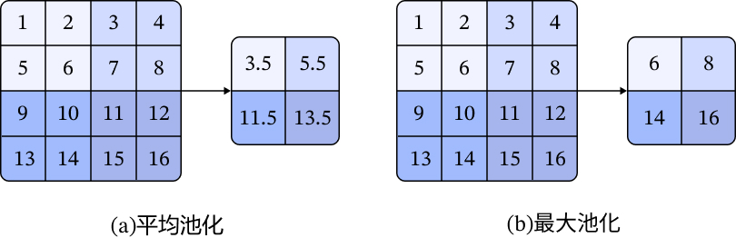

### 激活函数：引入非线性

如果没有激活函数，多层线性变换最终仍然等价于一次线性变换。激活函数让神经网络具备表达复杂非线性关系的能力。

ReLU 是 CNN 中常见的激活函数：

$$
\mathrm{ReLU}(x)=\max(0,x)
$$

与 Sigmoid 和 Tanh 相比，ReLU 在正区间的梯度为 1，有助于缓解深层网络中的梯度消失问题。


### Batch Normalization：稳定中间特征分布

Batch Normalization 对一个 mini-batch 中的中间特征进行标准化，再使用可学习参数完成缩放和平移，通常能够改善优化过程并支持更大的学习率。

常见归一化方法包括：

| 方法 | 主要归一化范围 | 典型特点 |
| --- | --- | --- |
| BatchNorm | 同一通道上的批量与空间维度 | 依赖 batch 统计量 |
| LayerNorm | 单个样本的特征维度 | 不依赖 batch 大小，Transformer 常用 |
| GroupNorm | 分组后的通道与空间维度 | 小 batch 场景更稳定 |
| InstanceNorm | 单样本、单通道的空间维度 | 常用于图像风格任务 |

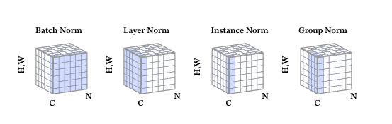

### Dropout：降低神经元之间的过度依赖

训练时，Dropout 随机将一部分神经元输出设置为 0，使模型不能长期依赖少量固定特征，从而起到正则化作用。

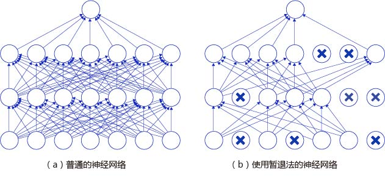

### 一页总结

| 模块 | 回答的问题 |
| --- | --- |
| 卷积 | 局部区域中出现了什么特征？ |
| 激活函数 | 如何表达复杂的非线性模式？ |
| 池化或步幅卷积 | 如何压缩特征并扩大感受野？ |
| 归一化 | 如何让训练过程更加稳定？ |
| Dropout | 如何降低模型过拟合风险？ |

---

# 第四部分：图像分类与 ResNet

## 14. 图像分类：识别整张图像的类别

图像分类模型通常包含两个部分：

```text
输入图像
   ↓
Backbone：提取视觉特征
   ↓
分类头：计算各类别得分
   ↓
类别概率
```

分类任务虽然输出形式简单，却是目标检测、图像分割和图像检索等任务的重要基础。

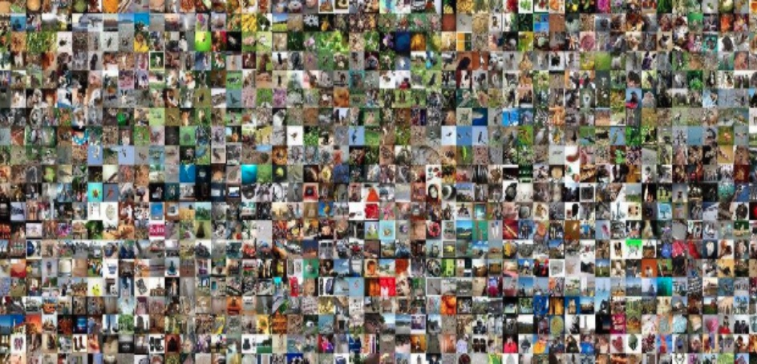

---

## 15. ResNet：让深层网络更容易优化

随着网络层数增加，普通深层网络可能出现训练误差反而升高的退化问题。ResNet 引入残差连接，让网络学习相对于输入的残差变化。

普通映射：

$$
y=F(x)
$$

残差映射：

$$
y=F(x)+x
$$

如果最合适的变换接近恒等映射，只需要让 $F(x)$ 接近 0，就可以得到：

$$
y\approx x
$$

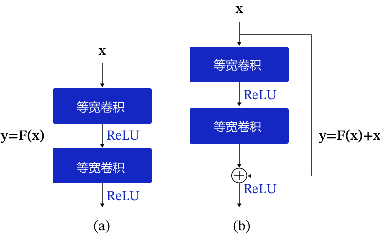

残差连接带来的关键价值：

- 为信息前向传播提供捷径；
- 为梯度反向传播提供更直接的路径；
- 让更深的神经网络更容易优化。

### Bottleneck 结构

ResNet-50 等模型常使用 $1\times1$、$3\times3$、$1\times1$ 的瓶颈结构：

```text
输入通道
   ↓ 1×1：降低通道数
较窄的中间表示
   ↓ 3×3：提取空间特征
中间特征
   ↓ 1×1：恢复通道数
输出通道
```

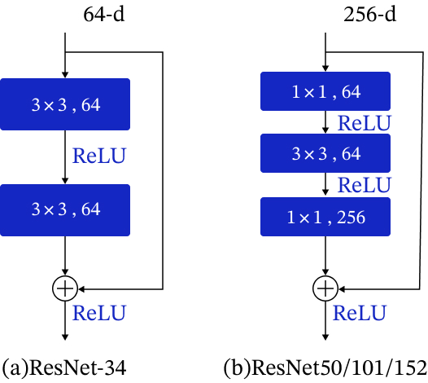

---

# 第五部分：目标检测与 YOLO

## 16. 目标检测：识别类别并确定位置

图像分类只需要回答“整张图是什么”，目标检测还需要回答“图中有哪些物体，它们在哪里”。

| 任务 | 输出 |
| --- | --- |
| 图像分类 | 整张图像的类别 |
| 目标检测 | 多个物体的类别、置信度和位置 |


一个常见检测结果可以表示为：

$$
[\mathrm{class},\ \mathrm{score},\ x_1,\ y_1,\ x_2,\ y_2]
$$

---

## 17. 边界框与 IoU

### 边界框

边界框（Bounding Box，BBox）是能够包围目标物体的矩形区域。

常见表示方式：

- $xyxy$：左上角和右下角坐标 $(x_1,y_1,x_2,y_2)$；
- $xywh$：中心坐标与宽高 $(x,y,w,h)$。


### IoU

交并比（Intersection over Union，IoU）用于衡量两个边界框的重合程度：

$$
\mathrm{IoU}=\frac{|A\cap B|}{|A\cup B|}
$$

- IoU 越接近 1，两个框越重合；
- IoU 越接近 0，两个框的重合程度越低。


PPT 主讲时保留概念和图示即可，坐标级交集面积推导建议放入附录。

---

## 18. NMS：去除重复检测框

一个目标附近往往会产生多个高度重叠的预测框。非极大值抑制（Non-Maximum Suppression，NMS）用于保留最合适的预测结果。

基本过程：

1. 选择当前置信度最高的预测框；
2. 计算它与其他同类别预测框的 IoU；
3. 删除 IoU 超过阈值的重复框；
4. 对剩余预测框重复上述过程。

```text
多个重叠候选框
       ↓
按照置信度排序
       ↓
保留最高分框
       ↓
删除与其高度重叠的框
       ↓
得到最终检测结果
```


---

## 19. 目标检测算法的主要路线

| 路线 | 基本思路 | 代表模型 | 特点 |
| --- | --- | --- | --- |
| 两阶段检测 | 先产生候选区域，再分类和回归 | Faster R-CNN | 流程清晰，通常计算链路较长 |
| 单阶段检测 | 直接预测类别和位置 | YOLO、SSD | 结构紧凑，适合实时检测 |
| Anchor-Free | 不依赖预设锚框，预测中心或关键点 | FCOS、CenterNet | 减少 Anchor 设计与匹配 |
| Transformer 检测 | 将目标检测建模为集合预测 | DETR 系列 | 使用注意力机制建模全局关系 |

> 两阶段、单阶段与 Anchor-Free 不是完全互斥的分类维度。单阶段和两阶段描述检测流程，Anchor-Based 与 Anchor-Free 描述候选框或位置表示方式。

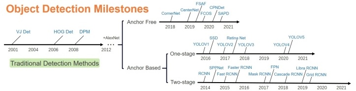

---

## 20. YOLOv3：经典单阶段目标检测模型

YOLO 的核心思想是：使用一次网络前向计算，直接预测多个目标的类别、置信度和位置。

YOLOv3 的整体流程：

```text
输入图像
   ↓
预处理
   ↓
YOLOv3 网络
   ↓
多尺度预测框与类别得分
   ↓
NMS 去除重复框
   ↓
最终检测结果
```


### Backbone、Neck 与 Head

| 模块 | 作用 |
| --- | --- |
| Backbone | 从输入图像中提取不同层级的视觉特征 |
| Neck | 融合不同尺度的特征，增强多尺度表达 |
| Head | 预测目标类别、置信度和边界框位置 |


PPT 主讲建议聚焦整体流程与三个模块的分工。锚框生成、坐标变换、标签分配和损失函数代码可放入实践课或技术附录。

---

# 第六部分：从 CNN 走向视觉大模型

## 21. ViT：把图像变成 Token 序列

Vision Transformer（ViT）将 Transformer 从自然语言处理迁移到视觉任务。

核心步骤：

1. 将图像切分为固定大小的 Patch；
2. 将每个 Patch 展平并映射为向量；
3. 加入位置编码和分类 Token；
4. 将 Token 序列输入 Transformer Encoder；
5. 使用输出表示完成图像分类。

```text
Image
  ↓
切分为 Patches
  ↓
Patch Embedding
  ↓
加入位置编码
  ↓
Transformer Encoder
  ↓
Classification Head
```


CNN 与 ViT 的关注重点不同：

| CNN                        | ViT                                   |
| -------------------------- | ------------------------------------- |
| 通过局部卷积逐层扩大感受野 | 通过自注意力直接建模 Patch 之间的关系 |
| 具有较强的局部结构先验     | 结构先验较少，更依赖数据和预训练      |
| 图像表示为二维特征图       | 图像表示为 Token 序列                 |

---

## 22. Diffusion：通过学习去噪生成图片

DDPM（Denoising Diffusion Probabilistic Models）的核心思想是：训练时向真实图像逐步加入噪声，并训练模型学习逆向去噪过程；生成时从随机噪声开始，经过多步去噪获得图像。

```text
前向扩散：逐步加噪

Image → x₁ → x₂ → x₃ → … → Noise


反向扩散：逐步去噪

Noise → xₜ₋₁ → xₜ₋₂ → … → Image
```

> DDPM 的关键不是记住每一条公式，而是理解“通过破坏图像来学习如何恢复图像”。

---

## 23. Latent Diffusion：从像素空间进入潜在空间

早期扩散模型直接在高维 Pixel Space 中进行多轮去噪，计算成本较高。Latent Diffusion Model（LDM）先使用 Autoencoder 将图像压缩到较小的 Latent Space，再完成扩散过程。

```text
Image
  ↓ Encoder
Latent
  ↓ 加噪
Noisy Latent
  ↓ 多轮去噪
Clean Latent
  ↓ Decoder
Image
```

核心变化：

> Pixel Space → Latent Space

这样能够降低训练和推理成本，同时保留重要的感知信息。

---

## 24. Stable Diffusion：使用文本控制图像生成

Stable Diffusion 在 Latent Diffusion 的基础上加入文本条件。

```text
Text Prompt
     ↓
Text Encoder
     ↓
Text Embedding
     │
     └────指导去噪过程
                  ↓
Noise → U-Net → Latent → VAE Decoder → Image
```

核心变化：

> Latent Diffusion + Text Condition → Text-to-Image

教学演示可使用：

[Diffusion Explainer：Stable Diffusion 交互式原理演示](https://poloclub.github.io/diffusion-explainer/)

---

## 25. DiT：使用 Transformer 完成扩散去噪

Diffusion Transformer（DiT）继续使用 Latent Diffusion 的总体框架，但将传统 U-Net 去噪骨干替换为 Transformer。

```text
Noisy Latent
      ↓
   Patchify
      ↓
Patch Embedding
      ↓
    Tokens
      ├── Timestep
      └── Condition
      ↓
 Transformer
      ↓
预测 Noise 并逐步去噪
      ↓
 Clean Latent
      ↓
 VAE Decoder
      ↓
    Image
```

核心变化：

> U-Net → Transformer

ViT 和 DiT 展示了 Transformer 在视觉中的两类角色：

| 模型 | 主要任务 | Transformer 的作用                  |
| ---- | -------- | ----------------------------------- |
| ViT  | 视觉理解 | 编码图像 Patch，提取视觉表示        |
| DiT  | 视觉生成 | 编码带噪 Latent Patch，预测去噪方向 |

---

## 26. 视觉生成技术演进

```text
DDPM（2020）
Pixel Space + U-Net
       │
       │ Pixel → Latent
       ↓
Latent Diffusion（2021）
Latent Space + U-Net
       │
       │ 加入文本条件
       ↓
Stable Diffusion（2022）
Text + Latent + U-Net
       │
       │ U-Net → Transformer
       ↓
DiT（2022）
Latent Space + Transformer
```

记住四句话：

1. **DDPM：学习从噪声中恢复图片；**
2. **Latent Diffusion：在压缩后的 Latent 中去噪；**
3. **Stable Diffusion：使用文本控制去噪方向；**
4. **DiT：使用 Transformer 承担去噪任务。**

---

# 第七部分：课程总结

## 27. 从像素到语义，再从语义到内容

计算机视觉可以归纳为三层能力：

| 能力层级 | 核心问题                     | 代表技术                              |
| -------- | ---------------------------- | ------------------------------------- |
| 感知     | 图像中出现了哪些局部模式？   | 卷积、池化、特征提取                  |
| 理解     | 有什么、在哪里、发生了什么？ | ResNet、YOLO、分割、OCR、ViT          |
| 生成     | 如何创造或编辑视觉内容？     | GAN、Diffusion、Stable Diffusion、DiT |

整条技术主线可以概括为：

```text
像素
 ↓
局部特征
 ↓
对象与位置
 ↓
场景与语义
 ↓
视觉内容生成
```

### 课程结束时需要带走的六句话

1. 图像进入计算机后，首先是一组像素数值；
2. 不同 CV 任务解决的是不同层级的视觉问题；
3. CNN 通过局部连接、权重共享和层级特征提取理解图像；
4. ResNet 让深层网络更容易训练；
5. YOLO 将特征提取、多尺度融合和检测预测组合为单阶段检测流程；
6. Transformer 与 Diffusion 正推动 CV 从任务专用模型走向理解与生成融合。


