# YOLO理论篇

# 计算机视觉基础：从像素感知到视觉理解与生成

##  计算机视觉

###  计算机视觉概述

计算机视觉（Computer Vision）又称机器视觉（Machine Vision），是一门让机器学会如何去“看”的学科，是深度学习技术的一个重要应用领域，被广泛应用到安防、工业质检和自动驾驶等场景。具体的说，就是让机器去识别摄像机拍摄的图片或视频中的物体，检测出物体所在的位置，并对目标物体进行跟踪，从而理解并描述出图片或视频里的场景和故事，以此来模拟人脑视觉系统。因此，计算机视觉也通常被叫做机器视觉，其目的是建立能够从图像或者视频中“感知”信息的人工系统。

计算机视觉的发展历程要从生物视觉讲起。对于生物视觉的起源，目前学术界尚没有形成定论。有研究者认为最早的生物视觉形成于距今约7亿年前的水母之中，也有研究

者认为生物视觉产生于距今约5亿年前寒武纪。寒武纪生物大爆发的原因一直是个未解之谜，不过可以肯定的是在寒武纪动物具有了视觉能力，捕食者可以更容易地发现猎物，被捕食者也可以更早的发现天敌的位置。视觉能力加剧了猎手和猎物之间的博弈，也催生出更加激烈的生存演化规则。视觉系统的形成有力地推动了食物链的演化，加速了生物进化过程，是生物发展史上重要的里程碑。经过几亿年的演化，目前人类的视觉系统已经具备非常高的复杂度和强大的功能，人脑中神经元数目达到了1000亿个，这些神经元通过网络互相连接，这样庞大的视觉神经网络使得我们可以很轻松的观察周围的世界，如 **图** 所示。
<br></br>

<center></center>
<center><br>图：人类视觉感知</br></center>

<br></br>


###  计算机视觉应用场景

计算机视觉技术经过几十年的发展，已经在交通（车牌识别、道路违章抓拍）、安防（人脸闸机、小区监控）、金融（刷脸支付、柜台的自动票据识别）、医疗（医疗影像诊断）、工业生产（产品缺陷自动检测）等多个领域应用，影响或正在改变人们的日常生活和工业生产方式。未来，随着技术的不断演进，必将涌现出更多的产品和应用，为我们的生活创造更大的便利和更广阔的机会。

<br></br>

<center></center>
<center><br>图2：计算机视觉技术在各领域的应用</br></center>

<br></br>

### 计算机视觉任务的挑战


对人类来说，识别猫和狗是件非常容易的事。但对计算机来说，即使是一个精通编程的高手，也很难轻松写出具有通用性的程序（比如：假设程序认为体型大的是狗，体型小的是猫，但由于拍摄角度不同，可能一张图片上猫占据的像素比狗还多）。计算机视觉任务在许多方面都具有挑战性，物体外观和所处环境往往变化很大，目标被遮挡、目标尺寸变化、目标变形、背景嘈杂、环境光照变化，如 **图5** 所示

<br></br>

<center></center>
<center><br>图3：计算机视觉技术在各领域的应用</br></center>

<br></br>

除此之外，计算机视觉任务还面临数据量有限、数据类别不均衡、速度实时需求等挑战。

****

图片来源：KristenGrauman, BastianLeibe, Visual Object Recognition

****

## 常见的计算机视觉任务简介和基础概念

计算机视觉任务依赖于图像特征(图像信息)，图像特征的质量在很大程度上决定了视觉系统的性能。传统方法通常采用SIFT、HOG等算法提取图像特征，再利用SVM等机器学习算法对这些特征进一步处理来解决视觉任务。行人检测就是判断图像或视频序列中是否存在行人并给予精确定位，最早采用的方法是HOG特征提取+SVM分类器，检测流程如下：

- 利用滑动窗口对整张图像进行遍历，获得候选区域
- 提取候选区域的HOG特征
- 利用SVM分类器对特征图进行分类(判断是否是人)
- 使用滑动窗口会出现重复区域，利用NMS(非极大值)对重复的区域进行过滤

<br></br>

<center></center>
<center><br>图4：行人检测和NMS合并重复区域示意图</br></center>

<br></br>

分类的结果强依赖于手工特征提取方法，往往只有经验丰富的研究者才能完成。

在这种背景下，基于神经网络的特征提取方法应运而生。Yann LeCun是1998年第一次将卷积神经网络应用到图像识别领域的，其主要逻辑是使用卷积神经网络提取图像特征，并对图像所属类别进行预测，通过训练数据不断调整网络参数，最终形成一套能自动提取图像特征并对这些特征进行分类的网络LeNet[1]。这一方法在手写数字识别任务上取得了极大的成功，但在接下来的时间里，却没有得到很好的发展。其主要原因一方面是数据集不完善，只能处理简单任务，在大尺寸的数据上容易发生过拟合；另一方面是硬件瓶颈，网络模型复杂时，计算速度会特别慢。

2012年Alex Krizhevsky等人在提出了AlexNet[2], 并应用在大尺寸图片数据集ImageNet上，获得2012年ImageNet比赛冠军，极大的推动了卷积神经网络在计算机视觉领域的发展。

如 **图3** 所示。 

<br></br>

<center></center>
<center><br>图5：早期的卷积神经网络处理图像任务示意</br></center>

<br></br>

* 全连接：也称为多层感知机。
* 卷积：在卷积神经网络中，卷积层的实现方式是数学中定义的互相关运算。
* 池化：池化是使用某一位置的相邻输出的总体统计特征代替网络在该位置的输出。
* dropout：是深度学习中一种常用的抑制过拟合的方法，通过随机删除一部分神经元。

## 常见的计算机视觉任务快速实践

目前，随着互联网技术的不断进步，数据量呈现大规模的增长，越来越丰富的数据集不断涌现。另外，得益于硬件能力的提升，计算机的算力也越来越强大。不断有研究者将新的模型和算法应用到计算机视觉领域。由此催生了越来越丰富的模型结构和更加准确的精度，同时计算机视觉所处理的问题也越来越丰富，包括分类、检测、分割、场景描述、图像生成和风格变换等，甚至还不仅仅局限于2维图片，包括视频处理技术和3D视觉等，应用的领域也越来越广泛。目前主流的计算机视觉任务，主要包括图像分类、目标检测、图像分割、OCR、视频分析和图像生成等。

### 图像分类

图像分类利用计算机对图像进行定量分析，把图像或图像中的像元或区域划分为若干个类别中的某一种，如 **图6** 所示：

<br></br>

<center></center>
<center><br>图6：图像分类示意图</br></center>

<br></br>

图像分类是计算机视觉中重要的基本问题，也是图像检测、图像分割、物体跟踪、行为分析等其他高层视觉任务的基础，在很多领域有广泛应用，包括安防领域的人脸识别和智能视频分析等，交通领域的交通场景识别，互联网领域基于内容的图像检索和相册自动归类，医学领域的图像识别等。


图像分类包含丰富的模型，主要分为CNN骨干网络模型和Transformer骨干网络模型，每一类又分为部署到服务器端的高精度模型和部署到手机等移动端平台的轻量级系列模型，具有更快的预测速度，如 **图8** 所示：

<br></br>

<center></center>
<center><br>图8：图像分类算法</br></center>

****

### 目标检测

对计算机而言，能够“看到”的是图像被编码之后的数字，但它很难理解高层语义概念，比如图像或者视频帧中出现的目标是人还是物体，更无法定位目标出现在图像中哪个区域。目标检测的主要目的是让计算机可以自动识别图片或者视频帧中所有目标的类别，并在该目标周围绘制边界框，标示出每个目标的位置。目标检测应用场景覆盖广泛，如安全帽检测、火灾烟雾检测、人员摔倒检测、电瓶车进电梯检测等等。

<br></br>

<center></center>
<center><br>图9：目标检测示意图</br></center>

<br></br>


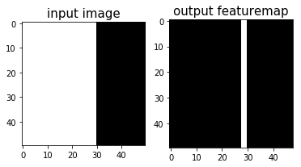
    


目标检测主要分为Anchor based(两阶段和单阶段)、Anchor free模型、Transformer系列如 **图10** 所示：
<br></br>

<center></center>
<center><br>图10：目标检测算法</br></center>

<br></br>


其中Anchor是预先设定好比例的一组候选框集合，Anchor based方法就是使用Anchor提取候选目标框，在特征图上的每一个点对Anchor进行分类和回归。两阶段模型表示模型分为两个阶段，第一个阶段使用anchor回归候选目标框，第二阶段使用候选目标框进一步回归和分类，输出最终目标框和对应的类别。单阶段模型无候选框提取过程，直接在输出层回归bbox的位置和类别，速度比两阶段模型块，但是可能造成精度损失。由于需要手工设计Anchor，并且Anchor匹配对不同尺寸大小的物体不友好，因此发展出Anchor free模型，不再使用预先设定的anchor，通常通过预测目标的中心或者角点，对目标进行检测。

****

###  图像分割

图像分割指的是将数字图像细分为多个图像子区域的过程，即对图像中的每个像素加标签，这一过程使得具有相同标签的像素具有某种共同视觉特性。图像分割的目的是简化或改变图像的表示形式，使得图像更容易理解和分析。图像分割通常用于定位图像中的物体和边界（线，曲线等）。图像分割的领域非常多，人像分割、车道线分割、无人车、地块检测、表计识别等等。

<br></br>

<center></center>
<center><br>图11：图像分割示意图</br></center>

<br></br>

人像分割示例：


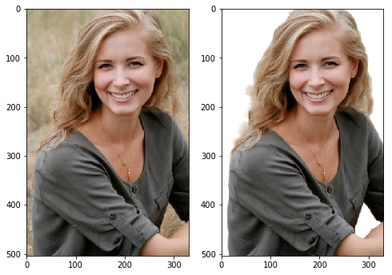
    


图像分割包含如 **图12** 所示算法：

<br></br>

<center></center>
<center>图12：图像分割算法</center>

<br></br>

****

### OCR

OCR（Optical Character Recognition，光学字符识别）是计算机视觉重要方向之一。传统定义的OCR一般面向扫描文档类对象，即文档场景文字识别(Document Analysis & Recognition，DAR)，现在我们常说的OCR一般指场景文字识别（Scene Text Recognition，STR），主要面向自然场景。OCR技术有着丰富的应用场景，如卡证票据信息抽取录入审核、工厂自动化、政府工作医院等文档电子化、在线教育等。


<br></br>

<center></center>
<center><br>图13：文字识别示意图</br></center>

<br></br>

OCR进行文字识别示例：


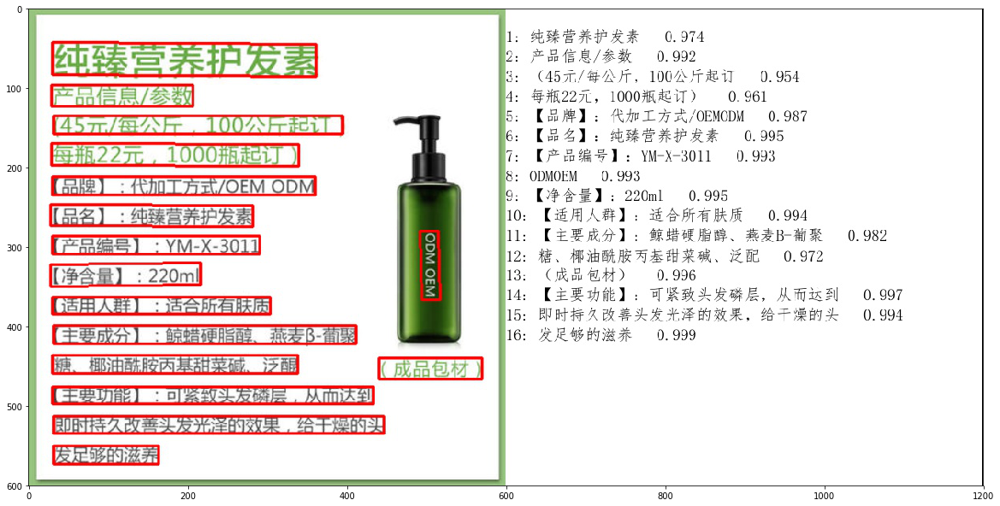


OCR实现过程如果分为检测和识别2个模型，我们称之为两阶段算法，除此之外还有端到端算法，使用一个模型同时完成文字检测和文字识别。文档分析能够帮助开发者更好地完成文档理解相关任务，通常OCR算法和文档分析算法结合使用。
<br></br>

<center></center>
<center><br>图14：OCR算法</br></center>

其中，版面分析识别文档中的图像、文本、标题和表格等区域，然后对文本、标题等区域进行OCR的检测识别，如 **图15(a)** 所示。表格识别对文档中表格区域进行结构化分析，最终结果输出Excel文件，如 **图15(b)** 所示。关键信息提取算法，将每个检测到的文本区域分类为预定义的类别，如订单ID、发票号码，金额等，如 **图15(c)** 所示。文档视觉问答DocVQA包括语义实体识别SER 和关系抽取RE任务。基于SER任务，可以完成对图像中的文本识别与分类；基于RE任务，可以完成对图象中的文本内容的关系提取，如判断问题对(pair)，如 **图15(d)** 所示。PP-Structure包含了版面分析、表格识别、视觉问答等功能，支持模型训练、测试等，如 **图15(e)** 所示。
<br></br>

<center></center>
<center><br>图15：文档分析算法</br></center>

****


### 视频分析


视频分析旨在通过智能分析技术，自动化地对视频中的内容进行识别和解析。视频是动态的按照时间排序的图片序列，然后图片帧间有着密切的联系，存在上下文联系；视频有音频信息，部分视频也有文本信息，视频分析常见子任务如 **图16** 所示：

<br></br>

<center></center>
<center><br>图16：视频分析子任务示意图</br></center>

<br></br>

视频进行分类示例如下

<br></br>

<center></center>
<center><br>图17：待分类视频</br></center>

<br></br>

结果：

```
[{'path': 'imgs/dance.mp4', 'prediction': {'舞蹈': 0.8504236936569214}}]
```


上面实现了视频分类，根据视频分析的应用领域，分为以下算法，

<br></br>

<center></center>
<center><br>图18：视频分析算法</br></center>

<br></br>

****

### 图像生成

GAN的全称是Generative Adversarial Networks，即生成对抗网络，由Ian J. Goodfellow等人提出。一般一个GAN网络包括了一个生成器（Generator）和一个判别器（Discriminator），生成器用于生成越来越接近实际标签的数据，判别器用来区分生成器的生成结果和实际标签。生成模型和判别模型构成了一个动态的“博弈过程”，最终的平衡点即纳什均衡点，即生成模型所生成数据（G(z)）无限接近真实数据(x)。GAN模型应用也非常广泛，可应用于图像生成、风格迁移、超分辨率、影像上色、人脸属性编辑、人脸融合、动作迁移等。

<br></br>

<center></center>
<center><br>图19：图像生成示意图</br></center>

<br></br>


人像动漫化示例：


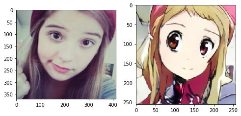
    


上面使用U-GAT-IT模型实现了人像动漫化，根据GAN的应用领域，分为以下算法，

<br></br>

<center></center>
<center><br>图20：图像生成算法</br></center>

<br></br>

---

# 视觉算法的技术演进：从手工特征到深度学习

计算机视觉的发展，可以从一个核心问题来理解：

> **图像中的有效特征，到底由谁来提取？**

早期计算机视觉依赖人工设计特征；深度学习出现之后，特征逐渐由神经网络从数据中自动学习；随着 Transformer、大规模预训练和多模态技术的发展，视觉模型又进一步从“完成单一视觉任务”走向“学习通用视觉表示”。

```text
传统计算机视觉
人工设计 SIFT、HOG 等特征
            ↓
卷积神经网络 CNN
从数据中自动学习局部特征与层级特征
            ↓
Vision Transformer
通过 Self-Attention 建模图像区域之间的全局关系
            ↓
视觉预训练
通过大规模数据学习可迁移的通用视觉表示
            ↓
视觉-语言多模态模型
将视觉信息与语言信息映射到统一的语义空间
```

与此同时，深度学习也推动了另一条重要的视觉技术路线——**生成式视觉模型**：

```text
GAN
 ↓
Diffusion
 ↓
DiT
```

视觉模型因此逐渐形成了两类重要能力：

* **视觉理解**：分类、检测、分割、识别、视觉问答等；
* **视觉生成**：图像生成、图像编辑、视频生成等。

---

## 传统方法示例：HOG + SVM 行人检测

在深度学习普及之前，目标检测通常采用“**人工设计特征 + 分类器**”的方式完成。

经典案例之一就是 **HOG + SVM 行人检测**。

典型流程包括：

1. **滑动窗口（Sliding Window）**：在图像不同位置生成候选区域；
2. **HOG 特征提取**：提取候选区域的边缘和轮廓特征；
3. **SVM 分类**：判断候选区域中是否包含行人；
4. **NMS**：去除重复检测框，保留最终检测结果。


其中：

* **HOG（Histogram of Oriented Gradients）**负责描述图像中的梯度、边缘和轮廓；
* **SVM（Support Vector Machine）**负责根据 HOG 特征进行分类。

因此，传统计算机视觉的基本范式可以概括为：

```text
图像
 ↓
人工设计特征
HOG / SIFT 等
 ↓
分类器
SVM 等
 ↓
预测结果
```

它的核心特点是：

> **人负责设计特征，机器负责根据这些特征进行判断。**

这种方法高度依赖人工特征工程。当目标的姿态、尺度、光照、背景等发生明显变化时，人工设计的特征可能难以适应，因此跨场景泛化能力受到限制。

---

## 深度学习带来的变化

卷积神经网络（CNN）带来的一个重要变化，就是将原来依赖人工完成的**特征设计过程，转变为由模型从训练数据中自动学习特征**。

传统视觉：

```text
图像
 ↓
人工特征提取
 ↓
分类器
 ↓
结果
```

深度学习：

```text
图像
 ↓
神经网络
 ↓
自动学习特征
 ↓
任务预测
 ↓
结果
```

CNN 的不同层可以逐步学习不同层次的视觉信息：

```text
浅层
边缘 / 颜色 / 纹理
        ↓
中层
形状 / 局部结构
        ↓
深层
物体 / 高层语义
```

因此，深度学习实现了一个重要转变：

> **传统视觉：人告诉机器“应该看什么”。**
> **深度学习：机器通过数据自己学习“应该看什么”。**

更进一步，CNN 可以将**特征提取与任务预测放在同一个网络中进行联合优化**，形成端到端（End-to-End）的学习方式。

这一变化推动了计算机视觉从传统的“**人工特征工程**”时代进入“**自动特征学习**”时代，并为后来的 AlexNet、ResNet、Faster R-CNN、YOLO、Vision Transformer 等视觉模型的发展奠定了基础。


---

# YOLO前置学习：卷积神经网络

卷积神经网络(Convolutional neural network, CNN)是受生物学上感受野机制的启发而提出的，是目前计算机视觉中使用最普遍的模型结构。本章节我们将先介绍卷积神经网络一些常用的基础模块，包括：

  - 卷积（Convolution）
  - 池化（Pooling）
  - 激活函数
  - 批归一化（Batch Normalization）
  - 丢弃法（Dropout）

回顾一下，在上一章“一个案例带你吃透深度学习”中，我们介绍了手写数字识别任务，应用的是全连接网络进行特征提取，即将一张图片上的所有像素点展开成一个1维向量输入网络，存在如下两个问题：

**1.模型参数过多，容易发生过拟合。** 在全连接前馈网络中，隐藏层的每个神经元都要跟该层所有输入的神经元相连接。随着隐藏层神经元数量的增多，参数的规模也会急剧增加，导致整个神经网络的训练效率非常低，也很容易发生过拟合。

**2.难以提取图像中的局部不变性特征。** 自然图像中的物体都具有局部不变性特征，比如尺度缩放、平移、旋转等操作不影响其语义信息。而全连接前馈网络很难提取这些局部不变性特征。

为了解决上述问题，我们引入卷积神经网络进行特征提取，既能提取到相邻像素点之间的特征模式，又能保证参数的个数不随图片尺寸变化。**图1** 是一个典型的卷积神经网络结构，包含：卷积层、池化层、全连接层、Dropout层，后续详细介绍各层作用。

<br></br>

<center></center>
<center><br>图1：卷积神经网络经典结构</br></center>

<br></br>

------

**说明：**

在卷积神经网络中，计算范围是在像素点的空间邻域内进行的，卷积核参数的数目也远小于全连接层。卷积核本身与输入图片大小无关，它代表了对空间邻域内某种特征模式的提取。比如，有些卷积核提取物体边缘特征，有些卷积核提取物体拐角处的特征，图像上不同区域共享同一个卷积核。当输入图片大小不一样时，仍然可以使用同一个卷积核进行操作。

------

## 卷积（Convolution）

这一小节将为读者介绍卷积算法的原理和实现方案，并通过具体的案例展示如何使用卷积对图片进行操作，主要涵盖如下内容：

- 卷积计算

- 填充（padding）

- 步幅（stride）

- 感受野（Receptive Field）

- 多输入通道、多输出通道和批量操作

- 飞桨卷积API介绍

- 卷积算子应用举例


### 卷积计算

卷积是数学分析中的一种积分变换的方法，在图像处理中采用的是卷积的离散形式。这里需要说明的是，在卷积神经网络中，卷积层的实现方式实际上是数学中定义的互相关（cross-correlation）运算，与数学分析中的卷积定义有所不同，这里跟其他框架和卷积神经网络的教程保持一致，都使用互相关运算作为卷积的定义，具体的计算过程如 **图2** 所示。

<br></br>

<center></center>
<center><br>图2：卷积计算过程</br></center>

<br></br>

------

**说明：**

卷积核（kernel）也被叫做滤波器（filter），假设卷积核的高和宽分别为$k_h$和$k_w$，则将称为$k_h\times k_w$卷积，比如$3\times5$卷积，就是指卷积核的高为3, 宽为5。

-----

- 如图2（a）所示：左边的图大小是$3\times3$，表示输入数据是一个维度为$3\times3$的二维数组；中间的图大小是$2\times2$，表示一个维度为$2\times2$的二维数组，我们将这个二维数组称为卷积核。先将卷积核的左上角与输入数据的左上角（即：输入数据的(0, 0)位置）对齐，把卷积核的每个元素跟其位置对应的输入数据中的元素相乘，再把所有乘积相加，得到卷积输出的第一个结果：

$$0\times1 + 1\times2 + 2\times4 + 3\times5 = 25  \ \ \ \ \ \ \ (a)$$

- 如图2（b）所示：将卷积核向右滑动，让卷积核左上角与输入数据中的(0,1)位置对齐，同样将卷积核的每个元素跟其位置对应的输入数据中的元素相乘，再把这4个乘积相加，得到卷积输出的第二个结果：

$$0\times2 + 1\times3 + 2\times5 + 3\times6 = 31  \ \ \ \ \ \ \ (b)$$

- 如图2（c）所示：将卷积核向下滑动，让卷积核左上角与输入数据中的(1, 0)位置对齐，可以计算得到卷积输出的第三个结果：

$$0\times4 + 1\times5 + 2\times7 + 3\times8 = 43   \ \ \ \ \ \ \ (c)$$

- 如图2（d）所示：将卷积核向右滑动，让卷积核左上角与输入数据中的(1, 1)位置对齐，可以计算得到卷积输出的第四个结果：

$$0\times5 + 1\times6 + 2\times8 + 3\times9 = 49   \ \ \ \ \ \ \ (d)$$


卷积核的计算过程可以用下面的数学公式表示，其中 $a$ 代表输入图片， $b$ 代表输出特征图，$w$ 是卷积核参数，它们都是二维数组，$\sum{u,v}{\ }$ 表示对卷积核参数进行遍历并求和。

$$b[i, j] = \sum_{u,v}{a[i+u, j+v]\cdot w[u, v]}$$

举例说明，假如上图中卷积核大小是$2\times 2$，则$u$可以取0和1，$v$也可以取0和1，也就是说：
$$b[i, j] = a[i+0, j+0]\cdot w[0, 0] + a[i+0, j+1]\cdot w[0, 1] + a[i+1, j+0]\cdot w[1, 0] + a[i+1, j+1]\cdot w[1, 1]$$

读者可以自行验证，当$[i, j]$取不同值时，根据此公式计算的结果与上图中的例子是否一致。


- **【思考】 当卷积核大小为$3 \times 3$时，$b$和$a$之间的对应关系应该是怎样的？**


------

**其它说明：**

在卷积神经网络中，一个卷积算子除了上面描述的卷积过程之外，还包括加上偏置项(引入非线性运算、增强模型拟合能力)的操作。例如假设偏置为1，则上面卷积计算的结果为：

$$0\times1 + 1\times2 + 2\times4 + 3\times5 \mathbf{\  + 1}  = 26$$
$$0\times2 + 1\times3 + 2\times5 + 3\times6 \mathbf{\  + 1} = 32$$
$$0\times4 + 1\times5 + 2\times7 + 3\times8 \mathbf{\  + 1} = 44$$
$$0\times5 + 1\times6 + 2\times8 + 3\times9 \mathbf{\  + 1} = 50$$

------


### 填充（padding）

在上面的例子中，输入图片尺寸为$3\times3$，输出图片尺寸为$2\times2$，经过一次卷积之后，图片尺寸变小。卷积输出特征图的尺寸计算方法如下（卷积核的高和宽分别为$k_h$和$k_w$）：

$$H_{out} = H - k_h + 1$$
$$W_{out} = W - k_w + 1$$

如果输入尺寸为4，卷积核大小为3时，输出尺寸为$4-3+1=2$。读者可以自行检查当输入图片和卷积核为其他尺寸时，上述计算式是否成立。当卷积核尺寸大于1时，输出特征图的尺寸会小于输入图片尺寸。如果经过多次卷积，输出图片尺寸会不断减小，边界和角落像素丢失越来越多，导致模型训练效果不佳。且当卷积核的高度和宽度不同，通过填充(padding)使输入和输出具有相同的宽和高。填充如 **图3** 所示。

<br></br>

<center></center>
<center><br>图3：图形填充 </br></center>

<br></br>

- 如图8（a）所示：填充的大小为1，填充值为0。填充之后，输入图片尺寸从$4\times4$变成了$6\times6$，使用$3\times3$的卷积核，输出图片尺寸为$4\times4$。

- 如图8（b）所示：填充的大小为2，填充值为0。填充之后，输入图片尺寸从$4\times4$变成了$8\times8$，使用$3\times3$的卷积核，输出图片尺寸为$6\times6$。

如果在图片高度方向，在第一行之前填充$p_{h1}$行，在最后一行之后填充$p_{h2}$行；在图片的宽度方向，在第1列之前填充$p_{w1}$列，在最后1列之后填充$p_{w2}$列；则填充之后的图片尺寸为$(H + p_{h1} + p_{h2})\times(W + p_{w1} + p_{w2})$。经过大小为$k_h\times k_w$的卷积核操作之后，输出图片的尺寸为：
$$H_{out} = H + p_{h1} + p_{h2} - k_h + 1$$
$$W_{out} = W + p_{w1} + p_{w2} - k_w + 1$$

在卷积计算过程中，通常会在高度或者宽度的两侧采取等量填充，即$p_{h1} = p_{h2} = p_h,\ \ p_{w1} = p_{w2} = p_w$，上面计算公式也就变为：
$$H_{out} = H + 2p_h - k_h + 1$$
$$W_{out} = W + 2p_w - k_w + 1$$
卷积核大小通常使用1，3，5，7这样的奇数，如果使用的填充大小为$p_h=(k_h-1)/2 ，p_w=(k_w-1)/2$，则卷积之后图像尺寸不变。例如当卷积核大小为3时，padding大小为1，卷积之后图像尺寸不变；同理，如果卷积核大小为5，padding大小为2，也能保持图像尺寸不变。

### 步幅（stride）

**图4** 中卷积核每次滑动一个像素点，这是步幅为1的特殊情况。**图9** 是步幅为2的卷积过程，卷积核在图片上移动时，每次移动大小为2个像素点。
<br></br>

<center></center>
<center><br>图4：步幅为2的卷积过程 </br></center>

<br></br>

当宽和高方向的步幅分别为$s_h$和$s_w$时，输出特征图尺寸的计算公式是：

$$H_{out} = \frac{H + 2p_h - k_h}{s_h} + 1$$

$$W_{out} = \frac{W + 2p_w - k_w}{s_w} + 1$$

假设输入图片尺寸是$H\times W = 100 \times 100$，卷积核大小$k_h \times k_w = 3 \times 3$，填充$p_h = p_w = 1$，步幅为$s_h = s_w = 2$，则输出特征图的尺寸为：

$$H_{out} = \frac{100 + 2 - 3}{2} + 1 = 50$$

$$W_{out} = \frac{100 + 2 - 3}{2} + 1 = 50$$

### 感受野（Receptive Field）

输出特征图上每个点的数值，是由输入图片上大小为$k_h\times k_w$的区域的元素与卷积核每个元素相乘再相加得到的，所以输入图像上$k_h\times k_w$区域内每个元素数值的改变，都会影响输出点的像素值。我们将这个区域叫做输出特征图上对应点的感受野。感受野内每个元素数值的变动，都会影响输出点的数值变化。比如$3\times3$卷积对应的感受野大小就是$3\times3$，如 **图5** 所示。

<br></br>

<center></center>
<center><br>图5：感受野为3×3的卷积 </br></center>

<br></br>

而当通过两层$3\times3$的卷积之后，感受野的大小将会增加到$5\times5$，如 **图6** 所示。

<br></br>

<center></center>
<center><br>图6：感受野为5×5的卷积 </br></center>

<br></br>

因此，当增加卷积网络深度的同时，感受野将会增大，输出特征图中的一个像素点将会包含更多的图像语义信息。

### 多输入通道、多输出通道和批量操作

前面介绍的卷积计算过程比较简单，实际应用时，处理的问题要复杂的多。例如：对于彩色图片有RGB三个通道，需要处理多输入通道的场景。输出特征图往往也会具有多个通道，而且在神经网络的计算中常常是把一个批次的样本放在一起计算，所以卷积算子需要具有批量处理多输入和多输出通道数据的功能，下面将分别介绍这几种场景的操作方式。

- **多输入通道场景**

上面的例子中，卷积层的数据是一个2维数组，但实际上一张图片往往含有RGB三个通道，要计算卷积的输出结果，卷积核的形式也会发生变化。假设输入图片的通道数为$C_{in}$，输入数据的形状是$C_{in}\times{H_{in}}\times{W_{in}}$，计算过程如 **图7** 所示。

1. 对每个通道分别设计一个2维数组作为卷积核，卷积核数组的形状是$C_{in}\times{k_h}\times{k_w}$。

1. 对任一通道$C_{in} \in [0, C_{in})$，分别用大小为$k_h\times{k_w}$的卷积核在大小为$H_{in}\times{W_{in}}$的二维数组上做卷积。

1. 将这$C_{in}$个通道的计算结果相加，得到的是一个形状为$H_{out}\times{W_{out}}$的二维数组。
   <br></br>

<center></center>
<center><br>图7：多输入通道计算过程 </br></center>

<br></br>

- **多输出通道场景**

一般来说，卷积操作的输出特征图也会具有多个通道$C_{out}$，这时我们需要设计$C_{out}$个维度为$C_{in}\times{k_h}\times{k_w}$的卷积核，卷积核数组的维度是$C_{out}\times C_{in}\times{k_h}\times{k_w}$，如 **图8** 所示。

1. 对任一输出通道$c_{out} \in [0, C_{out})$，分别使用上面描述的形状为$C_{in}\times{k_h}\times{k_w}$的卷积核对输入图片做卷积。
1. 将这$C_{out}$个形状为$H_{out}\times{W_{out}}$的二维数组拼接在一起，形成维度为$C_{out}\times{H_{out}}\times{W_{out}}$的三维数组。

------

**说明：**

通常将卷积核的输出通道数叫做卷积核的个数。

------

<center></center>
<center><br>图8：多输出通道计算过程 </br></center>

<br></br>


- **批量操作**

在卷积神经网络的计算中，通常将多个样本放在一起形成一个mini-batch进行批量操作，即输入数据的维度是$N\times{C_{in}}\times{H_{in}}\times{W_{in}}$。由于会对每张图片使用同样的卷积核进行卷积操作，卷积核的维度与上面多输出通道的情况一样，仍然是$C_{out}\times C_{in}\times{k_h}\times{k_w}$，输出特征图的维度是$N\times{C_{out}}\times{H_{out}}\times{W_{out}}$，如 **图9** 所示。

<br></br>

<center></center>
<center><br>图9：批量操作 </br></center>

<br></br>

### 飞桨卷积API介绍

飞桨卷积算子对应的API是[paddle.nn.Conv2D](https://www.paddlepaddle.org.cn/documentation/docs/zh/api/paddle/nn/Conv2D_cn.html)，用户可以直接调用API进行计算，也可以在此基础上修改。Conv2D名称中的“2D”表明卷积核是二维的，多用于处理图像数据。类似的，也有Conv3D可以用于处理视频数据（图像的序列）。

> *class* paddle.nn.Conv2D (*in_channels, out_channels, kernel_size, stride=1, padding=0, dilation=1, groups=1, padding_mode='zeros', weight_attr=None, bias_attr=None, data_format='NCHW'*)


常用的参数如下：

  - in_channels(int) - 输入图像的通道数。
  - out_channels(int) - 卷积核的个数，和输出特征图通道数相同，相当于上文中的$C_{out}$。
  - kernel_size(int|list|tuple) - 卷积核大小，可以是整数，比如3，表示卷积核的高和宽均为3 ；或者是两个整数的list，例如[3,2]，表示卷积核的高为3，宽为2。
  - stride(int|list|tuple，可选) - 步长大小，可以是整数，默认值为1，表示垂直和水平滑动步幅均为1；或者是两个整数的list，例如[3,2]，表示垂直滑动步幅为3，水平滑动步幅为2。
  - padding(int|list|tuple|str，可选) - 填充大小，可以是整数，比如1，表示竖直和水平边界填充大小均为1；或者是两个整数的list，例如[2,1]，表示竖直边界填充大小为2，水平边界填充大小为1。

输入数据维度$[N, C_{in}, H_{in}, W_{in}]$，输出数据维度$[N, out\_channels, H_{out}, W_{out}]$，权重参数$w$的维度$[out\_channels, C_{in}, filter\_size\_h, filter\_size\_w]$，偏置参数$b$的维度是$[out\_channels]$。注意，即使输入只有一张灰度图片$[H_{in}, W_{in}]$，也需要处理成四个维度的输入向量$[1, 1, H_{in}, W_{in}]$。

### 卷积算子应用举例

卷积核可以看作一个小型的**特征提取器**。不同的卷积核具有不同的参数，因此可以从图像中提取不同的信息，例如**边界、轮廓**，也可以实现**平滑、去噪**等效果。

下面通过三个典型案例，观察不同卷积核作用于图像后的计算结果。

------

#### 案例 1：检测黑白边界

首先考虑一个简单的黑白图像：图像左侧为亮色区域，右侧为暗色区域，希望利用卷积找到两者之间的分界线。

设置水平方向的卷积核：

$K= \begin{bmatrix} 1 & 0 & -1 \end{bmatrix}$

卷积核在图像上滑动时，本质上是在计算左右像素之间的差值：

$y=x_{\mathrm{left}}-x_{\mathrm{right}}$

当卷积核位于亮度相同的区域时，左右像素值接近，因此输出接近 0：

$x_{\mathrm{left}}\approx x_{\mathrm{right}} \Rightarrow y\approx0$

当卷积核跨越明暗边界时，左右像素值差异较大，因此输出的绝对值会明显增大：

$x_{\mathrm{left}}\neq x_{\mathrm{right}} \Rightarrow |y|>0$

因此，在输出的特征图中，**黑白分界线位置会产生明显响应，而其他平坦区域的响应接近 0**。


------

#### 案例 2：检测物体边缘

真实图像比简单的黑白图像更加复杂，但边缘位置通常同样表现为**局部像素值发生明显变化**。

因此，可以使用卷积核检测中心像素与周围像素之间的差异，从而突出物体的轮廓。

例如，可以使用下面的 $3\times3$ 拉普拉斯卷积核：

$K= \begin{bmatrix} -1 & -1 & -1\\ -1 & 8 & -1\\ -1 & -1 & -1 \end{bmatrix}$

其计算过程可以表示为：

$y= 8x_{\mathrm{center}} - \sum_{i=1}^{8}x_{\mathrm{neighbor},i}$

如果中心像素与周围像素比较接近，说明该区域较为平坦，卷积结果接近 0。

如果中心像素与周围像素差异较大，说明该位置可能存在明显的亮度变化，因此会产生较强的响应。

所以，这类卷积核能够**突出图像中亮度变化明显的位置，从而提取物体的边缘和轮廓信息**。


------

#### 案例 3：图像均值模糊

卷积不仅可以用于提取边缘，也可以用于图像平滑。

例如，使用一个 $5\times5$ 的均值卷积核：

$K= \frac{1}{25} \begin{bmatrix} 1&1&1&1&1\\ 1&1&1&1&1\\ 1&1&1&1&1\\ 1&1&1&1&1\\ 1&1&1&1&1 \end{bmatrix}$

对于图像中的每一个位置，输出像素值等于其 $5\times5$ 邻域内 25 个像素值的平均：

$y=\frac{1}{25}\sum_{i=1}^{25}x_i$

这样可以降低某一个像素点对结果的影响，使局部区域的像素值更加平滑。

因此，均值卷积可以起到**平滑图像、降低局部噪声**的作用，但与此同时，也会使图像中的**边缘和细节变得模糊**。

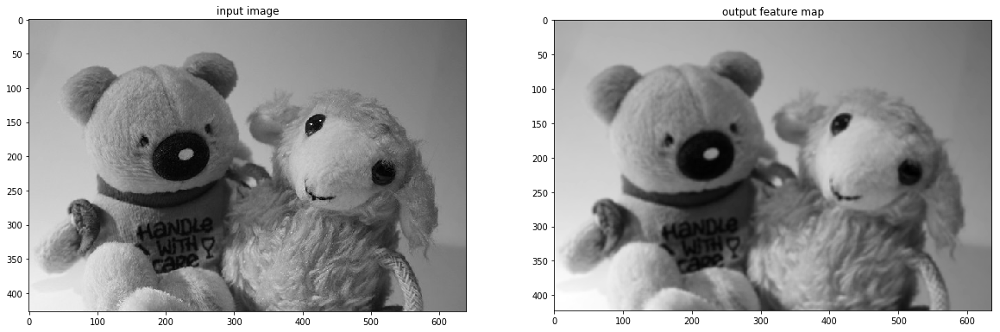

**这三个案例实际上展示了卷积最核心的思想：**

> **卷积核参数不同，关注的图像特征也不同。**

$[1,0,-1]$ 关注左右像素的变化，可以检测边界；拉普拉斯卷积核关注中心像素与周围像素的差异，可以提取物体轮廓；均值卷积核则对邻域像素求平均，可以实现图像平滑。

在传统图像处理中，这些卷积核通常由人工设计；而在 CNN 中，卷积核中的参数不再需要人工指定，而是**通过训练数据自动学习得到**。

这也是从传统卷积算子进一步理解卷积神经网络（CNN）的关键。


## 池化（Pooling）


池化层的作用是进行特征选择，降低特征数量，从而减少参数数量。由于池化之后特征图会变得更小，如果后面连接的是全连接层，可以有效地减小神经元的个数，节省存储空间并提高计算效率。如 **图10** 所示，将一个$2\times 2$的区域池化成一个像素点。通常有两种方法，平均池化和最大池化。
<br></br>

<center></center>
<center><br>图10：池化 </br></center>

<br></br>


- 如图10（a）：平均池化。这里使用大小为$2\times2$的池化窗口，每次移动的步幅为2，对池化窗口覆盖区域内的像素取平均值，得到相应的输出特征图的像素值。
- 如图10（b）：最大池化。对池化窗口覆盖区域内的像素取最大值，得到输出特征图的像素值。当池化窗口在图片上滑动时，会得到整张输出特征图。池化窗口的大小称为池化大小，用$k_h \times k_w$表示。在卷积神经网络中用的比较多的是窗口大小为$2 \times 2$，步幅为2的池化。

与卷积核类似，池化窗口在图片上滑动时，每次移动的步长称为步幅，当宽和高方向的移动大小不一样时，分别用$s_w$和$s_h$表示。也可以对需要进行池化的图片进行填充，填充方式与卷积类似，假设在第一行之前填充$p_{h1}$行，在最后一行后面填充$p_{h2}$行。在第一列之前填充$p_{w1}$列，在最后一列之后填充$p_{w2}$列，则池化层的输出特征图大小为：

$$H_{out} = \frac{H + p_{h1} + p_{h2} - k_h}{s_h} + 1$$

$$W_{out} = \frac{W + p_{w1} + p_{w2} - k_w}{s_w} + 1$$

在卷积神经网络中，通常使用$2\times2$大小的池化窗口，步幅也使用2，填充为0，则输出特征图的尺寸为：

$$H_{out} = \frac{H}{2}$$

$$W_{out} = \frac{W}{2}$$

通过这种方式的池化，输出特征图的高和宽都减半，但通道数不会改变。由于池化层是使用某一位置的相邻输出的总体统计特征代替网络在该位置的输出，所以其好处是当输入数据做出少量平移时，经过池化运算后的大多数输出还能保持不变。比如：当识别一张图像是否是人脸时，我们需要知道人脸左边有一只眼睛，右边也有一只眼睛，而不需要知道眼睛的精确位置，这时候通过汇聚某一片区域的像素点来得到总体统计特征会显得很有用。这也就体现了池化层的平移不变特性。

随着神经网络的发展，出现更多池化方法，比如SSPNet提出了空间金字塔池化(Spatial Pyramid Pooling，SPP)，对于不同尺寸的输入采用不同的滑窗大小和步长，从而确保输出尺寸相同，这样有利于提取不同尺寸的图像特征信息。全局平均池化(Global Average Pooling，GAP)第一次出现在论文Network in Network中，和Average Pooling的区别是对整个特征图求平均值，减少特征的丢失。除此之外还有Global Max Pooling、NetVLAD池化、随机池化、重叠池化、RoI池化等。

## 激活函数

激活函数对输入信息进行非线性变换，然后将变换后的输出信息作为输入信息传给下一层神经元。如果不用激活函数，每一层输出都是上层输入的线性函数，无论神经网络有多少层，最终的输出都是输入的线性组合。 激活函数给神经元引入了非线性因素，使得神经网络可以任意逼近任何非线性函数。

前面介绍的网络结构中，普遍使用Sigmoid函数做激活函数。在神经网络发展的早期，Sigmoid函数和Tanh函数用的比较多，而目前用的较多的激活函数是ReLU。这是因为Sigmoid函数和tanh函数在反向传播过程中，具有软饱和性，一但落入饱和区梯度就会接近0，容易造成梯度消失，让我们仔细观察Sigmoid函数图形。
<br></br>

<center></center>
<center><br>图11：Sigmoid函数图形 </br></center>

<br></br>

Tanh激活函数图形如 **图12** 所示：
<br></br>

<center></center>
<center><br>图12：Tanh函数图形 </br></center>

<br></br>

ReLU激活函数图形如 **图13** 所示：

<br></br>

<center></center>
<center><br>图13：ReLU函数图形 </br></center>

<br></br>

从 **图13** 可以看到当输入$x >= 0$时，ReLU的导数为常数，这样可有效缓解梯度消失问题。同时不涉及幂运算，实现也更加简单。但是当$x < 0$的时，ReLU的梯度总是为0，某些神经元可能永远不会被激活，导致相应参数永远不会被更新。之后出现更多激活函数，如LReLU、PReLU、ELU、swish、hswish等。

## 批归一化（Batch Normalization）

[批归一化方法](https://arxiv.org/abs/1502.03167)（Batch Normalization，BatchNorm）是由Ioffe和Szegedy于2015年提出的，已被广泛应用在深度学习中，其目的是对神经网络中间层的输出进行标准化处理，使得中间层的输出更加稳定。

通常我们会对神经网络的数据进行标准化处理，处理后的样本数据集满足均值为0，方差为1的统计分布，这是因为当输入数据的分布比较固定时，有利于算法的稳定和收敛。对于深度神经网络来说，由于参数是不断更新的，即使输入数据已经做过标准化处理，但是对于比较靠后的那些层，其接收到的输入仍然是剧烈变化的，通常会导致数值不稳定，模型很难收敛。BatchNorm能够使神经网络中间层的输出变得更加稳定，并有如下三个优点：

- 使学习快速进行（能够使用较大的学习率）

- 降低模型对初始值的敏感性

- 从一定程度上抑制过拟合

BatchNorm主要思路是在训练时以mini-batch为单位，对神经元的数值进行归一化，使数据的分布满足均值为0，方差为1。

BatchNorm的变体包括：层归一化(Layer Normalization, LN)、组归一化(Group Normalization, GN)、实例归一化(Instance Normalization, IN)，通过下图进行比较，

其中N知batch size、H和W分别表示特征图的高度和宽度、C表示特征图的通道数，蓝色像素表示使用相同的均值和方差进行归一化：

<br></br>

<center></center>
<center><br>图14：归一化方法</br></center>

<br></br>


- LN：对[C,W,H]维度求均值方差进行归一化，即在通道方向做归一化，与batch size大小无关，在小batch size上效果可能更好
- GN：先对通道方向进行分组，然后每个组内对[$C_{i}$,W,H]维度进行归一化，也与batch size大小无关
- IN：只对[H,W]维度进行归一化，图像风格化任务适合使用IN算法

****

## 丢弃法（Dropout）

丢弃法（Dropout）是深度学习中一种常用的抑制过拟合的方法，其做法是在神经网络学习过程中，随机删除一部分神经元。训练时，随机选出一部分神经元，将其输出设置为0，这些神经元将不对外传递信号。

**图15** 是Dropout示意图，左边是完整的神经网络，右边是应用了Dropout之后的网络结构。应用Dropout之后，会将标了$\times$的神经元从网络中删除，让它们不向后面的层传递信号。在学习过程中，丢弃哪些神经元是随机决定，因此模型不会过度依赖某些神经元，能一定程度上抑制过拟合。
<br></br>

<center></center>
<center><br>图15 Dropout示意图 </br></center>

<br></br>

Dropout的变体有很多，如：DropConnect、Standout、Gaussian Dropout、Spatial Dropout、Cutout、Max-Drop、RNNDrop、循环Drop等，下面简单介绍其中几种算法：

- DropConnect是由L. Wan等人提出，没有直接在神经元上应用dropout，而是在连接神经元的权重和偏置上应用，只能应用在全连接层
- Standout是由L. J. Ba和B. Frey提出，第$i$层丢弃一部分神经元的概率$p$不是恒定的，根据权重的值，是自适应的，权重越大被丢弃的概率也越大
- Spatial Dropout是由 J. Tompson等人提出，考虑相邻像素之间的高度相关性，不再进行单个像素进行dropout，而是在特征图上进行dropout
- Cutout是由T. DeVries和G. W. Taylor提出，通过对图像的隐藏区域进行泛化从而防止过拟合，提高神经网络的鲁棒性和整体性能

---

#  YOLOv设计思想：YOLO = Backbone + Neck + Head

对计算机而言，能够“看到”的是图像被编码之后的数字，但它很难理解高层语义概念，比如图像或者视频帧中出现的目标是人还是物体，更无法定位目标出现在图像中哪个区域。目标检测的主要目的是让计算机可以自动识别图片或者视频帧中所有目标的类别，并在该目标周围绘制边界框，标示出每个目标的位置，如 **图1** 所示。
<br></br>

<center></center>
<center><br>图1：图像分类和目标检测示意图。(a)是图像分类任务，只需识别出这是一张斑马的图片。(b)是目标检测任务，不仅要识别出这是一张斑马的图片，还要标出图中斑马的位置。</br></center>

<br></br>

## 目标检测发展历程

回顾图像分类处理基本流程，先使用卷积神经网络提取图像特征，然后再用这些特征预测分类概率，最后选出概率最大的类别，即为当前图片的类别，流程如 **图2** 所示。
<br></br>

<center></center>
<center><br>图2：图像分类流程示意图</br></center>

<br></br>

但对于目标检测问题，按照 **图2** 的流程则行不通。因为在图像分类任务中，对整张图提取特征的过程中没能体现出不同目标之间的区别，最终也就没法分别标示出每个物体所在的位置。

为了解决这个问题，结合图片分类任务取得的成功经验，我们可以将目标检测任务进行拆分。假设我们现在有某种方式可以在输入图片上生成一系列可能包含物体的区域，这些区域称为候选区域，在一张图上可以生成很多个候选区域。然后对每个候选区域，可以把它单独当成一幅图像来看待，使用图像分类模型对它进行分类，看它属于哪个类别或者背景（即不包含任何物体的类别）。

如何解决图像分类任务，使用卷积神经网络对一幅图像进行分类不再是一件困难的事情。那么，现在问题的关键就是如何产生候选区域？比如我们可以使用穷举法来产生候选区域，如图3所示。
<br></br>

<center></center>
<center><br>图3：候选区域</br></center>

<br></br>

A为图像上的某个像素点，B为A右下方另外一个像素点，A、B两点可以确定一个矩形框，记作AB。

* 如图3（a）所示：A在图片左上角位置，B遍历除A之外的所有位置，生成矩形框A1B1, …, A1Bn, …
* 如图3（b）所示：A在图片中间某个位置，B遍历A右下方所有位置，生成矩形框AkB1, …, AkBn, …

当点 $A$ 遍历图像中的所有像素位置时，对于每一个确定的点 $A_i$，点 $B$ 再遍历其**右下方的所有像素位置**。

其中，$A_i$ 作为矩形框的**左上角顶点**，$B_j$ 作为矩形框的**右下角顶点**，两点共同确定一个矩形区域：

$$
R_{ij} = (A_i, B_j)
$$

因此，通过遍历所有可能的 $A_i$ 和 $B_j$，最终得到的矩形框集合：

$$
\{R_{ij}\} = \{A_iB_j\}
$$

将包含图像中**所有可能选择的矩形区域**。

也就是说：

> **左上角 $A$ 遍历所有位置 + 右下角 $B$ 遍历所有合法位置 = 穷举图像中所有可能的候选区域。**

研究员开始思考，是否可以应用传统图像算法先产生候选区域，然后再用卷积神经网络对这些区域进行分类？只要我们对每个候选区域的分类足够的准确，则一定能找到跟实际物体足够接近的区域来。**穷举法也许能得到正确的预测结果，但其计算量也是非常巨大的**，其所生成的总候选区域数目约为$\frac{W^2 H^2}{4}$，假设$H=W=100$，总数将会达到$2.5 \times 10^{7}$个，如此多的候选区域使得这种方法几乎没有什么实用性。但是通过这种方式，我们可以看出，假设分类任务完成的足够完美，从理论上来讲检测任务也是可以解决的，亟待解决的问题是如何设计出合适的方法来产生候选区域。需要关注两点，一个是产生候选区域的方法，另一个是提升候选区域分类效率。目标检测算法就是解决这类问题的，**图4** 给出了基于深度学习的目标检测算法，主要分为Anchor-Based和Anchor-Free，其中Anchor-Based方法又可以分为两阶段检测算法和单阶段检测算法。

<br></br>

<center></center>
<center><br>图4：目标检测算法</br></center>

<br></br>

其中，Anchor(锚框)指人为预先设定好比例的一组候选框集合。

Anchor-Based使用Anchor提取候选目标框，然后在特征图上的每一个点，对Anchor进行分类和回归。

两阶段检测算法先使用Anchor在图像上产生候选区域，划分前景和背景，再对候选区域进行分类并预测目标物体位置。典型的两阶段检测算法是R-CNN系列(Fast R-CNN、Faster R-CNN等)，经典的Faster R-CNN通过RPN(Region Proposal Network)学习候选区域(Region Propposal, RP)，再对候选区域进行分类和回归，输出最终目标框和类别。基于先产生候选区域再检测的两阶段模型通常具有较优的精度，但是预测速度较慢。

此外，Anchor-Based还有一些单阶段模型，这类模型在产生候选区域的同时即可预测出物体类别和位置，不需要分成两阶段来完成检测任务。典型的单阶段算法是YOLO系列(YOLOV5、YOLOv8、YOLOv11、YOLOv26等)。单阶段算法摒弃两阶段算法中的RPN产生候选区域这一步骤，将候选区域和检测两个阶段合二为一，使得网络结构更加简单，检测速度快。

但是Anchor-Based方法在实际应用中存在一些缺点，比如：手工设计Anchor需要考虑Anchor的数量、尺寸(长宽比)；在特征图上像素点密集滑动会生成的检测框会存在大量负样本区域，就需要考虑正负样本不均衡的问题；Anchor的设计导致网络超参数变多，模型学习比较困难；更换不同的数据集需要重新调整Anchor。因此研究者提出了Anchor-Free方法，不再使用预先设定Anchor，通常通过预测目标的中心或角点，对目标进行检测。包含基于中心区域预测的方法(FCOS、CenterNet等)和基于多关键点联合表达的方法(CorNert、RepPoints等)。Anchor-Free算法不再需要设计Anchor，模型更为简单，减少模型耗时，但是精度也比Anchor-Based方法精度低。

三类算法的对比如下图所示：
<br></br>

<center></center>
<center><br>图5：目标检测算法对比</br></center>

## 目标检测基础概念

在介绍目标检测算法之前，先介绍一些跟检测相关的基本概念，包括边界框、锚框、交并比、非极大值抑制等。

### 边界框（Bounding Box，BBox）

检测任务需要同时预测物体的类别和位置，因此需要引入一些跟位置相关的概念。通常使用边界框（bounding box，bbox）来表示物体的位置，边界框是正好能包含物体的矩形框，如 **图6** 所示，图中3个人分别对应3个边界框。
<br></br>

<center></center>
<center><br>图6：边界框</br></center>

<br></br>

通常有两种格式来表示边界框的位置：

1. $xyxy$，即$(x_1, y_1, x_2, y_2)$，其中$(x_1, y_1)$是矩形框左上角的坐标，$(x_2, y_2)$是矩形框右下角的坐标。图4中3个红色矩形框用$xyxy$格式表示如下：

* 左：$(40.93, 141.1, 226.99, 515.73)$。
* 中：$(214.29, 325.03, 399.82, 631.37)$。
* 右：$(247.2, 131.62, 480.0, 639.32)$。

2. $xywh$，即$(x, y, w, h)$，其中$(x, y)$是矩形框中心点的坐标，$w$是矩形框的宽度，$h$是矩形框的高度。

在检测任务中，训练数据集的标签里会给出目标物体真实边界框所对应的$(x_1, y_1, x_2, y_2)$，这样的边界框也被称为真实框（ground truth box），如 **图5** 所示，图中画出了3个人像所对应的真实框。模型会对目标物体可能出现的位置进行预测，由模型预测出的边界框则称为预测框（prediction box）。

------

要完成一项检测任务，我们通常希望模型能够根据输入的图片，输出一些预测的边界框，以及边界框中所包含的物体的类别或者说属于某个类别的概率，例如这种格式: $[L, P, x_1, y_1, x_2, y_2]$，其中$L$是类别标签，$P$是物体属于该类别的概率。一张输入图片可能会产生多个预测框，本章的核心是学习如何完成这项任务。

### 锚框（Anchor box）

锚框与物体边界框不同，是由人们假想出来的一种框。先设定好锚框的大小和形状，再以图像上某一个点为中心画出矩形框。在下图中，以像素点[300, 500]为中心可以使用下面的程序生成3个框，如运行如下代码结果图中蓝色框所示，其中锚框A1跟人像区域非常接近。


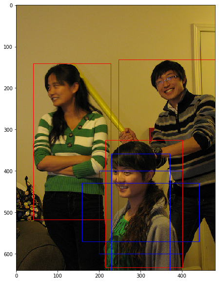
    


在目标检测任务中，通常会以某种规则在图片上生成一系列锚框，将这些锚框当成可能的候选区域。模型对这些候选区域是否包含物体进行预测，如果包含目标物体，则还需要进一步预测出物体所属的类别。还有更为重要的一点是，由于锚框位置是固定的，它不大可能刚好跟物体边界框重合，所以需要在锚框的基础上进行微调以形成能准确描述物体位置的预测框，模型需要预测出微调的幅度。在训练过程中，模型通过学习不断的调整参数，最终能学会如何判别出锚框所代表的候选区域是否包含物体，如果包含物体的话，物体属于哪个类别，以及物体边界框相对于锚框位置需要调整的幅度。

不同的模型往往有着不同的生成锚框的方式，在后面的内容中，会详细介绍YOLOv3算法里面产生锚框的规则，理解了它的设计方案，也很容易类推到其它模型上。

### 交并比

上面我们画出了以点$(300, 500)$为中心，生成的三个锚框，我们可以看到锚框A1 与真实框 G1的重合度比较好。那么如何衡量这三个锚框跟真实框之间的关系呢？在检测任务中，使用交并比（Intersection of Union，IoU）作为衡量指标。这一概念来源于数学中的集合，用来描述两个集合$A$和$B$之间的关系，它等于两个集合的交集里面所包含的元素个数，除以它们的并集里面所包含的元素个数，具体计算公式如下：

$$IoU = \frac{A\cap B}{A \cup B}$$

我们将用这个概念来描述两个框之间的重合度。两个框可以看成是两个像素的集合，它们的交并比等于两个框重合部分的面积除以它们合并起来的面积。下图“交集”中青色区域是两个框的重合面积，图“并集”中蓝色区域是两个框的相并面积。用这两个面积相除即可得到它们之间的交并比，如 **图7** 所示。

<br></br>

<center></center>
<center><br>图7：交并比</br></center>

<br></br>


假设两个矩形框A和B的位置分别为：
$$A:  [x_{a1}, y_{a1}, x_{a2}, y_{a2}]$$

$$B:  [x_{b1}, y_{b1}, x_{b2}, y_{b2}]$$

假如位置关系如 **图8** 所示：
<br></br>

<center></center>
<center><br>图8：计算交并比</br></center>

<br></br>

如果二者有相交部分，则相交部分左上角坐标为：
$$x_1 = max(x_{a1}, x_{b1}), \ \ \ \ \ y_1 = max(y_{a1}, y_{b1})$$

相交部分右下角坐标为：
$$x_2 = min(x_{a2}, x_{b2}), \ \ \ \ \ y_2 = min(y_{a2}, y_{b2})$$

计算先交部分面积：
$$intersection = max(x_2 - x_1 + 1.0, 0) \cdot max(y_2 - y_1 + 1.0, 0)$$

矩形框A和B的面积分别是：
$$S_A = (x_{a2} - x_{a1} + 1.0) \cdot (y_{a2} - y_{a1} + 1.0)$$

$$S_B = (x_{b2} - x_{b1} + 1.0) \cdot (y_{b2} - y_{b1} + 1.0)$$

计算相并部分面积：
$$union = S_A + S_B - intersection$$

计算交并比：

$$IoU = \frac{intersection}{union}$$

------

**思考：**

两个矩形框之间的相对位置关系，除了上面的示意图之外，还有哪些可能，上面的公式能否覆盖所有的情形？

------

交并比计算程序如下：


```python
# 计算IoU，矩形框的坐标形式为xyxy，这个函数会被保存在box_utils.py文件中
def box_iou_xyxy(box1, box2):
    # 获取box1左上角和右下角的坐标
    x1min, y1min, x1max, y1max = box1[0], box1[1], box1[2], box1[3]
    # 计算box1的面积
    s1 = (y1max - y1min + 1.) * (x1max - x1min + 1.)
    # 获取box2左上角和右下角的坐标
    x2min, y2min, x2max, y2max = box2[0], box2[1], box2[2], box2[3]
    # 计算box2的面积
    s2 = (y2max - y2min + 1.) * (x2max - x2min + 1.)
    
    # 计算相交矩形框的坐标
    xmin = np.maximum(x1min, x2min)
    ymin = np.maximum(y1min, y2min)
    xmax = np.minimum(x1max, x2max)
    ymax = np.minimum(y1max, y2max)
    # 计算相交矩形行的高度、宽度、面积
    inter_h = np.maximum(ymax - ymin + 1., 0.)
    inter_w = np.maximum(xmax - xmin + 1., 0.)
    intersection = inter_h * inter_w
    # 计算相并面积
    union = s1 + s2 - intersection
    # 计算交并比
    iou = intersection / union
    return iou


bbox1 = [100., 100., 200., 200.]
bbox2 = [120., 120., 220., 220.]
iou = box_iou_xyxy(bbox1, bbox2)
print('IoU is {}'.format(iou))  
```

    IoU is 0.47402644317607107


```python
# 计算IoU，矩形框的坐标形式为xywh
def box_iou_xywh(box1, box2):
    x1min, y1min = box1[0] - box1[2]/2.0, box1[1] - box1[3]/2.0
    x1max, y1max = box1[0] + box1[2]/2.0, box1[1] + box1[3]/2.0
    s1 = box1[2] * box1[3]

    x2min, y2min = box2[0] - box2[2]/2.0, box2[1] - box2[3]/2.0
    x2max, y2max = box2[0] + box2[2]/2.0, box2[1] + box2[3]/2.0
    s2 = box2[2] * box2[3]

    xmin = np.maximum(x1min, x2min)
    ymin = np.maximum(y1min, y2min)
    xmax = np.minimum(x1max, x2max)
    ymax = np.minimum(y1max, y2max)
    inter_h = np.maximum(ymax - ymin, 0.)
    inter_w = np.maximum(xmax - xmin, 0.)
    intersection = inter_h * inter_w

    union = s1 + s2 - intersection
    iou = intersection / union
    return iou

bbox1 = [100., 100., 200., 200.]
bbox2 = [120., 120., 220., 220.]
iou = box_iou_xywh(bbox1, bbox2)
print('IoU is {}'.format(iou))  
```

    IoU is 0.6902485659655831


为了直观的展示交并比的大小跟重合程度之间的关系，**图9** 示意了不同交并比下两个框之间的相对位置关系，从 IoU = 0.95 到 IoU = 0.
<br></br>

<center></center>
<center><br>图9：不同交并比下两个框之间相对位置示意图</br></center>

<br></br>

------

### NMS

在目标检测过程中，网络对同一个目标可能会产生多个预测框。因此需要消除重叠较大的冗余预测框。具体的处理方法就是非极大值抑制（Non-maximum suppression，NMS）。假设使用模型对图片进行预测，一共输出了11个预测框及其得分，在图上画出预测框。在每个人像周围，都出现了多个预测框，需要消除冗余的预测框以得到最终的预测结果。


​    
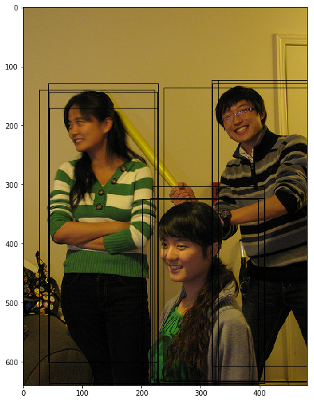
​    


NMS基本思想是，如果有多个预测框都对应同一个物体，则只选出得分最高的那个预测框，剩下的预测框被丢弃掉。

如何判断两个预测框对应的是同一个物体呢，标准该怎么设置？

如果两个预测框的类别一样，而且他们的位置重合度比较大，则可以认为他们是在预测同一个目标。非极大值抑制的做法是，选出某个类别得分最高的预测框，然后看哪些预测框跟它的IoU大于阈值，就把这些预测框给丢弃掉。这里IoU的阈值是超参数，需要提前设置，YOLOv3模型里面设置的是0.5。

比如在上面的程序中，boxes里面一共对应11个预测框，scores给出了它们预测"人"这一类别的得分。

- Step0：创建选中列表，keep_list = []
- Step1：对得分进行排序，remain_list = [ 3,  5, 10,  2,  9,  0,  1,  6,  4,  7,  8]， 
- Step2：选出boxes[3]，此时keep_list为空，不需要计算IoU，直接将其放入keep_list，keep_list = [3]， remain_list=[5, 10,  2,  9,  0,  1,  6,  4,  7,  8]
- Step3：选出boxes[5]，此时keep_list中已经存在boxes[3]，计算出IoU(boxes[3], boxes[5]) = 0.0，显然小于阈值，则keep_list=[3, 5], remain_list = [10,  2,  9,  0,  1,  6,  4,  7,  8]
- Step4：选出boxes[10]，此时keep_list=[3, 5]，计算IoU(boxes[3], boxes[10])=0.0268，IoU(boxes[5], boxes[10])=0.0268 = 0.24，都小于阈值，则keep_list = [3, 5, 10]，remain_list=[2,  9,  0,  1,  6,  4,  7,  8]
- Step5：选出boxes[2]，此时keep_list = [3, 5, 10]，计算IoU(boxes[3], boxes[2]) = 0.88，超过了阈值，直接将boxes[2]丢弃，keep_list=[3, 5, 10]，remain_list=[9,  0,  1,  6,  4,  7,  8]
- Step6：选出boxes[9]，此时keep_list = [3, 5, 10]，计算IoU(boxes[3], boxes[9]) = 0.0577，IoU(boxes[5], boxes[9]) = 0.205，IoU(boxes[10], boxes[9]) = 0.88，超过了阈值，将boxes[9]丢弃掉。keep_list=[3, 5, 10]，remain_list=[0,  1,  6,  4,  7,  8]
- Step7：重复上述Step6直到remain_list为空。

最终得到keep_list=[3, 5, 10]，也就是预测框3、5、10被最终挑选出来了，如下图所示。


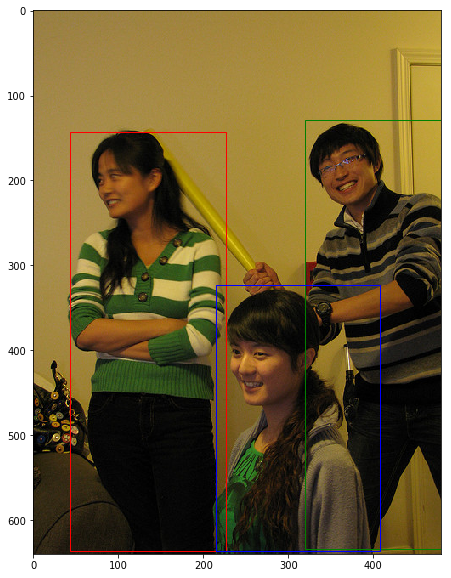
    

---

# YOLOv3：奠定现代 YOLO 基本框架

前面介绍了单阶段目标检测算法具有代表性的是YOLO系列，目前已经发展多个版本：YOLOv5、YOLOv8、YOLOv11、YOLOv26等。YOLOv3在之前模型的基础上通过改变模型结构、Anchor设计来权衡速度与精度，因此我们先以经典的YOLOv3模型为例讲解单阶段目标检测模型方便快速了解YOLO模型。

YOLOv3算法基本思想可以分成两部分：

* 按一定规则在图片上产生一系列的候选区域，然后根据这些候选区域与图片上物体真实框之间的位置关系对候选区域进行标注。跟真实框足够接近的那些候选区域会被标注为正样本，同时将真实框的位置作为正样本的位置目标。偏离真实框较大的那些候选区域则会被标注为负样本，负样本不需要预测位置或者类别。
* 使用卷积神经网络提取图片特征并对候选区域的位置和类别进行预测。这样每个预测框就可以看成是一个样本，根据真实框相对它的位置和类别进行了标注而获得标签值，通过网络模型预测其位置和类别，将网络预测值和标签值进行比较，就可以建立起损失函数。

YOLOv3算法预测过程的流程图如 **图1** 所示，预测图片经过一系列预处理(resize、normalization等)输入到YOLOv3模型，根据预先设定的Anchor和提取到的图片特征得到目标预测框，最后通过非极大值抑制(NMS)消除重叠较大的冗余预测框，得到最终预测结果。
<br></br>

<center></center>
<center><br>图1：YOLOv3算法预测流程图 </br></center>

<br></br>

YOLOv3网络结构大致分为3个部分：Backbone、Neck、Head，如 **图2** 所示:

<br></br>

<center></center>
<center><br>图2：YOLOv3网络结构 </br></center>

<br></br>

- Backbone：骨干网络，主要用于特征提取
- Neck：在Backbone和Head之间提取不同阶段中特征图
- Head：检测头，用于预测目标的类别和位置

## 产生候选区域

如何产生候选区域，是检测模型的核心设计方案。目前大多数基于卷积神经网络的模型所采用的方式大体如下：

* 按一定的规则在图片上生成一系列位置固定的锚框，将这些锚框看作是可能的候选区域。
* 对锚框是否包含目标物体进行预测，如果包含目标物体，还需要预测所包含物体的类别，以及预测框相对于锚框位置需要调整的幅度。

### 生成锚框

将原始图片划分成$m\times n$个区域，如下图所示，原始图片高度$H=640$, 宽度$W=480$，如果我们选择小块区域的尺寸为$32 \times 32$，则$m$和$n$分别为：

$$m = \frac{640}{32} = 20$$

$$n = \frac{480}{32} = 15$$

如 **图3** 所示，将原始图像分成了20行15列小方块区域。

<br></br>

<center></center>
<center><br>图3：将图片划分成多个32x32的小方块 </br></center>

<br></br>


YOLOv3算法会在每个区域的中心，生成一系列锚框。为了展示方便，我们先在图中第十行第四列的小方块位置附近画出生成的锚框，如 **图4** 所示。

------

**注意：**

这里为了跟程序中的编号对应，最上面的行号是第0行，最左边的列号是第0列。

------

<br></br>

<center></center>
<center><br>图4：在第10行第4列的小方块区域生成3个锚框 </br></center>

<br></br>

**图5** 展示在每个区域附近都生成3个锚框，很多锚框堆叠在一起可能不太容易看清楚，但过程跟上面类似，只是需要以每个区域的中心点为中心，分别生成3个锚框。

<br></br>

<center></center>
<center><br>图5：在每个小方块区域生成3个锚框 </br></center>

<br></br>

### 生成预测框

在前面已经指出，锚框的位置都是固定好的，不可能刚好跟物体边界框重合，需要在锚框的基础上进行位置的微调以生成预测框。预测框相对于锚框会有不同的中心位置和大小，采用什么方式能得到预测框呢？我们先来考虑如何生成其中心位置坐标。

比如上面图中在第10行第4列的小方块区域中心生成的一个锚框，如绿色虚线框所示。以小方格的宽度为单位长度，

此小方块区域左上角的位置坐标是：
$$c_x = 4$$
$$c_y = 10$$

此锚框的区域中心坐标是：
$$center\_x = c_x + 0.5 = 4.5$$
$$center\_y = c_y + 0.5 = 10.5$$

可以通过下面的方式生成预测框的中心坐标：
$$b_x = c_x + \sigma(t_x)$$
$$b_y = c_y + \sigma(t_y)$$

其中$t_x$和$t_y$为实数，$\sigma(x)$是我们之前学过的Sigmoid函数，其定义如下：

$$\sigma(x) = \frac{1}{1 + exp(-x)}$$

由于Sigmoid的函数值在$0 \thicksim 1$之间，因此由上面公式计算出来的预测框的中心点总是落在第十行第四列的小区域内部。

当$t_x=t_y=0$时，$b_x = c_x + 0.5$，$b_y = c_y + 0.5$，预测框中心与锚框中心重合，都是小区域的中心。

锚框的大小是预先设定好的，在模型中可以当作是超参数，下图中画出的锚框尺寸是

$$p_h = 350$$
$$p_w = 250$$

通过下面的公式生成预测框的大小：

$$b_h = p_h e^{t_h}$$
$$b_w = p_w e^{t_w}$$

如果$t_x=t_y=0, t_h=t_w=0$，则预测框跟锚框重合。

如果给$t_x, t_y, t_h, t_w$随机赋值如下：

$$t_x = 0.2,  t_y = 0.3, t_w = 0.1, t_h = -0.12$$

则可以得到预测框的坐标是(154.98, 357.44, 276.29, 310.42)，如 **图6** 中蓝色框所示。

------

**说明：**
这里坐标采用$xywh$的格式。

-------

<br></br>

<center></center>
<center><br>图6：生成预测框 </br></center>

<br></br>

这里我们会问：当$t_x, t_y, t_w, t_h$取值为多少的时候，预测框能够跟真实框重合？为了回答问题，只需要将上面预测框坐标中的$b_x, b_y, b_h, b_w$设置为真实框的位置，即可求解出$t$的数值。

令：
$$\sigma(t^*_x) + c_x = gt_x$$
$$\sigma(t^*_y) + c_y = gt_y$$
$$p_w e^{t^*_w} = gt_w$$
$$p_h e^{t^*_h} = gt_h$$

可以求解出：$(t^*_x, t^*_y, t^*_w, t^*_h)$

如果$t$是网络预测的输出值，将$t^*$作为目标值，以他们之间的差距作为损失函数，则可以建立起一个回归问题，通过学习网络参数，使得$t$足够接近$t^*$，从而能够求解出预测框的位置坐标和大小。

预测框可以看作是在锚框基础上的一个微调，每个锚框会有一个跟它对应的预测框，我们需要确定上面计算式中的$t_x, t_y, t_w, t_h$，从而计算出与锚框对应的预测框的位置和形状。

###  对候选区域进行标注

每个区域可以产生3种不同形状的锚框，每个锚框都是一个可能的候选区域，对这些候选区域我们需要了解如下几件事情：

- 锚框是否包含物体，这可以看成是一个二分类问题，使用标签objectness来表示。当锚框包含了物体时，objectness=1，表示预测框属于正类；当锚框不包含物体时，设置objectness=0，表示锚框属于负类。

- 如果锚框包含了物体，那么它对应的预测框的中心位置和大小应该是多少，或者说上面计算式中的$t_x, t_y, t_w, t_h$应该是多少，使用location标签。

- 如果锚框包含了物体，那么具体类别是什么，这里使用变量label来表示其所属类别的标签。

选取任意一个锚框对它进行标注，也就是需要确定其对应的objectness, $(t_x, t_y, t_w, t_h)$和label，下面将分别讲述如何确定这三个标签的值。

#### 标注锚框是否包含物体

如 **图13** 所示，这里一共有3个目标，以最左边的人像为例，其真实框是$(133.96, 328.42, 186.06, 374.63)$。
<br></br>

<center></center>
<center><br>图13：选出与真实框中心位于同一区域的锚框 </br></center>

<br></br>

真实框的中心点坐标是：

$$center\_x = 133.96$$

$$center\_y = 328.42$$

$$ i = 133.96 / 32 = 4.18625$$

$$ j = 328.42 / 32 = 10.263125$$

它落在了第10行第4列的小方块内，如**图13**所示。此小方块区域可以生成3个不同形状的锚框，其在图上的编号和大小分别是$A_1(116, 90), A_2(156, 198), A_3(373, 326)$。

用这3个不同形状的锚框跟真实框计算IoU，选出IoU最大的锚框。这里为了简化计算，只考虑锚框的形状，不考虑其跟真实框中心之间的偏移，具体计算结果如 **图14** 所示。

<br></br>

<center></center>
<center><br>图14：选出与真实框与锚框的IoU </br></center>

<br></br>

其中跟真实框IoU最大的是锚框$A_3$，形状是$(373, 326)$，将它所对应的预测框的objectness标签设置为1，其所包括的物体类别就是真实框里面的物体所属类别。

依次可以找出其他几个真实框对应的IoU最大的锚框，然后将它们的预测框的objectness标签也都设置为1。这里一共有$20 \times 15 \times 3 = 900$个锚框，只有3个预测框会被标注为正。

由于每个真实框只对应一个objectness标签为正的预测框，如果有些预测框跟真实框之间的IoU很大，但并不是最大的那个，那么直接将其objectness标签设置为0当作负样本，可能并不妥当。为了避免这种情况，YOLOv3算法设置了一个IoU阈值iou_threshold，当预测框的objectness不为1，但是其与某个真实框的IoU大于iou_threshold时，就将其objectness标签设置为-1，不参与损失函数的计算。

所有其他的预测框，其objectness标签均设置为0，表示负类。

对于objectness=1的预测框，需要进一步确定其位置和包含物体的具体分类标签，但是对于objectness=0或者-1的预测框，则不用管他们的位置和类别。

#### 标注预测框的位置坐标标签

当锚框objectness=1时，需要确定预测框位置相对于它微调的幅度，也就是锚框的位置标签。

在前面我们已经问过这样一个问题：当$t_x, t_y, t_w, t_h$取值为多少的时候，预测框能够跟真实框重合？其做法是将预测框坐标中的$b_x, b_y, b_h, b_w$设置为真实框的坐标，即可求解出$t$的数值。

令：
$$\sigma(t^*_x) + c_x = gt_x$$
$$\sigma(t^*_y) + c_y = gt_y$$
$$p_w e^{t^*_w} = gt_w$$
$$p_h e^{t^*_h} = gt_h$$

对于$t_x^*$和$t_y^*$，由于Sigmoid的反函数不好计算，我们直接使用$\sigma(t^*_x)$和$\sigma(t^*_y)$作为回归的目标。

$$d_x^* = \sigma(t^*_x) = gt_x - c_x$$

$$d_y^* = \sigma(t^*_y) = gt_y - c_y$$

$$t^*_w = log(\frac{gt_w}{p_w})$$

$$t^*_h = log(\frac{gt_h}{p_h})$$

如果$(t_x, t_y, t_h, t_w)$是网络预测的输出值，将$(d_x^*, d_y^*, t_w^*, t_h^*)$作为$(\sigma(t_x), \sigma(t_y), t_h, t_w)$的目标值，以它们之间的差距作为损失函数，则可以建立起一个回归问题，通过学习网络参数，使得$t$足够接近$t^*$，从而能够求解出预测框的位置。

#### 标注锚框包含物体类别的标签

对于objectness=1的锚框，需要确定其具体类别。正如上面所说，objectness标注为1的锚框，会有一个真实框跟它对应，该锚框所属物体类别，即是其所对应的真实框包含的物体类别。这里使用one-hot向量来表示类别标签label。比如一共有10个分类，而真实框里面包含的物体类别是第2类，则label为$(0,1,0,0,0,0,0,0,0,0)$

对上述步骤进行总结，标注的流程如 **图15** 所示。
<br></br>

<center></center>
<center><br>图15：标注流程示意图 </br></center>

<br></br>

通过这种方式，我们在每个小方块区域都生成了一系列的锚框作为候选区域，并且根据图片上真实物体的位置，标注出了每个候选区域对应的objectness标签、位置需要调整的幅度以及包含的物体所属的类别。位置需要调整的幅度由4个变量描述$(t_x, t_y, t_w, t_h)$，objectness标签需要用一个变量描述$obj$，描述所属类别的变量长度等于类别数C。

对于每个锚框，模型需要预测输出$(t_x, t_y, t_w, t_h, P_{obj}, P_1, P_2,... , P_C)$，其中$P_{obj}$是锚框是否包含物体的概率，$P_1, P_2,... , P_C$则是锚框包含的物体属于每个类别的概率。接下来让我们一起学习如何通过卷积神经网络输出这样的预测值。

##  Backbone(特征提取)

图像分类中，通过卷积神经网络提取图像特征。通过连续使用多层卷积和池化等操作，能得到语义含义更加丰富的特征图。**在检测问题中，也使用卷积神经网络逐层提取图像特征**，通过最终的输出特征图来表征物体位置和类别等信息。

YOLOv3算法使用的骨干网络是Darknet53。Darknet53网络的具体结构如 **图3** 所示，在ImageNet图像分类任务上取得了很好的成绩。在检测任务中，将图中C0后面的平均池化、全连接层和Softmax去掉，保留从输入到C0部分的网络结构，作为检测模型的基础网络结构，也称为骨干网络。YOLOv3模型会在骨干网络的基础上，再添加检测相关的网络模块。

<center></center>
<center><br>图3：Darknet53网络结构 </br></center>

下面的程序是Darknet53骨干网络的实现代码，这里将上图中C0、C1、C2所表示的输出数据取出，并查看它们的形状分别是，$C0 [1, 1024, 20, 20]$，$C1 [1, 512, 40, 40]$，$C2 [1, 256, 80, 80]$。

- 名词解释：特征图的步幅(stride)

在提取特征的过程中通常会使用步幅大于1的卷积或者池化，导致后面的特征图尺寸越来越小，特征图的步幅等于输入图片尺寸除以特征图尺寸。例如：C0的尺寸是$20\times20$，原图尺寸是$640\times640$，则C0的步幅是$\frac{640}{20}=32$。同理，C1的步幅是16，C2的步幅是8。

为了突出网络结构而不是框架实现细节，可以将上述 Darknet53 代码简化为下面的伪代码：

```text
输入图像 x

x → 卷积层
x → 下采样

依次经过 5 个 Stage：
    Stage1：若干残差块
    ↓ 下采样
    Stage2：若干残差块
    ↓ 下采样
    Stage3：若干残差块
    ↓ 下采样
    Stage4：若干残差块
    ↓ 下采样
    Stage5：若干残差块

取最后三个阶段的特征图作为：
    C0：高层语义特征
    C1：中层特征
    C2：较高分辨率特征

返回 C0、C1、C2
```

查看 Darknet53 网络输出特征图的过程可简化为：

```text
输入：
    x.shape = [1, 3, 640, 640]

经过 Darknet53 后输出：
    C0.shape = [1, 1024, 20, 20]
    C1.shape = [1, 512, 40, 40]
    C2.shape = [1, 256, 80, 80]
```

上面这段示例代码，指定输入数据的形状是$(1, 3, 640, 640)$，则3个层级的输出特征图的形状分别是$C0 (1, 1024, 20, 20)$，$C1 (1, 512, 40, 40)$和$C2 (1, 256, 80, 80)$。

## Neck（多尺度检测）

如果只在在特征图P0的基础上进行的，它的步幅stride=32。特征图的尺寸比较小，像素点数目比较少，每个像素点的感受野很大，具有非常丰富的高层级语义信息，可能比较容易检测到较大的目标。为了能够检测到尺寸较小的那些目标，需要在尺寸较大的特征图上面建立预测输出。如果我们在C2或者C1这种层级的特征图上直接产生预测输出，可能面临新的问题，它们没有经过充分的特征提取，像素点包含的语义信息不够丰富，有可能难以提取到有效的特征模式。在目标检测中，解决这一问题的方式是，将高层级的特征图尺寸放大之后跟低层级的特征图进行融合，得到的新特征图既能包含丰富的语义信息，又具有较多的像素点，能够描述更加精细的结构。

具体的网络实现方式如 **图4** 所示：

<br></br>

<center></center>
<center><br>图4：生成多层级的输出特征图P0、P1、P2 </br></center>

<br></br>

YOLOv3在每个区域的中心位置产生3个锚框，在3个层级的特征图上产生锚框的大小分别为P2 [(10×13),(16×30),(33×23)]，P1 [(30×61),(62×45),(59× 119)]，P0[(116 × 90), (156 × 198), (373 × 326]。越往后的特征图上用到的锚框尺寸也越大，能捕捉到大尺寸目标的信息；越往前的特征图上锚框尺寸越小，能捕捉到小尺寸目标的信息。

## 检测头设计(计算预测框位置和类别)

YOLOv3中对每个预测框计算逻辑如下：

- 预测框是否包含物体。也可理解为objectness=1的概率是多少，可以用网络输出一个实数$x$，可以用$Sigmoid(x)$表示objectness为正的概率$P_{obj}$

- 预测物体位置和形状。物体位置和形状$t_x, t_y, t_w, t_h$可以用网络输出4个实数来表示$t_x, t_y, t_w, t_h$

- 预测物体类别。预测图像中物体的具体类别是什么，或者说其属于每个类别的概率分别是多少。总的类别数为C，需要预测物体属于每个类别的概率$(P_1, P_2, ..., P_C)$，可以用网络输出C个实数$(x_1, x_2, ..., x_C)$，对每个实数分别求Sigmoid函数，让$P_i = Sigmoid(x_i)$，则可以表示出物体属于每个类别的概率。


对于一个预测框，网络需要输出$(5 + C)$个实数来表征它是否包含物体、位置和形状尺寸以及属于每个类别的概率。

由于我们在每个小方块区域都生成了K个预测框，则所有预测框一共需要网络输出的预测值数目是：

$$[K(5 + C)] \times m \times n $$

还有更重要的一点是网络输出必须要能区分出小方块区域的位置来，不能直接将特征图连接一个输出大小为$[K(5 + C)] \times m \times n$的全连接层。

#### 建立输出特征图与预测框之间的关联

现在观察特征图，经过多次卷积核池化之后，其步幅stride=32，$640 \times 480$大小的输入图片变成了$20\times15$的特征图；而小方块区域的数目正好是$20\times15$，也就是说可以让特征图上每个像素点分别跟原图上一个小方块区域对应。这也是为什么我们最开始将小方块区域的尺寸设置为32的原因，这样可以巧妙的将小方块区域跟特征图上的像素点对应起来，解决了空间位置的对应关系。

<br></br>

<center></center>
<center><br>图5：特征图C0与小方块区域形状对比 </br></center>

<br></br>

下面需要将像素点$(i,j)$与第i行第j列的小方块区域所需要的预测值关联起来，每个小方块区域产生K个预测框，每个预测框需要$(5 + C)$个实数预测值，则每个像素点相对应的要有$K(5 + C)$个实数。为了解决这一问题，对特征图进行多次卷积，并将最终的输出通道数设置为$K(5 + C)$，即可将生成的特征图与每个预测框所需要的预测值巧妙的对应起来。当然，这种对应是为了将骨干网络提取的特征对接输出层来形成Loss。实际中，这几个尺寸可以随着任务数据分布的不同而调整，只要保证特征图输出尺寸（控制卷积核和下采样）和输出层尺寸（控制小方块区域的大小）相同即可。

骨干网络的输出特征图是C0，对C0进行多次卷积以得到跟预测框相关的特征图P0。


由特征图C0生成特征图P0，P0的形状是$[1, 36, 20, 20]$。每个小方块区域生成的锚框或者预测框的数量是3，物体类别数目是7，每个区域需要的预测值个数是$3 \times (5 + 7) = 36$，正好等于P0的输出通道数。

将$P0[t, 0:12, i, j]$与输入的第t张图片上小方块区域$(i, j)$第1个预测框所需要的12个预测值对应，$P0[t, 12:24, i, j]$与输入的第t张图片上小方块区域$(i, j)$第2个预测框所需要的12个预测值对应，$P0[t, 24:36, i, j]$与输入的第t张图片上小方块区域$(i, j)$第3个预测框所需要的12个预测值对应。

$P0[t, 0:4, i, j]$与输入的第t张图片上小方块区域$(i, j)$第1个预测框的位置对应，$P0[t, 4, i, j]$与输入的第t张图片上小方块区域$(i, j)$第1个预测框的objectness对应，$P0[t, 5:12, i, j]$与输入的第t张图片上小方块区域$(i, j)$第1个预测框的类别对应。

如 **图6** 所示，通过这种方式可以巧妙的将网络输出特征图，与每个小方块区域生成的预测框对应起来了。
<br></br>

<center></center>
<center><br>图6：特征图P0与候选区域的关联 </br></center>

<br></br>

#### 计算预测框是否包含物体的概率

根据前面的分析，$P0[t, 4, i, j]$与输入的第t张图片上小方块区域$(i, j)$第1个预测框的objectness对应，$P0[t, 4+12, i, j]$与第2个预测框的objectness对应，...，则可以使用下面的程序将objectness相关的预测取出，并使用`paddle.nn.functional.sigmoid`计算输出概率。

这里将代码简化为伪代码：

```text
设 Anchor 数量 = 3
设类别数量 = 7

输出通道数 = 3 × (7 + 5)

输入图像
    ↓
Backbone 提取 C0、C1、C2
    ↓
Detection Block 处理 C0
    ↓
卷积得到 P0
    ↓
将 P0 按 [Anchor, 5 + 类别数] 重新组织
    ↓
取第 4 个位置作为 objectness
    ↓
通过 Sigmoid 转换为概率
```

其输出形状为：

```text
[1, 3, 20, 20]
```

上面的输出程序显示，预测框是否包含物体的概率`pred_objectness_probability`，其数据形状是[1, 3, 20, 20]，与我们上面提到的预测框个数一致，数据大小在0～1之间，表示预测框为正样本的概率。

#### 计算预测框位置坐标

$P0[t, 0:4, i, j]$与输入的第$t$张图片上小方块区域$(i, j)$第1个预测框的位置对应，$P0[t, 12:16, i, j]$与第2个预测框的位置对应，依此类推，则使用下面的程序可以从$P0$中取出跟预测框位置相关的预测值。

这里将代码简化为伪代码：

```text
输入图像
    ↓
Backbone 提取 C0、C1、C2
    ↓
Detection Block 处理 C0
    ↓
卷积得到 P0
    ↓
将 P0 按 [Anchor, 5 + 类别数] 重新组织
    ↓
取前 4 个值
    ↓
得到每个 Anchor 的位置预测
(tx, ty, tw, th)
```

其输出形状为：

```text
[1, 3, 4, 20, 20]
```

网络输出值是$(t_x, t_y, t_w, t_h)$，还需要将其转化为$(x_1, y_1, x_2, y_2)$这种形式的坐标表示。使用飞桨[paddle.vision.ops.yolo\_box](https://www.paddlepaddle.org.cn/documentation/docs/zh/2.0-rc1/api/paddle/vision/ops/yolo_box_cn.html) API可以直接计算出结果，但为了给读者更清楚的展示算法的实现过程，我们使用Numpy来实现这一过程。

原代码主要完成以下过程，可以用伪代码表示：

```text
输入：
    网络输出 pred
    Anchor 尺寸 anchors
    类别数 num_classes
    下采样倍数 downsample

1. 将网络输出重新整理为：
   [N, H, W, NUM_ANCHORS, 4]

2. 取出每个预测框的：
   tx, ty, tw, th

3. 根据当前网格位置 (i, j)
   和 Anchor 尺寸 (pw, ph)
   计算预测框：

   bx = (sigmoid(tx) + j) / W
   by = (sigmoid(ty) + i) / H
   bw = exp(tw) × pw / input_w
   bh = exp(th) × ph / input_h

4. 将坐标从：
   (x, y, w, h)
   转换成：
   (x1, y1, x2, y2)

5. 将坐标限制在 0～1 范围内

输出：
    所有预测框坐标
```

通过调用上面定义的`get_yolo_box_xxyy`函数，可以从$P0$计算出预测框坐标来，具体程序如下：

这里将代码简化为伪代码：

```text
输入图像
    ↓
Backbone 得到 C0、C1、C2
    ↓
Detection Block 得到 P0
    ↓
读取当前层对应的 Anchor
    ↓
调用预测框解码过程
    ↓
将 (tx, ty, tw, th)
转换为 (x1, y1, x2, y2)
    ↓
得到所有预测框坐标
```

输出形状：

```text
(1, 20, 20, 3, 4)
```

上面程序计算出来的pred_boxes的形状是$[N, H, W, num\_anchors, 4]$，坐标格式是$[x_1, y_1, x_2, y_2]$，数值在0~1之间，表示相对坐标。

#### 计算物体属于每个类别概率

$P0[t, 5:12, i, j]$与输入的第$t$张图片上小方块区域$(i, j)$第1个预测框包含物体的类别对应，$P0[t, 17:24, i, j]$与第2个预测框的类别对应，依此类推，则使用下面的程序可以从$P0$中取出那些跟预测框类别相关的预测值。

这里将代码简化为伪代码：

```text
输入 P0
    ↓
重新组织为：
[Batch, Anchor, 5 + Classes, H, W]
    ↓
取：
前 4 个值 → 位置
第 5 个值 → Objectness
后 C 个值 → 类别预测
    ↓
对类别预测执行 Sigmoid
    ↓
得到每个预测框属于各类别的概率
```

输出形状：

```text
[1, 3, 7, 20, 20]
```

上面的程序通过$P0$计算出了预测框包含的物体所属类别的概率，`pred_classification_probability`的形状是$[1, 3, 7, 20, 20]$，数值在0~1之间。

了解了检测模型的backbone、neck、head3个部分，接下来定义YOLOv3的模型，同时添加模型预测代码`get_pred`，通过网络输出计算出预测框位置和所属类别的得分，推荐大家直接使用[paddle.vision.ops.yolo_box](https://www.paddlepaddle.org.cn/documentation/docs/zh/2.0-rc1/api/paddle/vision/ops/yolo_box_cn.html)获得P0、P1、P2三个层级的特征图对应的预测框和得分，并将他们拼接在一块，即可得到所有的预测框及其属于各个类别的得分，关键参数含义如下：

> paddle.vision.ops.yolo\_box(x, img\_size, anchors, class\_num, conf\_thresh, downsample\_ratio, clip\_bbox=True, name=None, scale\_x\_y=1.0)

- x，网络输出特征图，例如上面提到的P0或者P1、P2。
- img\_size，输入图片尺寸。
- anchors，使用到的anchor的尺寸，如[10, 13, 16, 30, 33, 23, 30, 61, 62, 45, 59, 119, 116, 90, 156, 198, 373, 326]
- class\_num，物体类别数。
- conf\_thresh, 置信度阈值，得分低于该阈值的预测框位置数值不用计算直接设置为0.0。
- downsample\_ratio, 特征图的下采样比例，例如P0是32，P1是16，P2是8。
- name=None，名字，例如'yolo\_box'，一般无需设置，默认值为None。

返回值包括两项，boxes和scores，其中boxes是所有预测框的坐标值，scores是所有预测框的得分。

预测框得分的定义是所属类别的概率乘以其预测框是否包含目标物体的objectness概率，即

$$score = P_{obj} \cdot P_{classification}$$

原来的完整 YOLOv3 模型代码主要完成 Backbone、特征融合、三个尺度检测以及预测框解码。可以简化为下面的伪代码：

```text
定义 YOLOv3：

输入图像
    ↓
Darknet53 Backbone
    ↓
得到 C0、C1、C2

for 三个尺度:
    当前特征 → YOLO Detection Block
              ↓
          得到 route 和 tip
              ↓
          tip → 卷积
              ↓
          生成当前尺度输出 Pi

    如果不是最后一个尺度：
        route → 1×1 卷积
              ↓
            上采样
              ↓
        与下一层特征拼接

得到：
    P0、P1、P2

预测阶段：

for P0、P1、P2:
    选择该层对应的 Anchor
        ↓
    解码预测框 boxes
        ↓
    计算类别得分 scores

最后：
    拼接三个尺度的 boxes
    拼接三个尺度的 scores
    返回所有预测框和类别得分
```

##  损失函数

上面从概念上将输出特征图上的像素点与预测框关联起来了，那么要对神经网络进行求解，还必须从数学上将网络输出和预测框关联起来，也就是要建立起损失函数跟网络输出之间的关系。下面讨论如何建立起YOLOv3的损失函数。

对于每个预测框，YOLOv3模型会建立三种类型的损失函数：

- 表征是否包含目标物体的损失函数，通过pred_objectness和label_objectness计算。

```text
loss_obj
=
BCE(pred_objectness, label_objectness)
```

- 表征物体位置的损失函数，通过pred_location和label_location计算。

```text
取出预测位置中的：
    x、y、w、h

分别计算：
    loss_x
    loss_y
    loss_w
    loss_h

其中：
    x、y 使用二分类交叉熵形式进行计算
    w、h 使用预测值和标签值之间的差异进行计算

最后：

loss_location
=
loss_x + loss_y + loss_w + loss_h
```

- 表征物体类别的损失函数，通过pred_classification和label_classification计算。

```text
loss_class
=
BCE(pred_classification, label_classification)
```

## YOLOv3 整体流程总结

YOLOv3 的完整训练和推理逻辑可以总结为：

```text
输入图像
   ↓
Backbone：Darknet-53
提取多尺度特征
   ↓
Neck
上采样 + 特征融合
   ↓
P0 / P1 / P2
三个尺度检测
   ↓
Head
├── Objectness
├── Bounding Box
└── Classification
   ↓
训练阶段
与 Ground Truth 比较
计算 Loss
   ↓
推理阶段
解码预测框
计算 Score
   ↓
NMS
   ↓
最终检测结果
```

从课程理解角度，YOLOv3 最核心的几个概念是：

1. **Anchor-Based**：先在每个网格位置预设若干 Anchor。
2. **Bounding Box Regression**：网络不直接预测绝对坐标，而是学习相对于 Anchor 的偏移。
3. **Multi-Scale Detection**：使用 P0、P1、P2 三个尺度分别检测大、中、小目标。
4. **Objectness + Classification**：分别判断“有没有目标”和“是什么目标”。
5. **NMS**：推理阶段去除大量重叠预测框。

## 总结 :从HOG + SVM 到 YOLO

把 HOG+SVM 看成传统目标检测的“模块化流水线”，再看 YOLO 如何把这些人工设计模块逐渐变成**可学习、端到端训练的神经网络模块**。

### HOG + SVM 与 YOLO 怎么对应？

| 传统目标检测       | 作用                     | YOLO 中大致对应                  | 发生的变化                                                   |
| ------------------ | ------------------------ | -------------------------------- | ------------------------------------------------------------ |
| **Sliding Window** | 枚举可能存在目标的位置   | **检测头 Head + 多尺度特征位置** | 从人工遍历窗口 → 网络直接预测目标位置                        |
| **HOG**            | 人工提取边缘、轮廓等特征 | **Backbone**                     | 从人工设计特征 → CNN 自动学习特征                            |
| ——                 | 融合不同尺度的特征       | **Neck**                         | 传统流程中没有特别明确的对应模块，深度检测器新增了多尺度特征融合 |
| **SVM**            | 判断候选区域是什么       | **Head 中的分类分支**            | 从独立分类器 → 神经网络直接预测类别                          |
| 滑动窗口的位置     | 确定目标在哪里           | **Head 中的定位/回归分支**       | 从枚举位置 → 直接回归 Bounding Box                           |
| **NMS**            | 去除重复检测框           | **Post-processing**              | 思路基本保留，传统 NMS 仍长期用于 YOLO 后处理                |

所以可以画成：

```text
传统目标检测

图像
 ↓
Sliding Window ──────→ 生成候选区域
 ↓
HOG ─────────────────→ 人工特征提取
 ↓
SVM ─────────────────→ 分类
 ↓
NMS ─────────────────→ 去除重复框
 ↓
检测结果
```

到了 YOLO：

```text
YOLO

图像
 ↓
Backbone
自动提取视觉特征
 ↓
Neck
多尺度特征融合
 ↓
Head
 ├─ Classification → 是什么？
 └─ Box Regression → 在哪里？
 ↓
NMS / Post-processing
 ↓
检测结果
```

这里最值得强调的是 **Backbone、Neck、Head 分别解决什么问题**。

### Backbone：从 HOG 到“自动学习特征”

HOG 是：

> **人规定机器应该提取什么特征。**

例如梯度方向、边缘、轮廓。

而 Backbone 是：

> **让神经网络自己学习应该提取什么特征。**

CNN 不同层会逐渐学习：

```text
输入图像
   ↓
浅层：边缘 / 纹理
   ↓
中层：形状 / 局部结构
   ↓
深层：物体部件 / 高层语义
```

所以课程里可以直接建立这个对应关系：

$\boxed{\text{HOG / SIFT} \rightarrow \text{CNN Backbone}}$

本质是：

**Hand-crafted Features → Learned Features**

------

### Neck：为什么传统流程里没有明显对应？

这是深度学习目标检测器发展后非常重要的一步。

Backbone 越往后：

```text
浅层特征
分辨率高
细节丰富
语义较弱
      ↓
      ↓
深层特征
分辨率低
细节减少
语义丰富
```

检测目标有大有小。

检测小目标，需要较高分辨率的细节；检测大目标，则更依赖高层语义。

所以 Neck 的任务就是：

> **把 Backbone 不同层级、不同尺度的特征进行融合。**

典型技术包括：

```text
Backbone
   ↓
不同尺度特征
   ↓
Neck
FPN / PAN / PAN-FPN 等
   ↓
融合后的多尺度特征
```

因此 Neck 可以理解为深度学习目标检测器为了**多尺度检测**逐渐发展出来的重要模块。

------

### Head：从 SVM 到“分类 + 定位”

传统 SVM 主要回答：

> 这个窗口里是不是行人？

而目标检测其实有两个核心问题：

$\boxed{\text{What? + Where?}}$

也就是：

```text
Head
 │
 ├── Classification
 │      ↓
 │   是什么？
 │   Person / Car / Dog...
 │
 └── Box Regression
        ↓
      在哪里？
      x, y, w, h
```

所以：

$\boxed{\text{SVM Classification} \rightarrow \text{Neural Network Detection Head}}$

但 YOLO 的 Head 比 SVM 多做了一件非常重要的事情——**Bounding Box Regression**。

它不仅判断“是什么”，还直接预测“在哪里”。

------

### Sliding Window → YOLO 是最大的范式变化之一

传统方法需要：

```text
一张图片
 ↓
窗口1 → HOG → SVM
窗口2 → HOG → SVM
窗口3 → HOG → SVM
窗口4 → HOG → SVM
...
成千上万个窗口
```

效率很低，而且不同窗口之间存在大量重复计算。

YOLO 的核心思想则是：

> **You Only Look Once**

整张图片经过一次神经网络前向传播，就同时预测多个目标的：

$\text{类别}+\text{位置}$

因此可以把这个演进概括成：

```text
Sliding Window
逐窗口搜索
      ↓
Region Proposal
R-CNN / Faster R-CNN
      ↓
Dense Prediction
YOLO / SSD
      ↓
End-to-End Detection
现代目标检测
```

这里其实正好能引出 **Two-stage 与 One-stage** 的区别。

------

### NMS：反而是“保留下来的老东西”

这一点很适合课堂上讲。

虽然前面的很多模块都被神经网络替代了：

```text
HOG  → Backbone
SVM  → Head
滑窗 → Dense Prediction
```

但 **NMS 并没有立即消失**。

因为网络可能对同一个目标预测出多个框：

```text
          ┌─────────┐
       ┌──┼──────┐  │
       │  │ Person│  │
       │  └──────┼──┘
       └─────────┘
```

NMS 根据置信度和 IoU 去掉重复框：

```text
多个候选框
    ↓
   NMS
    ↓
保留最佳框
```

所以经典 YOLO 流程仍然是：

$\boxed{ Image \rightarrow Backbone \rightarrow Neck \rightarrow Head \rightarrow NMS \rightarrow Detection }$

不过现代检测器也在继续向**端到端、NMS-free**方向发展，因此不能把“NMS 是 YOLO 永远固定的一部分”讲死。

------

### 最适一张对应图

```text
       传统目标检测                         YOLO

┌──────────────────┐              ┌──────────────────┐
│  Sliding Window  │              │     Backbone     │
│   搜索候选区域    │              │    自动学习特征   │
└────────┬─────────┘              └────────┬─────────┘
         ↓                                 ↓
┌──────────────────┐              ┌──────────────────┐
│    HOG / SIFT    │   ───────→   │       Neck       │
│    人工设计特征   │              │    多尺度特征融合  │
└────────┬─────────┘              └────────┬─────────┘
         ↓                                 ↓
┌──────────────────┐              ┌──────────────────┐
│       SVM        │   ───────→   │       Head       │
│      分类判断     │              │   分类 + 框回归   │
└────────┬─────────┘              └────────┬─────────┘
         ↓                                 ↓
┌──────────────────┐              ┌──────────────────┐
│       NMS        │   ───────→   │       NMS        │
│     去除重复框    │              │     去除重复框    │
└────────┬─────────┘              └────────┬─────────┘
         ↓                                 ↓
      检测结果                            检测结果
```

不过图里不要画成 **HOG → Neck** 的直接对应。真正最重要的三个演进关系是：

**HOG/SIFT → Backbone：人工特征 → 自动特征学习**

**Sliding Window + SVM → Head：逐窗口分类 → 一次性分类 + 定位**

**单尺度人工处理 → Neck：引入多尺度特征融合**

这样接下来再讲 **YOLO = Backbone + Neck + Head**，学生会非常容易理解。


# YOLO26：架构增强、全任务基准与部署边界

## 来源

- 论文摘要页：[arXiv:2509.25164](https://arxiv.org/abs/2509.25164)
- 论文 PDF：[YOLO26: Key Architectural Enhancements and Performance Benchmarking for Real-Time Object Detection](https://arxiv.org/pdf/2509.25164)
- 交叉核验：[Ultralytics YOLO26 官方文档](https://docs.ultralytics.com/models/yolo26/)

> **模型：** YOLO26  
> **发布方：** Ultralytics  
> **论文编号：** arXiv:2509.25164  
> **论文标题：** *YOLO26: Key Architectural Enhancements and Performance Benchmarking for Real-Time Object Detection*  
> **作者：** Ranjan Sapkota、Rahul Harsha Cheppally、Ajay Sharda、Manoj Karkee  
> **首次提交：** 2025-09-29（本文解读基于 arXiv v5，修订于 2026-03-16）  
> **原文：** [摘要页](https://arxiv.org/abs/2509.25164)｜[PDF](https://arxiv.org/pdf/2509.25164)

## 核心观点

### 先说结论：这篇文章是什么、又不是什么

这是一篇围绕 YOLO26 的**架构综述与官方指标汇编**：它把 DFL 移除、端到端检测、ProgLoss、STAL、MuSGD、多任务能力、导出与量化放进同一叙事，并汇总检测、分割、分类、姿态和旋转框五类任务的规模—精度—延迟数据。

但它并不是一份足以独立复现 YOLO26 的完整技术报告。文中没有给出核心新方法的公式、伪代码、超参数、训练配方和逐模块消融；主要性能表也注明来自 Ultralytics 官方资料。因此，本文最适合回答“YOLO26 的设计方向和公开指标是什么”，不适合单独用来证明“究竟是哪一项改动带来了多少提升”。

还有两个必须先澄清的边界：

1. 论文称 YOLO26 于 2025 年 9 月推出，但当前 Ultralytics 官方文档写的是 **2026 年 1 月发布**；两者存在时间表述冲突。
2. 论文反复写“移除 NMS”，而当前官方文档表明：YOLO26 同时保留 one-to-many 与 one-to-one 两条预测路径；默认精度路径仍使用 NMS，只有设置 `nms=False` 时才走原生端到端、无 NMS 推理。因此更准确的说法是：**支持可选的 NMS-free 推理**。

### 从 YOLO 的演进脉络理解这次变化

Table 1 用一张谱系表概括了作者眼中的技术演进：

| 版本    | 论文概括的主要变化                    | 应理解的核心方向             |
| ------- | ------------------------------------- | ---------------------------- |
| YOLOv1  | 单阶段统一检测                        | 将定位与分类作为一次前向预测 |
| YOLOv2  | 多尺度训练、锚框                      | 提升尺度适应和召回           |
| YOLOv3  | Darknet-53、多尺度预测                | 更强骨干与多层输出           |
| YOLOv4  | CSPDarknet-53、Mish                   | 训练技巧与计算效率整合       |
| YOLOv5  | PyTorch、PANet、SiLU                  | 工程易用性与部署生态         |
| YOLOv6  | EfficientRep、无锚设计                | 面向工业部署和重参数化       |
| YOLOv7  | E-ELAN、重参数化                      | 梯度路径与训练/推理解耦      |
| YOLOv8  | C2f、解耦无锚头                       | 多任务统一与现代检测头       |
| YOLOv9  | PGI、G-ELAN                           | 改善梯度信息与网络聚合       |
| YOLOv10 | 端到端、双标签分配                    | 将无 NMS 推理引入 YOLO 主线  |
| YOLO11  | C3k2、C2PSA、多任务                   | 更高效的特征提取与注意力     |
| YOLOv12 | Area Attention、R-ELAN                | 注意力与高效层聚合           |
| YOLOv13 | HyperACE、FullPAD、深度可分离卷积     | 强化跨层聚合与效率           |
| YOLO26  | 去 DFL、可选无 NMS、MuSGD、小目标策略 | 简化端到端部署并改善训练     |

这张表是“路线图”，不是各版本的权威规格表：若要研究某一代模型，仍应回到该代原始论文或官方实现。它真正要表达的是，YOLO 的竞争重点已从单纯追求 COCO 精度，转向**精度、延迟、训练稳定性、导出便利性和多任务覆盖的共同优化**。

### 从速度—精度取舍看 YOLO26 的位置

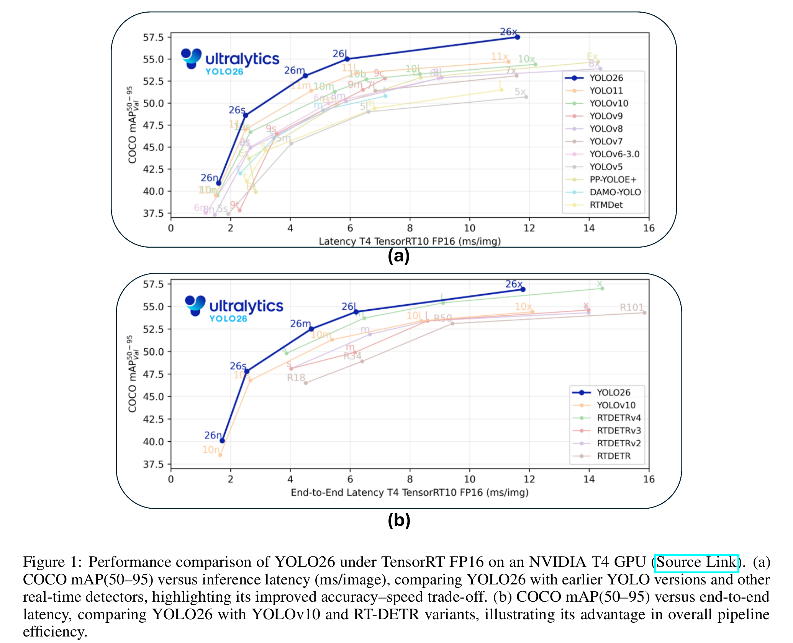

*Figure 1（原图）：YOLO26 的精度—延迟权衡；左图为标准检测，右图为端到端检测。[PDF 第 2 页](https://arxiv.org/pdf/2509.25164#page=2)*

论文首先用速度—精度关系说明 YOLO26 的定位。图中横轴是 NVIDIA T4、TensorRT 10、FP16、batch=1 下的单图延迟，越靠左越快；纵轴是 COCO val2017 的 mAP50–95，越高越准。左半部分把 n/s/m/l/x 五种容量与 YOLO11、YOLOv8、YOLOv5 等模型放在一起，右半部分则把端到端版本与 YOLOv10、RT-DETR 比较。两边共同传达的是：YOLO26 希望让整条模型曲线尽量靠近左上角，而不只是用最大模型争取一个最高分。

n、s、m、l、x 是同一家族由轻到重的容量档，不是五种任务。n 更适合严格时延或内存预算，x 以明显更高的计算成本换取精度，实际选型往往落在曲线的拐点。还要注意，这里展示的是各项设计组合后的**总体系统表现**，不能据此分离 DFL、端到端头、ProgLoss、STAL 或 MuSGD 各自贡献了多少；论文没有相应消融。

### 一套设计语言，覆盖五类视觉任务

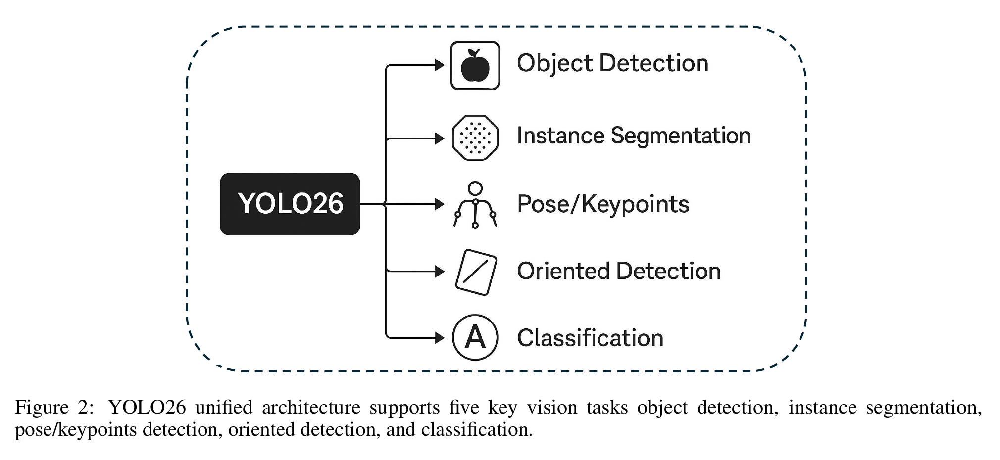

*Figure 2（原图）：YOLO26 统一架构覆盖五类视觉任务。[PDF 第 4 页](https://arxiv.org/pdf/2509.25164#page=4)*

这种速度—精度取舍不只服务于普通目标检测。YOLO26 把相似的骨干、特征融合方式和任务头接口扩展到五种视觉任务：

- **目标检测**：输出类别、置信度与水平矩形框；文中将其描述为 anchor-free，并突出端到端路径。
- **实例分割**：除框与类别外，为每个对象产生独立掩码；这不同于只给每个像素分类的语义分割。
- **姿态/关键点**：输出人体或部件的关键点坐标与可见性，可用于动作、工效学和行为分析。
- **旋转目标检测（OBB）**：输出有方向的矩形框，适合航拍、遥感及细长、倾斜目标。
- **图像分类**：整张图只输出类别概率，不做对象定位。

“统一”主要指共享骨干—颈部—任务头的设计范式、训练接口和部署工具链；实际通常为任务分别训练/下载权重，并非同一个 checkpoint 无条件同时输出五类结果。

### 图像如何流经网络：从层级特征到多尺度预测

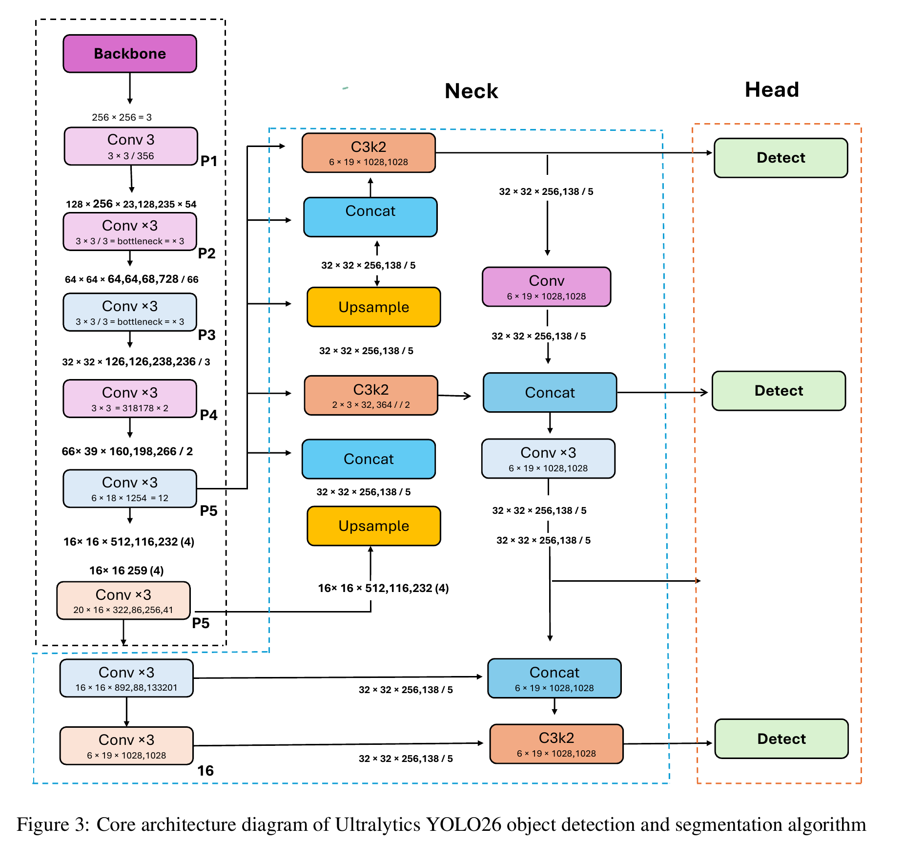

*Figure 3（原图）：YOLO26 的 backbone、neck 与多尺度 detection head。[PDF 第 5 页](https://arxiv.org/pdf/2509.25164#page=5)*

在普通检测任务中，一张图像从输入到输出大致经历四个连续阶段：

1. **输入与逐级下采样**：图像经过 Conv 与 C3k2 等模块，空间分辨率降低、通道与语义表达增强，形成 P1 到 P5 的层级特征。
2. **深层语义加工**：最深层包含更大感受野和注意力/聚合类模块，用于捕获全局语义，但空间细节较少。
3. **颈部多尺度融合**：上采样与 Concat 把深层语义传回高分辨率层；随后再经卷积、拼接形成双向融合，使小目标细节和大目标语义共同进入预测层。
4. **三个 Detect 输出**：分别在高、中、低分辨率特征上预测，覆盖小、中、大目标。

图中的箭头和 Concat 是理解重点：它们表示不同深度特征的跨层复用。论文没有逐一定义图中每个模块的内部结构、重复次数和全部超参数，且部分尺寸标注不够清晰；因此这是一张概念架构图，不能代替 YAML/源码作为精确复现规范。

### 为什么它更容易训练和部署

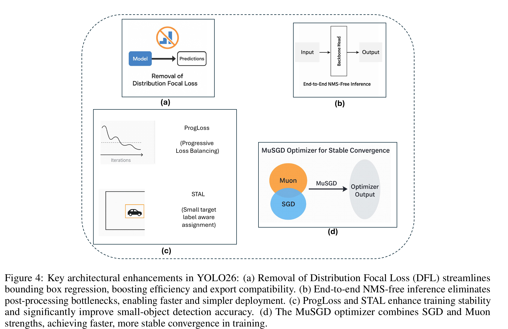

*Figure 4（原图）：DFL 移除、端到端推理、ProgLoss/STAL 与 MuSGD。[PDF 第 6 页](https://arxiv.org/pdf/2509.25164#page=6)*

架构主线解决了“如何提取并融合特征”，而 YOLO26 的差异化重点更多落在预测、样本分配和优化过程。原论文把四项变化汇总在同一张图里，它们分别作用于推理图与训练过程。

#### 更直接的框回归：移除 Distribution Focal Loss（DFL）

常见 DFL 框回归不是直接预测一个连续边界距离，而是预测离散区间上的概率分布，再通过期望解码成坐标。这有利于刻画边界不确定性，但会增加输出通道、分布解码与导出图复杂度。YOLO26 移除 DFL，目标是让框回归路径更直接，减少边缘端和不同推理后端的工程负担。

需要注意：本文没有给出替代回归损失的完整公式，也没有“只移除 DFL、其余不变”的消融结果，所以能确认的是结构简化，不能仅凭本文精确量化它对速度或精度的独立影响。

#### 更短的输出链路：端到端、无 NMS 的预测路径

传统密集检测会对同一物体产生多个候选框，再用非极大值抑制（NMS）按分数排序、计算 IoU、删除重叠框。NMS 带来额外延迟、阈值调参和后端兼容成本。

端到端方案通过 one-to-one 分配，让一个真实目标对应一个主要预测，从训练阶段抑制重复输出，因而可直接返回结果。可是，结合当前官方文档，更严谨的结构是：**one-to-many 头用于默认高精度/NMS 路径，one-to-one 头用于 `nms=False` 的端到端路径**。所以 Figure 4(b) 展示的是可选能力，而非所有推理模式都永久取消 NMS。

#### 让训练关注难例和小目标：ProgLoss 与 STAL

- **ProgLoss（Progressive Loss Balancing）**：随训练进程动态调整不同目标或样本的损失权重，意图防止后期大量容易样本支配梯度，把学习资源转向仍未解决的困难部分。
- **STAL（Small-Target-Aware Label Assignment）**：在正负样本匹配阶段偏向照顾小尺寸、遮挡或模糊目标，目标是改善航拍、机器人、智能摄像头等密集场景的小目标召回。

这两者分别作用于“损失如何加权”和“哪些预测被分配为正样本”。论文只给概念说明，没有算法流程、阈值、公式与单独消融，因此“提升多少”无法从本文验证。

#### 改变参数如何更新：MuSGD 优化器

作者将 MuSGD 描述为 SGD 与 Muon 风格更新的混合体：希望保留 SGD 的泛化特性，同时获得更平滑、更快的收敛。它改变的是训练优化过程，不增加部署时的推理模块。

但本文未给出参数更新方程、动量/学习率设置、训练轮次对照或方差统计。“更少 epoch 达到收敛”属于作者主张，而不是这篇论文中有完整数字支撑的结论。

### 检测和实例分割：模型越大，收益是否一直划算

检测使用 COCO val2017、输入 640；延迟为 CPU ONNX 与 T4 TensorRT FP16。`e2e mAP` 指端到端路径。论文数值如下：

| 检测模型 | mAP50–95 | e2e mAP |    CPU ms |    T4 ms | 参数 M | FLOPs B |
| -------- | -------: | ------: | --------: | -------: | -----: | ------: |
| YOLO26n  |     40.9 |    40.1 |  38.9±0.7 |  1.7±0.0 |    2.4 |     5.4 |
| YOLO26s  |     48.6 |    47.8 |  87.2±0.9 |  2.5±0.0 |    9.5 |    20.7 |
| YOLO26m  |     53.1 |    52.5 | 220.0±1.4 |  4.7±0.1 |   20.4 |    68.2 |
| YOLO26l  |     55.0 |    54.4 | 286.2±2.0 |  6.2±0.2 |   24.8 |    86.4 |
| YOLO26x  |     57.5 |    56.9 | 525.8±4.0 | 11.8±0.2 |   55.7 |   193.9 |

最重要的规律是：从 n 到 x，标准 mAP 提高 16.6 点，但 T4 延迟约增至 6.9 倍，CPU 延迟约增至 13.5 倍。端到端路径相对标准路径低 0.6–0.8 mAP，换来不依赖 NMS 的更简洁输出。

实例分割同样输入 640，`Box mAP` 衡量框，`Mask mAP` 衡量实例掩码：

| 分割模型    | Box mAP | Mask mAP |    CPU ms |    T4 ms | 参数 M | FLOPs B |
| ----------- | ------: | -------: | --------: | -------: | -----: | ------: |
| YOLO26n-seg |    39.6 |     33.9 |  53.3±0.5 |  2.1±0.0 |    2.7 |     9.1 |
| YOLO26s-seg |    47.3 |     40.0 | 118.4±0.9 |  3.3±0.0 |   10.4 |    34.2 |
| YOLO26m-seg |    52.5 |     44.1 | 328.2±2.4 |  6.7±0.1 |   23.6 |   121.5 |
| YOLO26l-seg |    54.4 |     45.5 | 387.0±3.7 |  8.0±0.1 |   28.0 |   139.8 |
| YOLO26x-seg |    56.5 |     47.0 | 787.0±6.8 | 16.4±0.1 |   62.8 |   313.5 |

掩码分支使参数、FLOPs 和延迟都高于同档检测模型；`x-seg` 的 Mask mAP 最高，但 CPU 单图约 787 ms，不适合把“最高精度”直接等同于“实时”。

### 图像分类：精度提升逐渐进入平台期

分类输入为 224。Top-1 是最高分标签命中率，Top-5 是正确标签出现在前五名中的比例：

| 分类模型    | Top-1 % | Top-5 % |   CPU ms |   T4 ms | 参数 M | FLOPs B |
| ----------- | ------: | ------: | -------: | ------: | -----: | ------: |
| YOLO26n-cls |    71.4 |    90.1 |  5.0±0.3 | 1.1±0.0 |    2.8 |     0.5 |
| YOLO26s-cls |    76.0 |    92.9 |  7.9±0.2 | 1.3±0.0 |    6.7 |     1.6 |
| YOLO26m-cls |    78.1 |    94.2 | 17.2±0.4 | 2.0±0.0 |   11.6 |     4.9 |
| YOLO26l-cls |    79.0 |    94.6 | 23.2±0.3 | 2.8±0.0 |   14.1 |     6.2 |
| YOLO26x-cls |    79.9 |    95.0 | 41.4±0.9 | 3.8±0.0 |   29.6 |    13.6 |

从 l 到 x，Top-1 只增加 0.9 点，但参数翻倍有余；如果部署预算严格，m/l 往往比 x 更接近收益拐点。

### 姿态估计：中型模型已覆盖大部分精度收益

姿态任务在 COCO Keypoints val2017、输入 640 上评估：

| 姿态模型     | Pose mAP50–95 | mAP50 | CPU ms | T4 ms | 参数 M | FLOPs B |
| ------------ | ------------: | ----: | -----: | ----: | -----: | ------: |
| YOLO26n-pose |          57.2 |  83.3 |   40.3 |   1.8 |    2.9 |     7.5 |
| YOLO26s-pose |          63.0 |  86.6 |   85.3 |   2.7 |   10.4 |    23.9 |
| YOLO26m-pose |          68.8 |  89.6 |  218.0 |   5.0 |   21.5 |    73.1 |
| YOLO26l-pose |          70.4 |  90.5 |  275.4 |   6.5 |   25.9 |    91.3 |
| YOLO26x-pose |          71.6 |  91.6 |  565.4 |  12.2 |   57.6 |   201.7 |

`mAP50` 只要求 OKS/匹配阈值 0.50，通常显著高于跨 0.50–0.95 严格阈值平均的 mAP；后者更能反映关键点定位精度。n→m 提升较明显，l→x 的边际收益减小。

### 旋转框检测：分辨率与方向预测显著增加成本

OBB 使用 DOTA v1、输入 1024；更高分辨率和旋转框计算让延迟明显高于 640 检测：

| OBB 模型    | mAP50–95 | mAP50 | CPU ms | T4 ms | 参数 M | FLOPs B |
| ----------- | -------: | ----: | -----: | ----: | -----: | ------: |
| YOLO26n-obb |     52.4 |  78.9 |   97.7 |   2.8 |    2.5 |    14.0 |
| YOLO26s-obb |     54.8 |  80.9 |  218.0 |   4.9 |    9.8 |    55.1 |
| YOLO26m-obb |     55.3 |  81.0 |  579.2 |  10.2 |   21.2 |   183.3 |
| YOLO26l-obb |     56.2 |  81.6 |  735.6 |  13.0 |   25.6 |   230.0 |
| YOLO26x-obb |     56.7 |  81.7 | 1485.7 |  30.5 |   57.6 |   516.5 |

n→s 的提升较明显，此后容量增长带来的增益很小：s→x 的 mAP50–95 只提高 1.9 点，而 T4 延迟增加约 6.2 倍。这是全文最典型的“更大不一定更划算”。

### 指标与比较中最容易误读的点

- **mAP50–95**：在 IoU 0.50 到 0.95 多个阈值上平均，比单独 mAP50 更严格。
- **延迟不是 FPS 的简单普适保证**：它受硬件、batch、输入尺寸、预处理、数据传输、推理后端和是否计入后处理影响。表中的 T4 数字不能直接外推到手机或 Jetson。
- **参数量与 FLOPs 不等于实际延迟**：算子融合、内存访问、并行度和后端支持都会改变运行速度。
- **不同任务不能横向比较 mAP 数字**：检测框、掩码、关键点和旋转框使用的匹配对象与数据集不同。
- **标准 mAP 与 e2e mAP 是两条推理路径**：前者与默认 NMS 路径对应，后者强调端到端输出；部署时要明确选择。

### 导出、量化与边缘部署

论文列出的目标格式包括 ONNX、TensorRT、CoreML、TensorFlow Lite 和 OpenVINO；它们分别覆盖跨平台运行、NVIDIA GPU、Apple 设备、移动/嵌入式与 Intel 硬件。移除 DFL、提供无 NMS 路径的工程意义，正是减少复杂算子和后处理依赖，使计算图更容易被这些后端接受。

量化部分讨论 FP16 与 INT8：

- **FP16** 通常在支持半精度的 GPU/NPU 上降低显存与带宽成本，改造风险较小。
- **INT8** 进一步压缩模型并可能加速整数硬件，但依赖代表性校准数据，尤其要检查小目标、置信度和框回归误差。
- 论文声称量化只有很小精度损失，却没有给出 FP32/FP16/INT8 的成套对照数据；因此这应视为部署建议，而非本文已量化证明的结论。

论文设想的应用包括机器人感知与避障、制造业质检与安全监控、智慧农业、无人机和 IoT 摄像头。真正落地还必须测端到端流水线：采集与解码、resize/normalize、模型、后处理、跟踪或业务规则、温度与功耗，而不只是模型内核延迟。

### 论文提出的未来方向

1. **开放词汇检测与视觉基础模型结合**：让类别不再完全受封闭训练集约束，但会增加文本编码、对齐训练和部署成本。
2. **半监督/自监督学习**：利用未标注图像、教师—学生和伪标签，降低数据标注成本；挑战是伪标签误差累积。
3. **CNN—Transformer 混合结构**：兼顾卷积的局部高效归纳偏置与注意力的长程依赖建模。
4. **硬件感知训练**：将量化感知训练、神经架构搜索和动态计算纳入训练目标，使模型针对真实设备而非抽象 FLOPs 优化。

## 带来的收益

### 可确认的收益

- YOLO26 提供 n/s/m/l/x 五档容量和五类任务的完整公开性能矩阵，便于按精度、CPU/T4 延迟、参数与 FLOPs 选型。
- 去 DFL 与端到端输出方向减少了部署图中的分布解码和可选后处理依赖，理论上更利于 ONNX/TensorRT/CoreML/TFLite/OpenVINO 等后端。
- 检测端到端路径只比标准路径低约 0.6–0.8 mAP，显示“简化后处理”与精度之间的差距不大。
- 多任务家族共享相似的模型尺度和工具链，降低检测、分割、姿态、OBB、分类之间的迁移成本。

### 尚不能由本文独立确认的收益

- DFL 移除、ProgLoss、STAL、MuSGD 各自带来的精度、速度或收敛增益，因为没有模块级消融。
- “MuSGD 用更少 epoch 收敛”和“INT8 几乎不损失精度”，因为缺少学习曲线与量化对照表。
- Jetson Nano/Orin 上的具体实时性、功耗和温度表现，因为正文没有对应测量值。
- 相比所有竞争模型都“更优”的普适结论，因为 Figure 1 的结果依赖同一硬件、后端和评测配置，且本文的数据主要来自官方资料而非独立复现实验。

一句话总结：**YOLO26 的重点不是单一新模块，而是把直接框回归、可选端到端无 NMS、困难/小目标训练策略和更易导出的多任务模型家族组合起来；公开表格显示它有良好的速度—精度梯度，但核心改动的独立贡献与真实边缘设备收益仍需消融和实机测试验证。**


