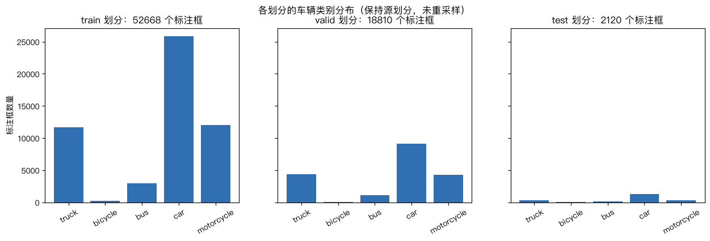
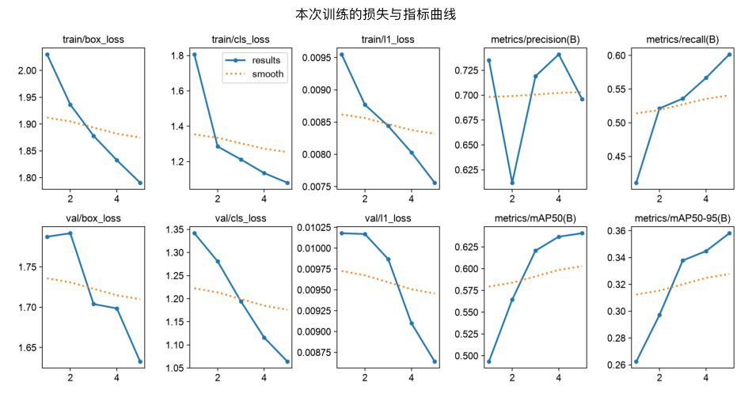
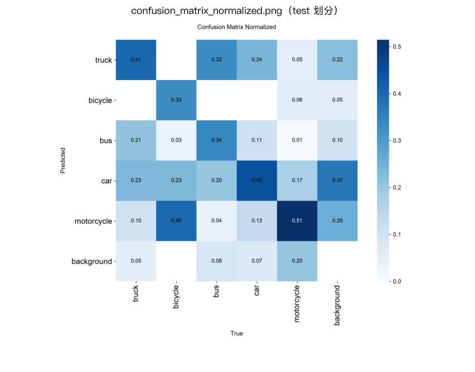
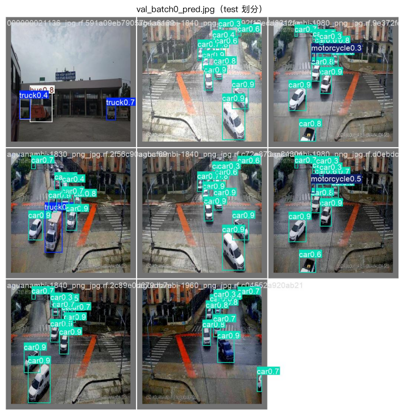
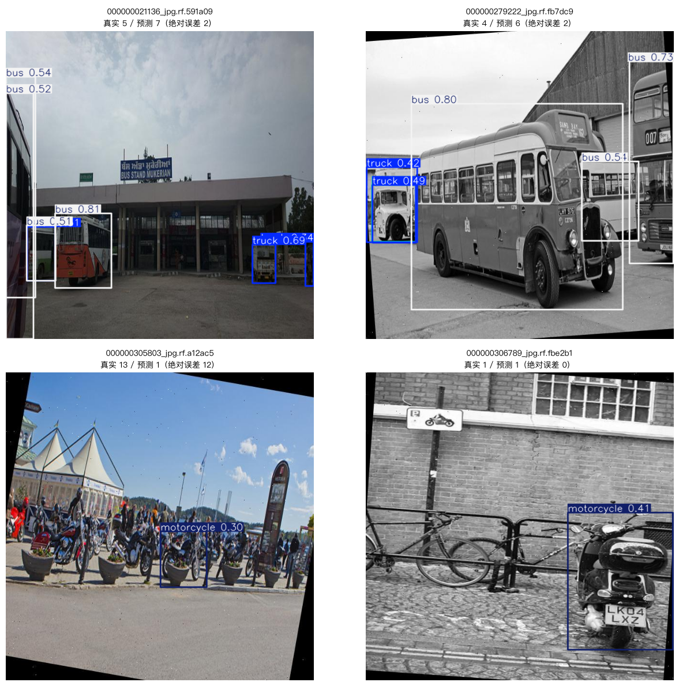
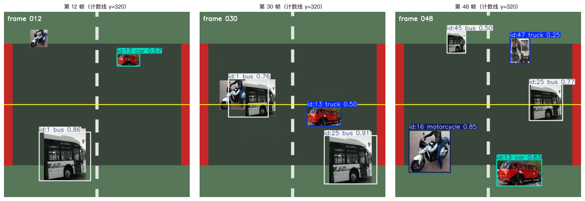

# 车流量统计实跑报告（YOLO26 + ByteTrack）

本报告记录 [车流量统计 Notebook](../notebooks/02-yolo26-vehicle-counting.ipynb) 的一次**完整真实执行**：真实数据集、真实训练、真实推理与跟踪，全部单元都带执行序号与输出。所有文字输出原样摘录自该 Notebook 已保存的结果，图片同样取自该次执行，存放在平行目录 [`../assets/`](../assets/) 并以相对路径引用。

## 运行环境

| 项目 | 值 |
|---|---|
| 日期 | 2026-10-18 |
| 内核 | `env_dl_uv`（当时的课堂 uv 项目，现已退役；现行环境见[环境准备](../../docs/environment-setup.zh-CN.md)） |
| Python / torch / ultralytics | 3.12.12 / 2.14.1 / 8.4.177 |
| 设备与参数 | Apple 芯片 **MPS**，`epochs=5`、`imgsz=320`、`batch=8`、`seed=42`（课堂默认参数，非 smoke） |
| 端到端耗时 | 940.47 s（其中训练 5 轮累计 897 s，约 180 s/轮） |
| 执行方式 | `english/scripts/execute_and_save.py --group detection --language zh-CN` |
| 执行记录 | `english/reports/detection-zh-CN-executed.json`（`status: passed`） |

产物目录 `02-object-detection/outputs/`：`runs/vehicle-counting-v4-yolo26n-3/`（本次权重与训练图）、`vehicle-counting-data.yaml`、`vehicle-counting-metrics.json`、`traffic-demo.mp4`、`traffic-demo.ground-truth.json`、`vehicle-flow-report.json`。

设备选择按 CUDA → MPS → CPU 顺序判定，本机命中 MPS。Ultralytics 会用 `seed=42` 打开「仅告警」的确定性开关，但 MPS 上的自动微分算子 `index_put_with_accumulate_mps` 没有确定性实现，所以重跑整体一致、不保证逐位复现；Notebook 的 setup 单元只吞掉这条重复告警，不改变上述事实。与英文版同数据、同种子、同参数，test 指标完全一致。

## 1 核对数据与类别映射

数据来自 Roboflow `vehicle-counting-rtvul / vehicle-counting-tksu5` **v4**（CC BY 4.0），由 `english/scripts/import_vehicle_counting.py --from-staging` 从 `/workspace/DataSet/yolo` 导入。导入器核对来源、类别、逐划分计数与压缩包 SHA-256。

预期输出：

```text
类别映射： {0: 'truck', 1: 'bicycle', 2: 'bus', 3: 'car', 4: 'motorcycle'}
校验后的划分规模： {'train': {'images': 4708, 'boxes': 52668}, 'val': {'images': 1661, 'boxes': 18810}, 'test': {'images': 196, 'boxes': 2120}, 'segmentation_lines_normalised': 0}
数据来源： https://universe.roboflow.com/vehicle-counting-rtvul/vehicle-counting-tksu5 | 许可： CC BY 4.0
数据集压缩包 SHA-256： 3945432ed7ce76c9 ...
```

`segmentation_lines_normalised: 0` 指**校验时已不存在**分割多边形行；源包中 3 行分割标注已在导入阶段改写为外接检测框，记录在该数据目录的 `provenance.json`。

类别分布（源划分未做任何重采样）：



test 划分只有 2120 框，`bicycle`/`bus` 极少，因此这两类的指标波动大——这是后面误差解读的前提。

带框标注抽样（每格一张，框内编号即类别号）：


## 2 零样本对照：不改权重直接推理

先用 COCO 预训练 `yolo11n.pt`（80 类）映射到本课 5 类，看看“不做任何训练”能做到什么程度。

预期输出：

```text
图片                                     真实    预测      绝对误差
000000021136_jpg.rf.591a09eb79057b      5     3         2
000000279222_jpg.rf.fb7dc97a15f0d2      4     4         0
000000305803_jpg.rf.a12ac5644291b0     13     0        13
000000306789_jpg.rf.fbe2b1ca62b53a      1     1         0
000000306893_jpg.rf.4c136a12ec3d5c      2     4         2
000000314251_jpg.rf.6fc0048d77bbd3      9     0         9
零样本平均绝对计数误差： 4.33 辆/张图片
```

GT 取自 YOLO 布局的 `test/labels/*.txt`（**不是**图片同目录）。误差几乎全部来自密集小目标（一次漏掉 13 辆摩托车、9 辆摩托车）。

## 3 微调 YOLO26n

从 `yolo26n.pt` 起训，5 轮、320 像素、`workers=0`。

预期输出：

```text
已保存检查点： .../deep-learning-lab/02-object-detection/outputs/runs/vehicle-counting-v4-yolo26n-3/weights/best.pt
```

验证集指标逐轮上升，5 轮结束时仍未见平台期：

| epoch | 累计时间 (s) | mAP50 (val) | mAP50-95 (val) |
|---:|---:|---:|---:|
| 1 | 182 | 0.4933 | 0.2624 |
| 2 | 363 | 0.5645 | 0.2972 |
| 3 | 541 | 0.6207 | 0.3378 |
| 4 | 719 | 0.6368 | 0.3448 |
| 5 | 897 | 0.6407 | 0.3582 |



## 4 评估微调后的权重

在**独立 test 划分**上评估（与训练/验证无交集）。

预期输出：

```text
test 划分精确率 precision：0.7308
test 划分召回率 recall：0.6444
test 划分 mAP50：0.6983
test 划分 mAP50-95：0.4071
指标报告已写出： .../deep-learning-lab/02-object-detection/outputs/vehicle-counting-metrics.json
```



逐类 AP50 / AP 分别取自 `vehicle-counting-metrics.json`：`car` 0.8439 / 0.5747、`bicycle` 0.7297 / 0.3128、`truck` 0.7118 / 0.4274、`bus` 0.6994 / 0.4847、`motorcycle` 0.5069 / 0.2360。瓶颈是小目标与类别不均衡——检测器能看见车，只是认错类别、漏掉最小的那些，而不是“看不见”。

test 划分预测样例（蓝色为 GT，青色为预测）：



## 5 图片车流量：数清「这一帧里有几辆车」

对 4 张 test 图片做检测并按类别计数，与标注逐类比较。

预期输出：

```text
000000021136_jpg.rf.591a09eb79057b4a8139188b25aabd95.jpg：预测 {'bus': 4, 'truck': 3} | 真实 {'bus': 4, 'truck': 1}
000000279222_jpg.rf.fb7dc97a15f0d237311be501e45f110a.jpg：预测 {'bus': 3, 'truck': 2, 'car': 1} | 真实 {'bus': 3, 'truck': 1}
000000305803_jpg.rf.a12ac5644291b03859ee97bf32999079.jpg：预测 {'motorcycle': 1} | 真实 {'motorcycle': 13}
000000306789_jpg.rf.fbe2b1ca62b53abcb7fb9fbc765b29e0.jpg：预测 {'motorcycle': 1} | 真实 {'motorcycle': 1}
微调后平均绝对计数误差： 4.0 辆/张图片（这四张测试图）
```



读数要点：前两张大车图每辆车都被检出了（总数 7 对 5、6 对 4），剩下的误差来自类别分配和重复框，不是漏检；后两张在 320 像素下整群摩托车仍然几乎全丢，仅 13 → 1 就贡献了 16 个绝对误差中的 12 个，所以平均值停在 4.0。

## 6 视频车流量：跟踪 + 过线判定

演示视频由 `english/scripts/build_traffic_demo_video.py` 用**数据集中的真实车辆裁剪**合成（108 帧 @ 12 fps，过线次数有确定答案），因此这里的偏差衡量的是检测与跟踪质量，而不是真实交通量。

演示片段在上一步已经生成过，所以本次直接复用而不再重写；下面的真值取自 `outputs/traffic-demo.ground-truth.json`。

预期输出：

```text
使用的视频： .../deep-learning-lab/02-object-detection/outputs/traffic-demo.mp4
计数线位置： [0, 320, 640, 320] | 总帧数： 108 | 帧率： 12
```

该片段的真值是 `expected_total_crossings: 6`，按类别为 `{'truck': 1, 'bicycle': 0, 'bus': 3, 'car': 1, 'motorcycle': 1}`。

```text
实际分析帧数： 108 ，声明总帧数 108 | 帧率： 12.0
forward 过线：  4  各类别：{'truck': 1, 'motorcycle': 1, 'bus': 2}
backward 过线：  2  各类别：{'bus': 2}
已计数车辆（去重）： 6 | 出现过的车辆跟踪轨迹数： 10
过线流向： {'duration_seconds': 9.0, 'total_crossings': 6, 'vehicles_per_minute': 40.0}
标注真实过线数量： 6 ，检测与跟踪偏差：+0
```

```text
{
  "counts": {
    "forward": {
      "crossings": 4,
      "per_class": {
        "truck": 1,
        "motorcycle": 1,
        "bus": 2
      },
      "last_crossing": {
        "class": "bus",
        "track_id": 61,
        "frame": 78,
        "timestamp": 6.5
      }
    },
    "backward": {
      "crossings": 2,
      "per_class": {
        "bus": 2
      },
      "last_crossing": {
        "class": "bus",
        "track_id": 25,
        "frame": 52,
        "timestamp": 4.333333333333333
      }
    }
  },
  "unique_vehicles_counted": 6,
  "flow": {
    "duration_seconds": 9.0,
    "total_crossings": 6,
    "vehicles_per_minute": 40.0
  }
}
```



跟踪把“每帧多少辆”变成“多少个不同车辆”：出现 10 条轨迹，其中 6 辆完成过线，`unique_vehicles_counted` 不会因为一辆车在多帧出现而被重复计数；`vehicles_per_minute` 由视频自身帧率换算，可直接作为流量指标。

这次总数偏差是 **0**，但类别分配仍不完美：片段里放了 1 辆 `car` 和 1 辆正向 `bus`，检测器给出的是正向 `bus: 2`、没有 `car`，也就是把轿车判成了公交车。总流量对、类别归属错，这与第 4 节的逐类 AP 一致。

## 7 同一批图片的公平对照

Notebook 里两次计数用的是**不同图片数**（零样本 6 张、微调 4 张），不能直接比较。下面在同一组 4 张 test 图片上重算两个权重，结论才成立：

| 权重 | 同 4 张图平均绝对计数误差 |
|---|---:|
| 零样本 `yolo11n.pt`（COCO 80 类映射） | 3.75 辆/图 |
| 微调 `best.pt`（本课 5 类，5 轮 320 像素） | 4.00 辆/图 |

也就是说：**在这 4 张图上零样本权重的总计数误差仍然略小**，即便微调模型已经把早前 CPU 那次运行的 4.75 缩小到 4.00。两个模型都丢了那 13 辆摩托车的大部分，仅此一项就占掉微调模型 16 个绝对误差里的 12 个。微调的收益体现在 test 集整体（mAP50 0.6983，优于零样本基线）和类别一致性上，而不是这个被单个小目标失败主导的四图计数上。要改善计数，优先提高 `imgsz`（320 → 640）与 `epochs`，其次才是换更大的骨干。

## 8 复现

```bash
# 1) 数据：从 DataSet 暂存区导入（详见 ../data/README.md）
cd /path/to/deep-learning-lab
uv run python english/scripts/import_vehicle_counting.py --from-staging

# 2) 生成演示视频（可选，Notebook 缺失时会自动生成）
uv run python english/scripts/build_traffic_demo_video.py \
  --export-dir english/02-object-detection/data/vehicle-counting-tksu5-v4 \
  --output     02-object-detection/outputs/traffic-demo.mp4 --fps 12 --frames 108

# 3) 执行并保存输出（课堂默认参数，Apple 芯片 MPS 约 16 分钟）
cd english
uv run python scripts/execute_and_save.py \
  --group detection --language zh-CN --notebook 02-yolo26-vehicle-counting

# 全课环境在仓库根用 uv sync --locked 重建
```

`COURSE_SMOKE=1` 会切换到 COCO8 流程检查，其数字**不能**当作本案例的车流量结果；`COURSE_EPOCHS=1` 只验证流程连通性。

## 已知限制

- 5 轮 320 像素未收敛（val mAP50 仍在上升），本报告数字是“课堂默认参数下的这次实跑”，不是该数据集可达上限。
- 视频为合成片段、过线真值已知，偏差指标才有意义——这次总数正好为 0，但类别上仍把 1 辆 `car` 判成了 `bus`。真实道路视频需自备并用 `TRAFFIC_VIDEO` 指定。
- MPS 上的跟踪同样会经过 setup 单元提到的 `index_put_with_accumulate_mps` 路径，重跑可能差 1 次过线；这里记录的是当前交付这次实跑的结果。
- `bicycle`/`bus` 在 test 划分样本极少，单类指标置信区间宽。
