# Computer vision fundamentals: from pixel sensing to visual understanding and generation

The whole lesson follows one learning path:

```text
what the machine sees
      ↓
which visual tasks the machine has to solve
      ↓
why visual understanding is hard
      ↓
how a CNN extracts features from pixels
      ↓
how classification, detection and other tasks are implemented
      ↓
how Transformers and Diffusion change CV
```

In one sentence:

> The history of computer vision is essentially the machine moving from "reading pixels" towards "extracting features, understanding content and generating images".

---

# Part 1: How the machine "sees" the world

## 1. What is computer vision

Computer Vision (CV) studies how a computer extracts information from images, video and other visual data, understands
the content, and completes a task.

When a person looks at a photo they immediately understand the objects, the people, their spatial relations and the
event. What the computer receives first is only a block of pixel values. Computer vision has to build the mapping from
pixels to semantics.

```text
image or video
    ↓
pixels and frame sequences
    ↓
feature extraction
    ↓
objects, positions, relations, semantics
    ↓
recognition, analysis, decision or generation
```

> The core goal of computer vision: give a machine the ability to perceive, understand and generate information from
> visual data.

### Terminology

Computer vision and machine vision are closely related but not identical:

- **computer vision** stresses general visual perception, understanding and generation techniques;
- **machine vision** usually means the integrated industrial application of cameras, lighting, algorithms and control
  systems.

### Figure


---

## 2. What an image looks like to a computer

A digital image is a multidimensional array.

A colour image normally has a red, green and blue channel:

$$
X\in\mathbb{R}^{C\times H\times W}
$$

where:

- $C$: number of channels, e.g. $C=3$ for an RGB image;
- $H$: image height;
- $W$: image width.

A person sees a cat, a car or a face. A computer first sees numbers arranged by spatial position.

A slide can put the two views side by side:

| What the human sees | What the computer receives |
| --- | --- |
| cat, car, road, pedestrian | an RGB pixel matrix |
| spatial relations between objects | values at different positions and channels |
| the meaning of the scene | an uninterpreted pattern of numbers |

---

## 3. The main tasks of computer vision

Visual tasks are easiest to understand by asking "which question must the machine answer".

| Visual task | Core question | Typical output | Example applications |
| --- | --- | --- | --- |
| Image classification | what is this image? | one or more classes | product recognition, medical image classification |
| Object detection | what is there, and where? | class, confidence, bounding box | pedestrian detection, hard-hat detection |
| Image segmentation | which class does each pixel belong to? | pixel-level mask | portrait matting, lane-line detection |
| OCR | what does the text say? | text location and content | receipts, ID documents, document recognition |
| Video analysis | what is happening? | action, event, trajectory | action recognition, video surveillance |
| Image generation | can the image be generated or edited? | a new image or an edit | text-to-image, inpainting, style transfer |

### Image classification

Image classification assigns a class label to the whole image.

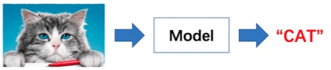

### Object detection

Object detection must recognise the class of every object and locate it in the image.


### Image segmentation

Image segmentation classifies every pixel and therefore captures object outlines far more precisely than a bounding
box.


### OCR

OCR (Optical Character Recognition) detects and recognises the text inside an image.


### Video analysis

A video is a sequence of images ordered in time. Video analysis has to understand individual frames and model the
temporal relations between them.

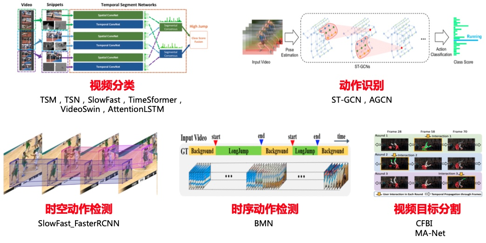

### Image generation

Image generation produces new visual content from noise, text, reference images or other conditions.


---

## 4. Why computer vision is hard

The same object can produce a completely different pixel distribution in a different environment.

The main challenges:

| Challenge | How it shows up |
| --- | --- |
| Lighting | day, night and shadows change colour and brightness |
| Viewpoint | the same object looks very different from another angle |
| Scale | an object may be right next to the camera or far away |
| Occlusion | part of the object may be hidden behind something else |
| Deformation | people, animals and soft objects constantly change shape |
| Background clutter | the target may blend into a complex background |
| Data issues | labels are expensive to obtain and class distributions are often imbalanced |
| Engineering limits | real systems also have latency, power and compute budgets |


> A CV model must not memorise one image; it must learn the visual features that stay stable under all kinds of
> change.

---

## 5. Where computer vision is used

| Industry | Typical scenarios |
| --- | --- |
| Security | face recognition, person detection, abnormal behaviour analysis |
| Transportation | licence plate recognition, vehicle detection, autonomous driving perception |
| Industrial | defect detection, dimensional measurement, robot guidance |
| Healthcare | medical image classification, lesion detection, organ segmentation |
| Finance | face payment, receipt recognition, document verification |
| Internet | image search, content moderation, product recognition |
| Content creation | text-to-image, image editing, video generation |

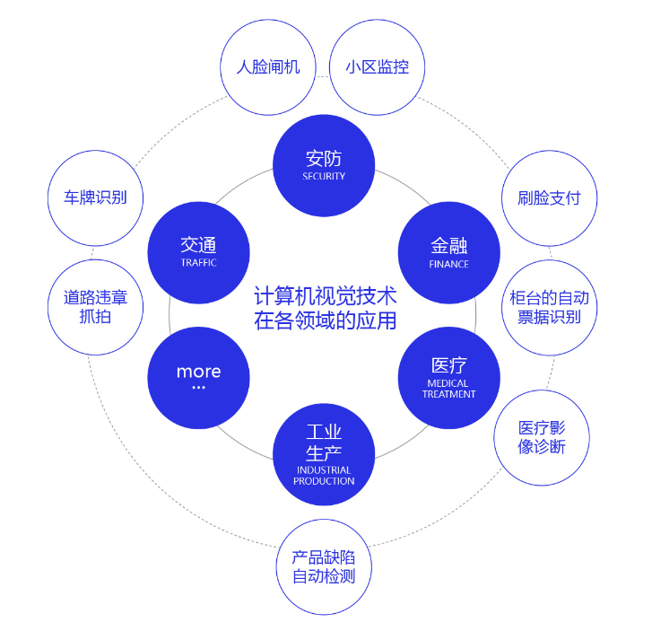

---

# Part 2: From hand-crafted features to deep learning

## 6. How visual algorithms evolved

The evolution of CV is easiest to follow by asking "who designs the features".

```text
classical vision
hand-designed features such as SIFT and HOG
            ↓
convolutional neural networks
local, hierarchical features learned automatically from training data
            ↓
Vision Transformer
attention models global relations between image patches
            ↓
visual pretraining and multimodal models
transferable general visual representations learned from massive data
            ↓
Diffusion / DiT
visual models extend from understanding to content generation
```

### A classical example: HOG + SVM pedestrian detection

The classical pedestrian detection pipeline:

1. scan the image with a sliding window;
2. extract HOG features for each candidate region;
3. use an SVM to decide whether the candidate contains a pedestrian;
4. remove duplicate boxes with NMS.

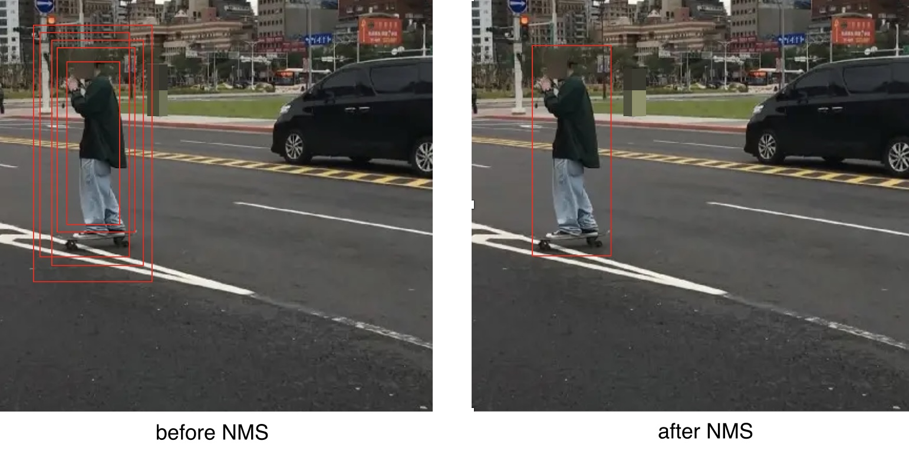

The main limitation of classical methods is that accuracy depends heavily on hand-designed features and transfers
poorly across scenes.

### What deep learning changed

A CNN puts "feature extraction" and "task prediction" inside one trainable network:

```text
classical:    image -> hand-crafted features -> classifier -> result

deep learning: image -> network learns features automatically -> result
```

---

# Part 3: How a CNN understands images

## 7. Why images need a convolutional network

Flattening an image into a 1-D vector and feeding a fully connected network causes two problems.

### Problem 1: too many parameters

Every neuron of a fully connected layer connects to every input of the previous layer. As image size and hidden width
grow, the parameter count explodes.

### Problem 2: the spatial structure is destroyed

Neighbouring pixels are strongly related. After flattening, the vertical, horizontal and local neighbourhood
relations are no longer visible to the model.

### How a CNN answers both

| CNN property | Effect |
| --- | --- |
| Local connectivity | each unit looks at one small region only |
| Weight sharing | one kernel is reused across the whole image |
| Hierarchical extraction | edges, textures, parts and semantic features are composed layer by layer |
| Translation equivariance | when an object moves, its feature response moves with it |

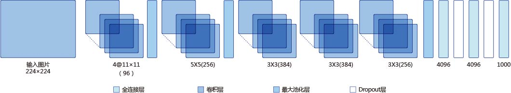

---

## 8. Convolution: scanning the image with a small window

A convolution kernel is a small feature detector. It slides over the image, takes one local region at a time,
multiplies corresponding positions and sums the products.

With local input region $X$ and kernel $K$, the value at one output position is:

$$
y=\sum_i\sum_j X_{i,j}K_{i,j}+b
$$

For example, with a $3\times3$ input region and a $3\times3$ kernel:

$$
X=
\left[
\begin{array}{ccc}
x_{11} & x_{12} & x_{13} \cr
x_{21} & x_{22} & x_{23} \cr
x_{31} & x_{32} & x_{33}
\end{array}
\right]
$$

$$
K=
\left[
\begin{array}{ccc}
k_{11} & k_{12} & k_{13} \cr
k_{21} & k_{22} & k_{23} \cr
k_{31} & k_{32} & k_{33}
\end{array}
\right]
$$

one convolution step computes:

$$
y=x_{11}k_{11}+x_{12}k_{12}+\cdots+x_{33}k_{33}+b
$$

> The parameters inside the kernel decide which local pattern it responds to strongly.


---

## 9. Three worked convolution examples

### Case 1: detecting a black-white boundary

Use a horizontal kernel:

$$
K=
\left[
\begin{array}{ccc}
1 & 0 & -1
\end{array}
\right]
$$

It computes the difference between the left and the right pixel:

$$
y=x_{\mathrm{left}}-x_{\mathrm{right}}
$$

In a region of constant brightness the difference is close to 0; once the kernel straddles a bright-dark boundary the
absolute output grows sharply.


### Case 2: detecting object outlines

The Laplacian kernel below highlights edges in the image:

$$
K=
\left[
\begin{array}{ccc}
-1 & -1 & -1 \cr
-1 &  8 & -1 \cr
-1 & -1 & -1
\end{array}
\right]
$$

It measures the difference between the centre pixel and its eight neighbours:

$$
y=8x_{\mathrm{center}}-\sum_{i=1}^{8}x_{\mathrm{neighbor},i}
$$

Flat regions respond near zero, while regions with a strong intensity change respond strongly.


### Case 3: mean blurring

A $5\times5$ mean kernel:

$$
K=\frac{1}{25}
\left[
\begin{array}{ccccc}
1 & 1 & 1 & 1 & 1 \cr
1 & 1 & 1 & 1 & 1 \cr
1 & 1 & 1 & 1 & 1 \cr
1 & 1 & 1 & 1 & 1 \cr
1 & 1 & 1 & 1 & 1
\end{array}
\right]
$$

makes the output pixel the average of the 25 pixels in its neighbourhood:

$$
y=\frac{1}{25}\sum_{i=1}^{25}x_i
$$

Mean convolution reduces local noise, but it also blurs edges and detail.


---

## 10. Padding, stride and output size

### Padding: add pixels around the border or not

If the kernel never leaves the image border, the feature map shrinks after every convolution. Padding adds pixels
around the input, which controls the output size and reduces the loss of border information.

### Stride: how far the kernel moves each step

- small stride: denser sampling, larger output feature map;
- large stride: sparser sampling, smaller output feature map.

With input height $H$, kernel height $K_h$, total vertical padding $P_h$ and stride $S_h$:

$$
H_{out}=\left\lfloor\frac{H+P_h-K_h}{S_h}\right\rfloor+1
$$

and the same for width:

$$
W_{out}=\left\lfloor\frac{W+P_w-K_w}{S_w}\right\rfloor+1
$$

---

## 11. Receptive field: how much of the input one neuron sees

The receptive field is the region of the input image that influences one neuron of a feature map.

- shallow features have a small receptive field and usually encode edges and texture;
- as the network gets deeper the receptive field grows;
- deep features combine information from a wide area and form part- and object-level semantics.

```text
pixels
 ↓
edges and orientations
 ↓
textures and local shapes
 ↓
object parts
 ↓
whole objects and scene semantics
```

> "Depth" in a CNN does not only mean more layers to compute; it means the model can combine visual information over a
> larger region.

---

## 12. Multiple channels and multiple kernels

A colour image has several input channels and a convolution layer usually produces several output channels as well.

With input shape:

$$
N\times C_{in}\times H\times W
$$

the kernel parameters normally have shape:

$$
C_{out}\times C_{in}\times K_h\times K_w
$$

and the output shape is:

$$
N\times C_{out}\times H_{out}\times W_{out}
$$

where:

- $N$: batch size;
- $C_{in}$: number of input channels;
- $C_{out}$: number of output channels, i.e. the number of kernels;
- every output channel can learn to attend to a different feature pattern.

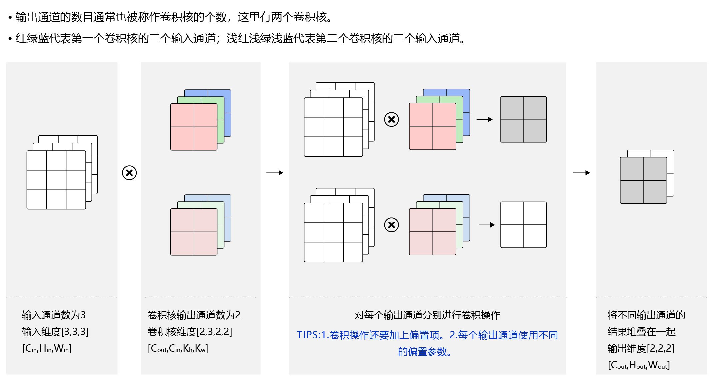


---

## 13. The other basic CNN modules

### Pooling: compress spatial information

Pooling replaces pixel or feature values with a statistic computed over a local region.

| Pooling | Computation | Main property |
| --- | --- | --- |
| Max pooling | maximum inside the window | keeps the strongest feature response |
| Average pooling | mean inside the window | keeps the aggregate statistic of the region |
| Global average pooling | mean over the whole feature map | compresses each channel to a single number |


### Activation functions: add nonlinearity

Without activation functions a stack of linear transforms is still one linear transform. Activations give the network
the capacity to express complex nonlinear relations.

ReLU is the usual activation in a CNN:

$$
\mathrm{ReLU}(x)=\max(0,x)
$$

Compared with Sigmoid and Tanh, ReLU has gradient 1 on the positive side, which helps against vanishing gradients in
deep networks.

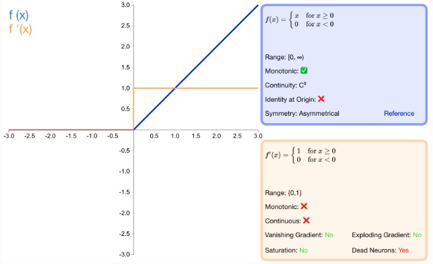

### Batch Normalization: stabilise the intermediate feature distribution

Batch Normalization standardises the intermediate features inside a mini-batch and then applies a learnable scale and
shift. It usually improves optimisation and allows a larger learning rate.

Common normalization methods:

| Method | Normalized range | Typical property |
| --- | --- | --- |
| BatchNorm | batch and spatial dimensions of one channel | depends on batch statistics |
| LayerNorm | feature dimensions of a single sample | independent of batch size, standard in Transformers |
| GroupNorm | channel groups plus spatial dimensions | more stable with small batches |
| InstanceNorm | spatial dimensions of one sample and one channel | common for style tasks |


### Dropout: reduce over-reliance on particular neurons

During training Dropout randomly sets part of the neuron outputs to 0, so the model cannot keep depending on a few
fixed features. It acts as a regulariser.


### One-page summary

| Module | Question it answers |
| --- | --- |
| Convolution | which features appear in a local region? |
| Activation function | how do we express complex nonlinear patterns? |
| Pooling or strided convolution | how do we compress features and enlarge the receptive field? |
| Normalization | how do we make training more stable? |
| Dropout | how do we reduce the risk of overfitting? |


---

# Part 4: Image classification and ResNet

## 14. Image classification: one label for the whole image

A classification model normally has two parts:

```text
input image
   ↓
backbone: extract visual features
   ↓
classification head: compute a score per class
   ↓
class probabilities
```

Its output format is simple, but classification is the foundation of detection, segmentation and image retrieval.


---

## 15. ResNet: making deep networks easy to optimise

As networks get deeper, plain deep networks can show the degradation problem, where the *training* error rises.
ResNet adds a residual connection so the network learns a change relative to its input.

Plain mapping:

$$
y=F(x)
$$

Residual mapping:

$$
y=F(x)+x
$$

If the best transform is close to the identity, the network only has to push $F(x)$ towards 0 to obtain:

$$
y\approx x
$$


What the residual connection actually buys us:

- a shortcut for the forward flow of information;
- a more direct path for the backward flow of gradients;
- deeper networks that are actually optimisable.

### The bottleneck block

Models such as ResNet-50 use a $1\times1$, $3\times3$, $1\times1$ bottleneck:

```text
input channels
   ↓ 1x1: reduce the number of channels
narrow intermediate representation
   ↓ 3x3: extract spatial features
intermediate features
   ↓ 1x1: restore the number of channels
output channels
```


---

# Part 5: Object detection and YOLO

## 16. Object detection: recognise the class and locate it

Classification answers "what is this image". Detection must also answer "which objects are in it and where".

| Task | Output |
| --- | --- |
| Image classification | the class of the whole image |
| Object detection | class, confidence and location for several objects |

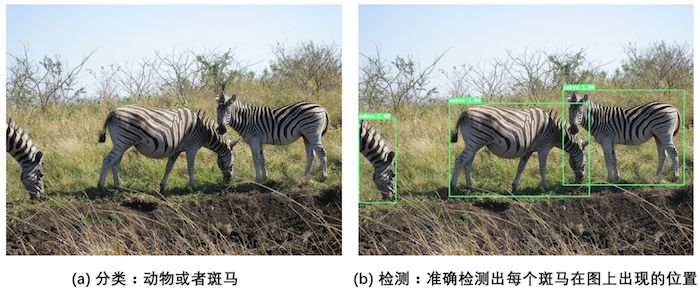

One detection is commonly written as:

$$
[\mathrm{class},\ \mathrm{score},\ x_1,\ y_1,\ x_2,\ y_2]
$$


---

## 17. Bounding boxes and IoU

### Bounding boxes

A bounding box (BBox) is the rectangle that encloses a target object.

Common notations:

- $xyxy$: top-left and bottom-right corners $(x_1,y_1,x_2,y_2)$;
- $xywh$: centre coordinates plus width and height $(x,y,w,h)$.

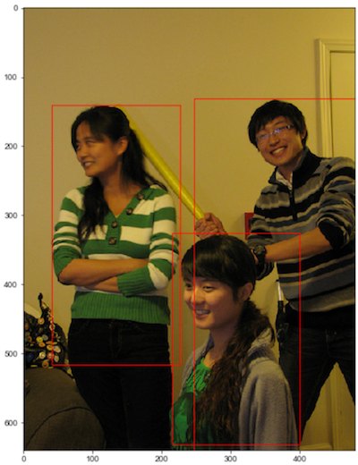

### IoU

Intersection over Union (IoU) measures how much two boxes overlap:

$$
\mathrm{IoU}=\frac{|A\cap B|}{|A\cup B|}
$$

- IoU close to 1: the boxes almost coincide;
- IoU close to 0: they barely overlap.

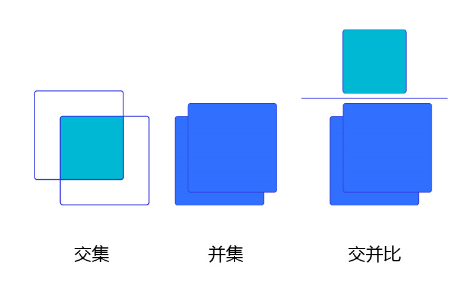

For a presentation, keep the concept and the figure; move the coordinate-level intersection-area derivation to an
appendix.

---

## 18. NMS: removing duplicate boxes

One object usually produces several heavily overlapping predictions. Non-Maximum Suppression (NMS) keeps the best one.

The procedure:

1. take the box with the highest confidence;
2. compute its IoU with the other predictions of the same class;
3. delete the boxes whose IoU exceeds the threshold;
4. repeat for the remaining boxes.

```text
many overlapping candidate boxes
       ↓
sort by confidence
       ↓
keep the highest-scoring box
       ↓
delete the boxes that overlap it heavily
       ↓
final detections
```


---

## 19. The main families of detection algorithms

| Family | Basic idea | Representative models | Properties |
| --- | --- | --- | --- |
| Two-stage | propose regions first, then classify and regress | Faster R-CNN | clear pipeline, usually a longer compute chain |
| One-stage | predict class and location directly | YOLO, SSD | compact, suitable for real-time detection |
| Anchor-free | predict centres or keypoints instead of preset anchors | FCOS, CenterNet | removes anchor design and matching |
| Transformer detection | formulate detection as set prediction | the DETR family | attention models global relations |

> Two-stage, one-stage and anchor-free are not mutually exclusive axes. Two-stage and one-stage describe the detection
> pipeline; anchor-based and anchor-free describe how candidate boxes or positions are represented.


---

## 20. YOLOv3: a classical one-stage detector

The core idea of YOLO is to predict the class, confidence and location of many objects in a single forward pass.

The YOLOv3 pipeline:

```text
input image
   ↓
preprocessing
   ↓
YOLOv3 network
   ↓
multi-scale boxes and class scores
   ↓
NMS removes duplicate boxes
   ↓
final detections
```

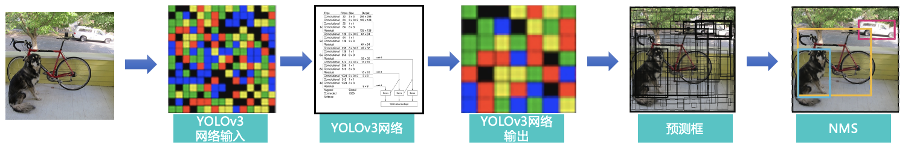

### Backbone, neck and head

| Module | Role |
| --- | --- |
| Backbone | extract visual features at different levels from the input image |
| Neck | fuse features of different scales to strengthen multi-scale representation |
| Head | predict object class, confidence and box location |

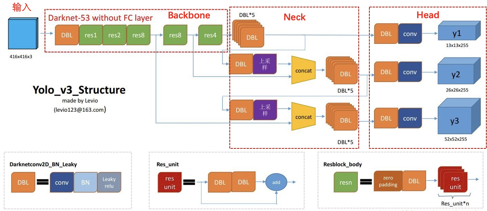

In a presentation, focus on the pipeline and the division of labour between the three modules. Move anchor generation,
coordinate transforms, label assignment and loss code to a practical session or a technical appendix.


---

# Part 6: From CNNs to large vision models

## 21. ViT: turning an image into a token sequence

Vision Transformer (ViT) moves the Transformer from natural language processing into vision.

The core steps:

1. split the image into fixed-size patches;
2. flatten every patch and project it into a vector;
3. add positional encodings and a classification token;
4. feed the token sequence into a Transformer encoder;
5. use the output representation to classify the image.

```text
image
  ↓
split into patches
  ↓
patch embedding
  ↓
add positional encoding
  ↓
Transformer encoder
  ↓
classification head
```

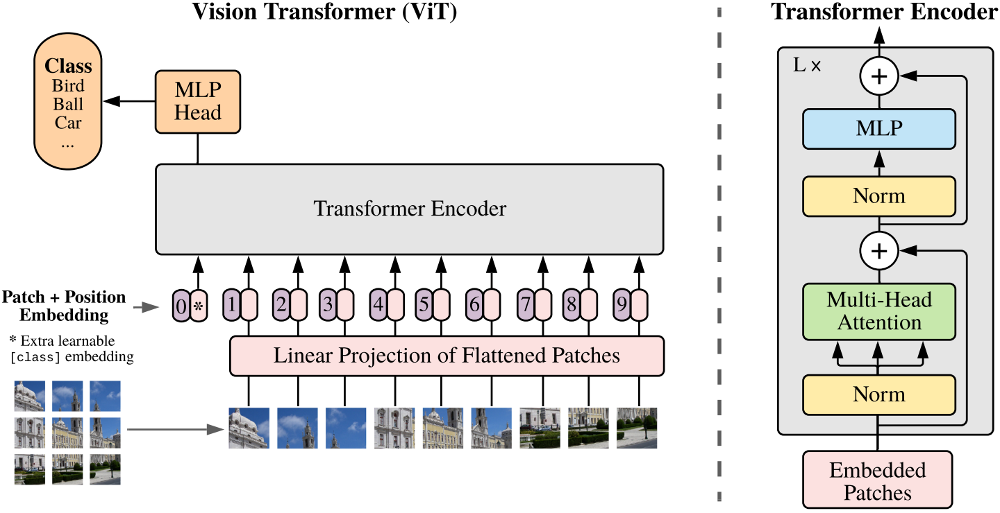

CNN and ViT put their inductive bias in different places:

| CNN                                                | ViT                                              |
| -------------------------- | ------------------------------------- |
| enlarges the receptive field layer by layer through local convolution | models patch relations directly with self-attention |
| strong local structural prior                      | little structural prior, relies more on data and pretraining |
| represents an image as a 2-D feature map           | represents an image as a token sequence |

---

## 22. Diffusion: generating images by learning to denoise

The core idea of DDPM (Denoising Diffusion Probabilistic Models) is: during training, add noise to a real image step by
step and train a model to learn the reverse denoising process; at generation time, start from random noise and denoise
over many steps to obtain an image.

```text
forward diffusion: add noise step by step

image -> x1 -> x2 -> x3 -> ... -> noise


reverse diffusion: denoise step by step

noise -> x(t-1) -> x(t-2) -> ... -> image
```

> The point of DDPM is not to memorise every formula but to understand "learn how to restore an image by destroying
> it".

---

## 23. Latent Diffusion: leaving pixel space for latent space

Early diffusion models denoised for many steps directly in high-dimensional pixel space, which is expensive. A Latent
Diffusion Model (LDM) first compresses the image into a much smaller latent space with an autoencoder, and runs the
diffusion process there.

```text
image
  ↓ encoder
latent
  ↓ add noise
noisy latent
  ↓ denoise for many steps
clean latent
  ↓ decoder
image
```

The key change:

> pixel space -> latent space

This lowers training and inference cost while keeping the perceptually important information.

---

## 24. Stable Diffusion: controlling generation with text

Stable Diffusion adds a text condition on top of Latent Diffusion.

```text
text prompt
     ↓
text encoder
     ↓
text embedding
     │
     └──── guides the denoising process
                  ↓
noise -> U-Net -> latent -> VAE decoder -> image
```

The key change:

> Latent Diffusion + text condition -> text-to-image

For a classroom demo use:

[Diffusion Explainer: interactive Stable Diffusion walkthrough](https://poloclub.github.io/diffusion-explainer/)


---

## 25. DiT: doing the diffusion denoising with a Transformer

Diffusion Transformer (DiT) keeps the overall Latent Diffusion framework but replaces the U-Net denoising backbone
with a Transformer.

```text
noisy latent
      ↓
   patchify
      ↓
patch embedding
      ↓
    tokens
      |-- timestep
      --+ condition
      ↓
 Transformer
      ↓
predict the noise and denoise step by step
      ↓
 clean latent
      ↓
 VAE decoder
      ↓
    image
```

The key change:

> U-Net -> Transformer

ViT and DiT show the two roles a Transformer can play in vision:

| Model | Main task | What the Transformer does |
| ----- | --------- | ------------------------- |
| ViT | visual understanding | encodes image patches and extracts a visual representation |
| DiT | visual generation | encodes noisy latent patches and predicts the denoising direction |

---

## 26. The evolution of visual generation

```text
DDPM (2020)
pixel space + U-Net
       |
       | pixel -> latent
       v
Latent Diffusion (2021)
latent space + U-Net
       |
       | add a text condition
       v
Stable Diffusion (2022)
text + latent + U-Net
       |
       | U-Net -> Transformer
       v
DiT (2022)
latent space + Transformer
```

Four sentences to remember:

1. **DDPM: learn to recover an image from noise;**
2. **Latent Diffusion: denoise inside a compressed latent space;**
3. **Stable Diffusion: let text control the direction of denoising;**
4. **DiT: let a Transformer do the denoising.**

---

# Part 7: Course summary

## 27. From pixels to semantics, and from semantics to content

Computer vision comes down to three levels of capability:

| Capability level | Core question | Representative techniques |
| ---------------- | ------------- | ------------------------- |
| Perception | which local patterns appear in the image? | convolution, pooling, feature extraction |
| Understanding | what is there, where is it, what happened? | ResNet, YOLO, segmentation, OCR, ViT |
| Generation | how do we create or edit visual content? | GAN, Diffusion, Stable Diffusion, DiT |

The whole technical line:

```text
pixels
 ↓
local features
 ↓
objects and locations
 ↓
scenes and semantics
 ↓
generation of visual content
```

### Six sentences to take away

1. Once an image enters a computer it is first a block of pixel values;
2. different CV tasks answer visual questions at different levels;
3. a CNN understands images through local connectivity, weight sharing and hierarchical feature extraction;
4. ResNet makes deep networks easier to train;
5. YOLO combines feature extraction, multi-scale fusion and detection prediction into a one-stage pipeline;
6. Transformer and Diffusion are moving CV from task-specific models towards fused understanding and generation.
