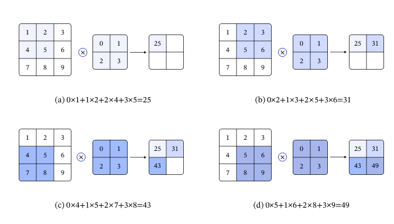
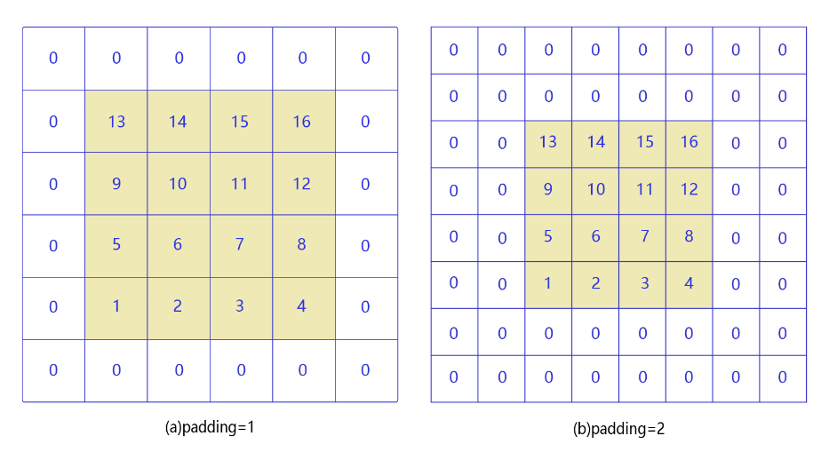
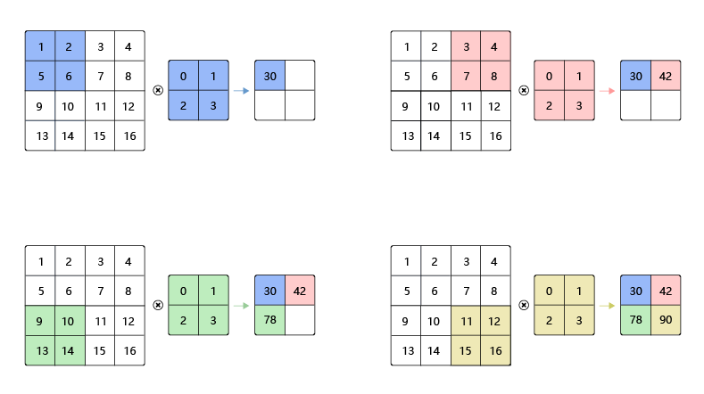
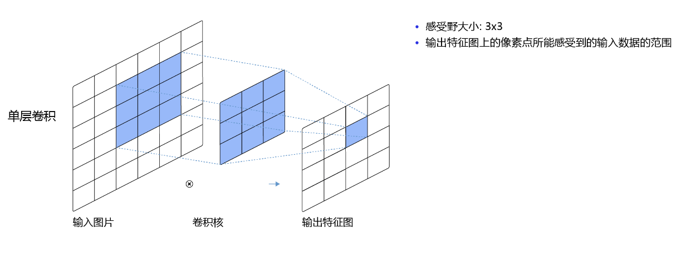
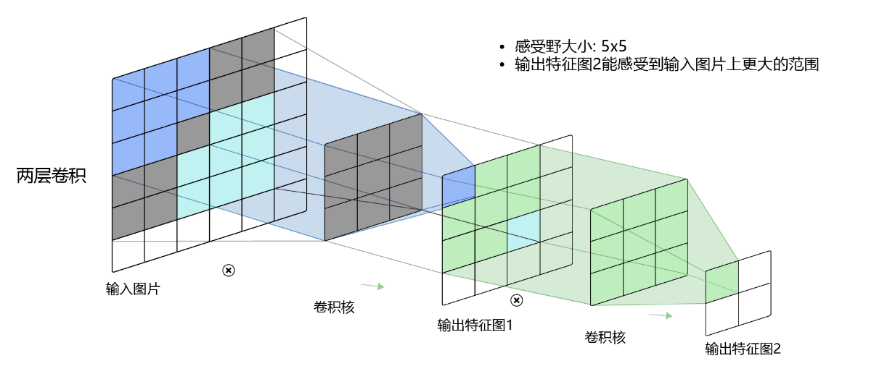
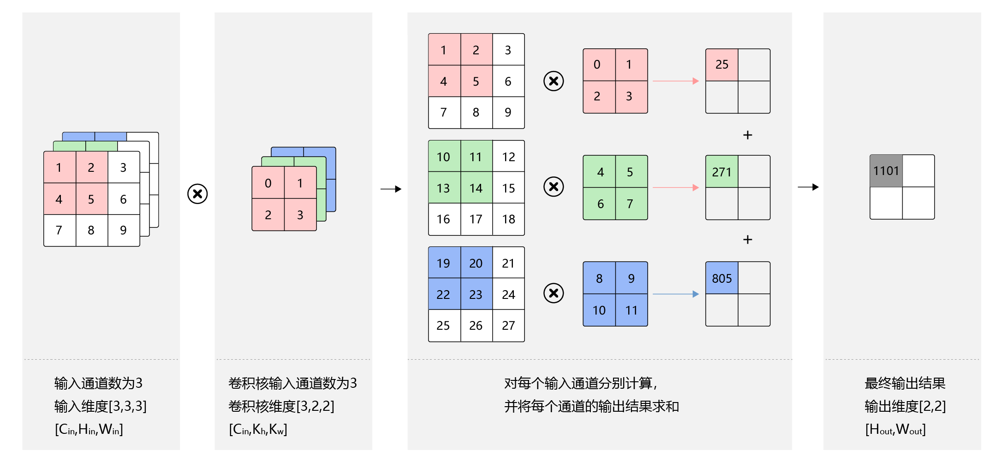
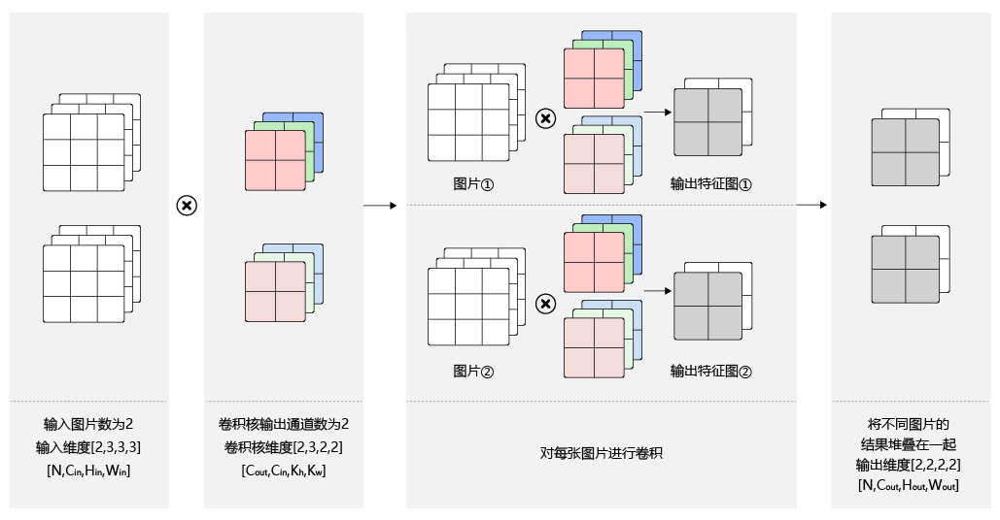
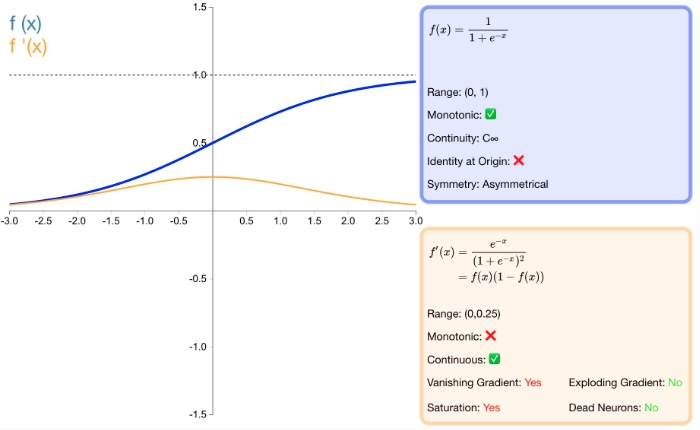
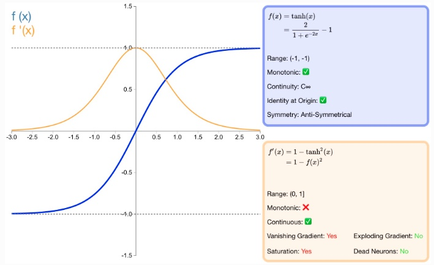

# CNN building blocks

A convolutional neural network (CNN) was motivated by the receptive-field mechanism found in biology, and it is still
the most widely used model structure in computer vision. This lesson walks through the building blocks you will reuse
in every vision notebook of this course:

  - Convolution
  - Pooling
  - Activation functions
  - Batch normalization
  - Dropout

Recall the digit-classification task: a fully connected network treats an image as one flat vector of pixels, and that
creates two problems.

**1. Too many parameters, so the model overfits easily.** In a fully connected feed-forward network every neuron of a
hidden layer connects to every input neuron. As hidden neurons grow, the parameter count grows with them, training
becomes slow, and overfitting becomes likely.

**2. Local invariance is hard to capture.** Objects in natural images keep their meaning under scaling, translation
and rotation. A fully connected network has no structure that expresses that invariance.

A convolutional network fixes both: it extracts patterns between neighbouring pixels while keeping the parameter count
independent of the image size. **Figure 1** shows a classic CNN: convolution layers, pooling layers, fully connected
layers and a dropout layer, which are described one by one below.

  

 Figure 1: the classic convolutional neural network structure 

  

------

**Note:**

Inside a CNN the computation is restricted to the spatial neighbourhood of each pixel, so a kernel has far fewer
parameters than a fully connected layer. A kernel does not depend on the input image size: it encodes one feature
pattern over a local neighbourhood - one kernel may respond to edges, another to corners - and the same kernel is
shared by every region of the image. The same kernel still works when the input image has a different size.

------

## Convolution

This section covers the principle and implementation of convolution, and then applies kernels to real images:

- Convolution arithmetic
- Padding
- Stride
- Receptive field
- Multiple input channels, multiple output channels, and batched inputs
- The convolution API in PyTorch
- Three worked kernels

### Convolution arithmetic

Convolution is an integral transform in mathematical analysis; image processing uses its discrete form. One caveat:
what a CNN layer actually computes is the operation mathematicians call **cross-correlation**. This course keeps the
convention used by the frameworks and by most CNN tutorials and calls it convolution. The arithmetic is in
**Figure 2**.

  

 Figure 2: how a convolution is computed 

  

------

**Note:**

A kernel is also called a filter. If its height and width are $k_h$ and $k_w$, we speak of a $k_h\times k_w$
convolution: a $3\times5$ convolution has a kernel three pixels high and five wide.

-----

- In Figure 2(a): the left grid is $3\times3$, so the input is a two-dimensional array of shape $3\times3$. The middle
  grid is $2\times2$, which is the kernel. Align the kernel's top-left corner with the input's (0, 0) position,
  multiply each kernel element by the input element at the same position, and add the products. That is the first
  output value:

$$0\times1 + 1\times2 + 2\times4 + 3\times5 = 25  \ \ \ \ \ \ \ (a)$$

- In Figure 2(b): slide the kernel right so its top-left corner sits at (0, 1) and repeat:

$$0\times2 + 1\times3 + 2\times5 + 3\times6 = 31  \ \ \ \ \ \ \ (b)$$

- In Figure 2(c): slide the kernel down to (1, 0):

$$0\times4 + 1\times5 + 2\times7 + 3\times8 = 43   \ \ \ \ \ \ \ (c)$$

- In Figure 2(d): slide it right to (1, 1):

$$0\times5 + 1\times6 + 2\times8 + 3\times9 = 49   \ \ \ \ \ \ \ (d)$$

In general, with $a$ the input image, $b$ the output feature map, $w$ the kernel (all two-dimensional arrays) and
$\sum_{u,v}$ the loop over the kernel:

$$b[i, j] = \sum_{u,v}{a[i+u, j+v]\cdot w[u, v]}$$

For a $2\times2$ kernel, $u$ and $v$ each take the values 0 and 1, so:
$$b[i, j] = a[i+0, j+0]\cdot w[0, 0] + a[i+0, j+1]\cdot w[0, 1] + a[i+1, j+0]\cdot w[1, 0] + a[i+1, j+1]\cdot w[1, 1]$$

Check for yourself that the four values above follow from this formula.

- **[Think]** For a $3\times3$ kernel, what is the correspondence between $b$ and $a$?

------

**Another note:**

A convolution operator also adds a bias term (which introduces non-linearity and increases fitting capacity). With a
bias of 1 the four outputs above become:

$$0\times1 + 1\times2 + 2\times4 + 3\times5 \mathbf{\  + 1}  = 26$$
$$0\times2 + 1\times3 + 2\times5 + 3\times6 \mathbf{\  + 1} = 32$$
$$0\times4 + 1\times5 + 2\times7 + 3\times8 \mathbf{\  + 1} = 44$$
$$0\times5 + 1\times6 + 2\times8 + 3\times9 \mathbf{\  + 1} = 50$$

------

### Padding

In the example above a $3\times3$ input produced a $2\times2$ output: convolution shrank the image. Without padding,
with kernel height and width $k_h$ and $k_w$:

$$H_{out} = H - k_h + 1$$
$$W_{out} = W - k_w + 1$$

An input of size 4 with a kernel of size 3 outputs $4-3+1=2$. Verify the formula for other combinations yourself.
Whenever a kernel is larger than $1\times1$ the output is smaller than the input, and after several convolutions the
border and corner pixels are lost, which hurts accuracy. Padding keeps the spatial size, as shown in **Figure 3**.

  

 Figure 3: padding 

  

- In Figure 3(a): padding of 1 with zeros turns a $4\times4$ input into $6\times6$, and a $3\times3$ kernel then
  outputs $4\times4$.
- In Figure 3(b): padding of 2 with zeros turns $4\times4$ into $8\times8$, and a $3\times3$ kernel outputs $6\times6$.

If you add $p_{h1}$ rows before the first row, $p_{h2}$ rows after the last row, $p_{w1}$ columns before the first
column and $p_{w2}$ columns after the last, the padded size is
$(H + p_{h1} + p_{h2})\times(W + p_{w1} + p_{w2})$, and a $k_h\times k_w$ kernel outputs:
$$H_{out} = H + p_{h1} + p_{h2} - k_h + 1$$
$$W_{out} = W + p_{w1} + p_{w2} - k_w + 1$$

Convolutions normally pad both sides equally, $p_{h1} = p_{h2} = p_h$ and $p_{w1} = p_{w2} = p_w$, so:
$$H_{out} = H + 2p_h - k_h + 1$$
$$W_{out} = W + 2p_w - k_w + 1$$
Kernels are usually odd (1, 3, 5, 7). Choosing $p_h=(k_h-1)/2$ and $p_w=(k_w-1)/2$ leaves the spatial size unchanged: a
$3\times3$ kernel with padding 1, or a $5\times5$ kernel with padding 2, both preserve width and height.

### Stride

In **Figure 4** the kernel moves one pixel at a time, which is the special case of stride 1. **Figure 4** below shows
stride 2, where each step moves two pixels.
  

 Figure 4: convolution with stride 2 

  

With strides $s_h$ and $s_w$ the output size becomes:

$$H_{out} = \frac{H + 2p_h - k_h}{s_h} + 1$$

$$W_{out} = \frac{W + 2p_w - k_w}{s_w} + 1$$

For a $100\times100$ input, a $3\times3$ kernel, padding 1 and stride 2:

$$H_{out} = \frac{100 + 2 - 3}{2} + 1 = 50$$

$$W_{out} = \frac{100 + 2 - 3}{2} + 1 = 50$$

The one-dimensional version of the same rule, including dilation, is what the notebooks print when they trace shapes:

`floor((input + 2 * padding - dilation * (kernel - 1) - 1) / stride + 1)`

For a 28-pixel input with kernel 5, padding 2, stride 1 and dilation 1 the output stays 28, and a following stride-2
pooling layer halves it to 14. Check height and width separately.

### Receptive field

Each value in the output feature map comes from a $k_h\times k_w$ region of the input, so changing any element inside
that region changes that output value. That region is the **receptive field** of the output point: a $3\times3$
convolution has a $3\times3$ receptive field, as shown in **Figure 5**.

  

 Figure 5: a convolution with a 3x3 receptive field 

  

Two stacked $3\times3$ convolutions raise the receptive field to $5\times5$, as shown in **Figure 6**.

  

 Figure 6: a convolution with a 5x5 receptive field 

  

Depth therefore enlarges the receptive field, and one output pixel can summarise more of the image. Detection networks
combine features from several scales so that both small and large objects are represented.

### Multiple input channels, multiple output channels, and batches

The examples above are deliberately simple. Real inputs have RGB channels, feature maps have many channels, and
networks compute on a mini-batch, so the convolution operator has to handle all three at once.

- **Multiple input channels**

Above, the layer input was two-dimensional, but a colour image has three channels, so the kernel changes shape too.
With $C_{in}$ input channels of shape $C_{in}\times H_{in}\times W_{in}$, the computation is in **Figure 7**:

1. Design one two-dimensional kernel per channel, so the kernel array has shape $C_{in}\times k_h\times k_w$.
2. For each channel, convolve the $H_{in}\times W_{in}$ array with its $k_h\times k_w$ kernel.
3. Sum the $C_{in}$ results, which yields one $H_{out}\times W_{out}$ array.
     

 Figure 7: convolution with multiple input channels 

  

- **Multiple output channels**

A convolution usually emits $C_{out}$ channels, which needs $C_{out}$ kernels of shape $C_{in}\times k_h\times k_w$,
so the kernel array is $C_{out}\times C_{in}\times k_h\times k_w$, as in **Figure 8**:

1. For every output channel $c_{out} \in [0, C_{out})$, convolve the input with the $C_{in}\times k_h\times k_w$
   kernel described above.
2. Stack the $C_{out}$ arrays of shape $H_{out}\times W_{out}$ into one $C_{out}\times H_{out}\times W_{out}$ tensor.

------

**Note:**

The number of output channels of a kernel is normally called the number of kernels.

------

 Figure 8: convolution with multiple output channels 

  

- **Batched inputs**

Training feeds a mini-batch, so the input is $N\times C_{in}\times H_{in}\times W_{in}$. Every image shares the same
kernels, so the kernel shape stays $C_{out}\times C_{in}\times k_h\times k_w$ and the output is
$N\times C_{out}\times H_{out}\times W_{out}$, as in **Figure 9**.

  

 Figure 9: batched convolution 

  

### The convolution API

The course uses PyTorch, where the operator is
[`torch.nn.Conv2d`](https://pytorch.org/docs/stable/generated/torch.nn.Conv2d.html):
`nn.Conv2d(in_channels, out_channels, kernel_size, stride=1, padding=0, dilation=1, groups=1, bias=True)`.
The "2D" in the name means a two-dimensional kernel, which is what images need; `Conv3d` exists for video (sequences of
images).

  - `in_channels` - number of input channels.
  - `out_channels` - number of kernels, which equals the number of output channels ($C_{out}$ above).
  - `kernel_size` - an int such as 3 (square kernel) or a tuple `(3, 2)` (height 3, width 2).
  - `stride` - an int (both directions) or a tuple `(3, 2)` (vertical 3, horizontal 2). Default 1.
  - `padding` - an int, a tuple, or a string such as `"same"`. Default 0.
  - `dilation` - spacing inside the kernel; 1 is a dense kernel.

With the default `data_format`, inputs are $[N, C_{in}, H_{in}, W_{in}]$, outputs are
$[N, out\_channels, H_{out}, W_{out}]$, the weight tensor is $[out\_channels, C_{in}, k_h, k_w]$ and the bias is
$[out\_channels]$. Even a single grayscale image must be shaped as $[1, 1, H_{in}, W_{in}]$.

The mirrored Chinese lesson documents the equivalent `paddle.nn.Conv2D`, whose parameter names and shapes are the same.

### Three worked kernels

A kernel is a small **feature extractor**. Different parameters pull different information out of an image: edges,
outlines, smoothing, denoising. The three cases below show the same operator doing very different jobs.

------

#### Case 1: detecting a black-white boundary

Start with a simple image: bright on the left, dark on the right. The goal is to find the dividing line. Use a
horizontal kernel

$K= \begin{bmatrix} 1 & 0 & -1 \end{bmatrix}$

Sliding it across the image computes the difference between the left and right pixel:

$y=x_{\mathrm{left}}-x_{\mathrm{right}}$

Inside a uniform region the two pixels are almost equal, so the response is near zero:

$x_{\mathrm{left}}\approx x_{\mathrm{right}} \Rightarrow y\approx0$

Across the boundary they differ, so the absolute response grows:

$x_{\mathrm{left}}\neq x_{\mathrm{right}} \Rightarrow |y|>0$

The output feature map therefore lights up **on the boundary and stays near zero on flat regions**.

------

#### Case 2: detecting object edges

Real images are messier, but an edge is still a sharp local change in pixel values. A kernel can therefore measure the
difference between the centre pixel and its neighbours to highlight outlines. The $3\times3$ Laplacian kernel is one
choice:

$K= \begin{bmatrix} -1 & -1 & -1\\ -1 & 8 & -1\\ -1 & -1 & -1 \end{bmatrix}$

which computes

$y= 8x_{\mathrm{center}} - \sum_{i=1}^{8}x_{\mathrm{neighbor},i}$

If the centre pixel matches its neighbours the region is flat and the response is near zero. If it differs, there is a
strong local intensity change and the response is large. Such a kernel therefore **emphasises places where intensity
changes quickly, which is exactly object outline information**.

------

#### Case 3: mean blurring

Convolution can also smooth an image. A $5\times5$ mean kernel

$K= \frac{1}{25} \begin{bmatrix} 1&1&1&1&1\\ 1&1&1&1&1\\ 1&1&1&1&1\\ 1&1&1&1&1\\ 1&1&1&1&1 \end{bmatrix}$

sets every output pixel to the average of its $5\times5$ neighbourhood:

$y=\frac{1}{25}\sum_{i=1}^{25}x_i$

No single pixel dominates, so local values become smoother. Mean convolution therefore **smooths the image and damps
local noise**, at the cost of **blurring edges and detail**.

**These three cases show the core idea of convolution:**

> **Different kernel parameters attend to different image features.**

$[1,0,-1]$ reacts to the left-right difference and detects a boundary; the Laplacian reacts to the centre-versus-
neighbour difference and extracts outlines; the mean kernel averages a neighbourhood and smooths.

In classical image processing these kernels were designed by hand. In a CNN the parameters are **learned from the
training data** instead. That is the bridge from a convolution operator to a convolutional neural network.

## Pooling

A pooling layer performs feature selection. It reduces the number of features, and therefore the number of
parameters, which matters most when a fully connected layer follows the backbone: a smaller feature map means far
fewer neurons, less storage, and less compute. **Figure 10** pools every $2\times2$ region into a single pixel. There
are two standard variants, average pooling and max pooling.

 Figure 10: Pooling  

  

- Figure 10(a): average pooling. A $2\times2$ pooling window slides with stride 2 and every output pixel is the mean
  of the pixels covered by the window.
- Figure 10(b): max pooling. Every output pixel is the maximum of the pixels covered by the window. Sliding the
  window over the whole input produces the whole output feature map. The window size is called the pooling size and
  is written $k_h \times k_w$. In practice $2 \times 2$ with stride 2 is by far the most common choice.

Exactly like a convolution kernel, the distance the pooling window moves per step is the stride, written $s_w$ and
$s_h$ when width and height differ. Padding works as it does for convolution: padding $p_{h1}$ rows before the first
row, $p_{h2}$ rows after the last row, $p_{w1}$ columns before the first column and $p_{w2}$ columns after the last
column gives

$$H_{out} = \frac{H + p_{h1} + p_{h2} - k_h}{s_h} + 1$$

$$W_{out} = \frac{W + p_{w1} + p_{w2} - k_w}{s_w} + 1$$

The usual configuration is a $2\times2$ window, stride 2, and no padding, so the output size becomes

$$H_{out} = \frac{H}{2}$$

$$W_{out} = \frac{W}{2}$$

With this configuration pooling halves height and width while **leaving the number of channels unchanged**. Because
pooling replaces the output at a position with an aggregate statistic of its neighbourhood, small shifts of the input
leave most outputs unchanged. Face detection is the classic example: we need to know that there is an eye on the left
and an eye on the right, not the exact pixel position of each eye, so summarising a region is more useful than
localising it precisely. This is the **translation invariance** of pooling.

Later work added more pooling operators. SSPNet proposed Spatial Pyramid Pooling (SPP), which adapts the window size
and stride to the input size so that the output size is always the same, making it easier to extract features from
images of different scales. Global Average Pooling (GAP), introduced in Network in Network, averages over the entire
feature map rather than over a local window, which loses less information. Global Max Pooling, NetVLAD pooling,
stochastic pooling, overlapping pooling, and RoI pooling are further variants.

## Activation functions

An activation function applies a nonlinear transform to its input and passes the result to the next layer. Without
activation functions every layer output is a linear function of the layer input, so however deep the network is, the
final output is only a linear combination of the input. Nonlinearity is what lets a neural network approximate
arbitrary nonlinear functions.

Early networks, including the ones in the previous section, used Sigmoid as the activation. Sigmoid and Tanh were
dominant in the early years, while ReLU is the common default today. The reason is that Sigmoid and Tanh are softly
saturated: once a unit falls into a saturated region its gradient is close to zero, which causes the vanishing
gradient problem during backpropagation. Look closely at the Sigmoid curve.

  

 Figure 11: The Sigmoid function  

  

The Tanh activation looks like **Figure 12**:

  

 Figure 12: The Tanh function  

  

The ReLU activation looks like **Figure 13**:

  

 Figure 13: The ReLU function  

  

**Figure 13** shows that for $x >= 0$ the derivative of ReLU is constant, which directly relieves the vanishing
gradient problem, and that ReLU needs no exponentiation, so it is also cheap to implement. The cost is that for $x <
0$ the gradient is always zero: some neurons may never activate, and the parameters attached to them are then never
updated. LReLU, PReLU, ELU, swish and hswish were all proposed to soften that failure mode.

## Batch Normalization

[Batch Normalization](https://arxiv.org/abs/1502.03167) (BatchNorm), proposed by Ioffe and Szegedy in 2015, is now
used throughout deep learning. Its purpose is to standardise the outputs of the intermediate layers of a network so
that those outputs stay stable.

We already standardise datasets, because a fixed input distribution with mean 0 and variance 1 makes optimisation
stable and helps convergence. In a deep network the parameters change constantly, so even a standardised input
produces rapidly changing inputs for the later layers; the numbers become unstable and the model is hard to
converge. BatchNorm stabilises the intermediate outputs and has three practical benefits:

- it speeds up learning (larger learning rates become usable)

- it reduces how sensitive the model is to initialisation

- it suppresses overfitting to some degree

BatchNorm normalises the activations of each mini-batch so that their distribution has mean 0 and variance 1.

Its variants are Layer Normalization (LN), Group Normalization (GN) and Instance Normalization (IN), compared below.

Here N is the batch size, H and W are the height and width of the feature map, C is the number of channels, and blue
pixels share the same mean and variance:

  

 Figure 14: Normalization methods  

  

- LN: computes mean and variance over the [C,W,H] dimensions, i.e. normalises along the channel axis. It does not
  depend on the batch size and can work better with small batches.
- GN: splits the channels into groups and normalises each group over [$C_{i}$,W,H]. It is also independent of batch
  size.
- IN: normalises over the [H,W] dimensions only, which suits image stylization tasks.

## Dropout

Dropout is a common way to suppress overfitting. During training it randomly removes part of the neurons: the selected
neurons have their outputs set to zero and therefore send no signal outward.

**Figure 15** shows the idea, with the full network on the left and the network after Dropout on the right. Neurons
marked $\times$ are removed for that step and stop sending signals to later layers. Which neurons are dropped is
decided randomly at every step, so the model cannot rely too heavily on any particular neuron, which suppresses
overfitting to some degree.

  

 Figure 15: Dropout  

  

There are many Dropout variants, including DropConnect, Standout, Gaussian Dropout, Spatial Dropout, Cutout,
Max-Drop, RNNDrop and recurrent Drop. A few of them:

- DropConnect, proposed by L. Wan et al., does not apply Dropout to the neurons but to the weights and biases of the
  connections, and can only be applied to fully connected layers.
- Standout, proposed by L. J. Ba and B. Frey, does not keep the drop probability $p$ of layer $i$ constant: $p$ is
  adaptive to the weights, and larger weights are dropped with larger probability.
- Spatial Dropout, proposed by J. Tompson et al., exploits the strong correlation between neighbouring pixels and
  drops whole feature maps instead of individual pixels.
- Cutout, proposed by T. DeVries and G. W. Taylor, generalises by hiding regions of the input image, which prevents
  overfitting and improves the robustness and overall performance of the network.
