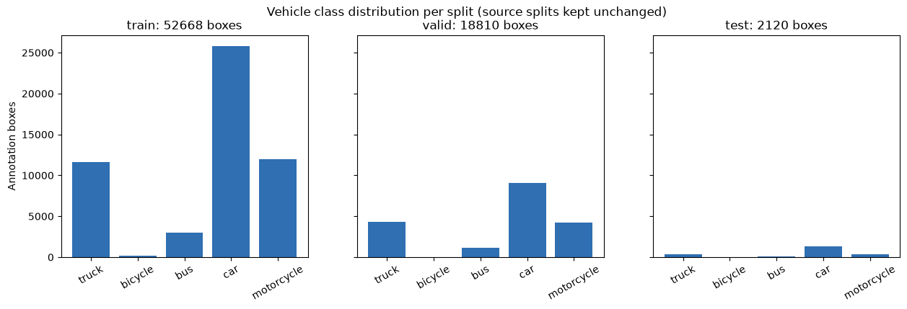
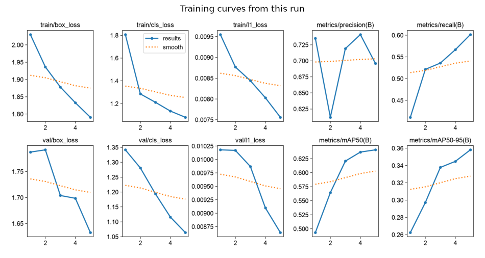
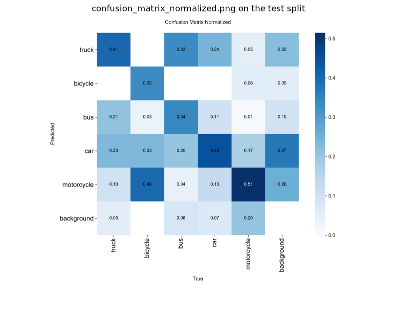
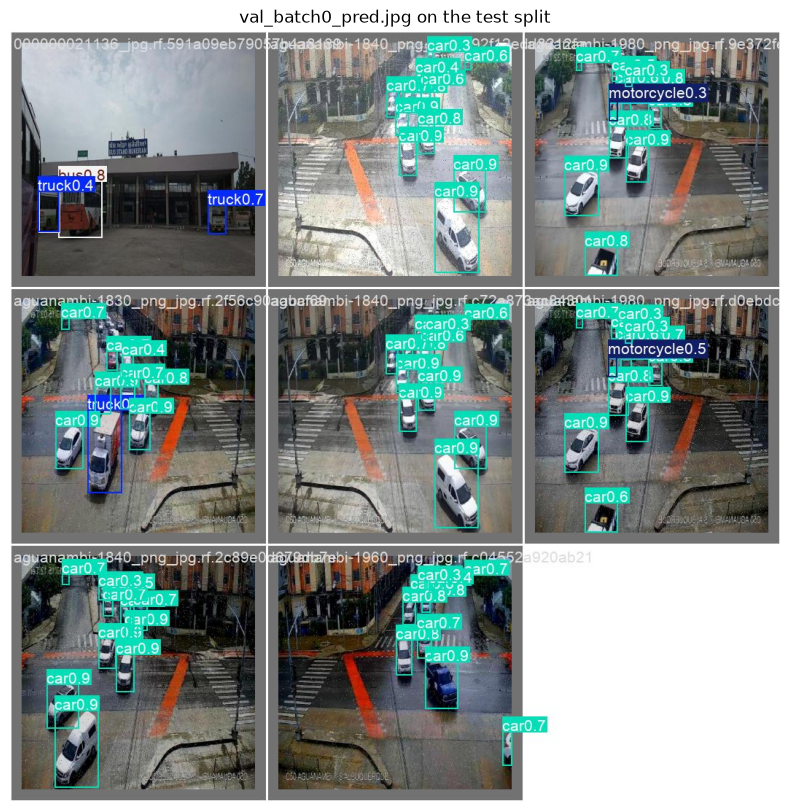
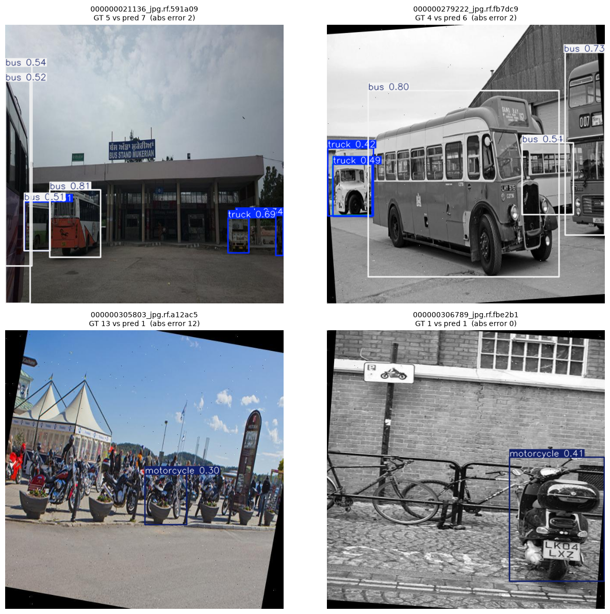
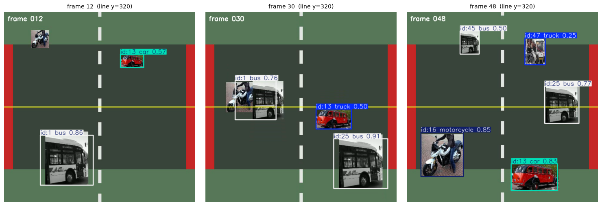

# Vehicle counting run report (YOLO26 + ByteTrack)

This report records one **complete, real execution** of the
[vehicle counting notebook](../notebooks/02-yolo26-vehicle-counting.ipynb): real dataset, real training, real
inference and tracking, with execution counters and outputs on every cell. Every quoted line is copied verbatim from
the outputs saved in that notebook, and the figures come from the same run; they live in the sibling
[`../assets/`](../assets/) directory and are referenced with relative paths.

## Run environment

| Item | Value |
|---|---|
| Date | 2026-10-18 |
| Kernel | `env_dl_uv` (uv project, see [environment setup](../../docs/environment-setup.md)) |
| Python / torch / ultralytics | 3.12.12 / 2.14.1 / 8.4.177 |
| Device and parameters | Apple Silicon **MPS**, `epochs=5`, `imgsz=320`, `batch=8`, `seed=42` (classroom defaults, not a smoke test) |
| End-to-end time | 940.21 s (the five training epochs took 896 s of it, about 179 s per epoch) |
| How it was run | `english/scripts/execute_and_save.py --group detection --language en --notebook 02-yolo26-vehicle-counting` |
| Execution record | `english/reports/detection-executed.json` (`status: passed`) |

Artifacts under `english/02-object-detection/outputs/`: `runs/vehicle-counting-v4-yolo26n-2/` (weights and training
plots), `runs/evaluation-vehicle-3/` (test-split evaluation), `vehicle-counting-data.yaml`,
`vehicle-counting-metrics.json`, `traffic-demo.mp4`, `traffic-demo.ground-truth.json`, `vehicle-flow-report.json`.
The `-2` suffix is Ultralytics' collision handling: it appends a counter whenever a run folder of that name already
exists, so earlier attempts on this machine remain as sibling folders.

## 1 Dataset and class mapping

The data is Roboflow `vehicle-counting-rtvul / vehicle-counting-tksu5` **v4** (CC BY 4.0), imported from the
`/workspace/DataSet/yolo` staging area with `english/scripts/import_vehicle_counting.py --from-staging`. The importer
checks the provenance, the class mapping, the per-split counts and the archive SHA-256 before writing anything.

Expected output:

```text
Class mapping: {0: 'truck', 1: 'bicycle', 2: 'bus', 3: 'car', 4: 'motorcycle'}
Validated split sizes: {'train': {'images': 4708, 'boxes': 52668}, 'val': {'images': 1661, 'boxes': 18810}, 'test': {'images': 196, 'boxes': 2120}, 'segmentation_lines_normalised': 0}
Source: https://universe.roboflow.com/vehicle-counting-rtvul/vehicle-counting-tksu5 | license: CC BY 4.0
Archive SHA-256: 3945432ed7ce76c9 ...
```

`segmentation_lines_normalised: 0` means the validator found **no remaining** segmentation polygon rows at check time;
the three segmentation rows in the source package were rewritten as bounding boxes during import and recorded in that
data directory's `provenance.json`.

Class distribution (the source splits are used exactly as published, with no resampling):



The test split only has 2,120 boxes, so `bicycle` and `bus` are barely represented and their per-class metrics are
noisy. That is the premise for how the errors below should be read.

Annotated samples (one image per panel, the number inside each box is its class id):


## 2 Zero-shot baseline: inference without touching the weights

First the COCO-pretrained `yolo11n.pt` (80 classes) is mapped onto this course's five classes, to see what
"no training at all" delivers.

Expected output:

```text
image                                  GT  pred abs error
000000021136_jpg.rf.591a09eb79057b      5     3         2
000000279222_jpg.rf.fb7dc97a15f0d2      4     4         0
000000305803_jpg.rf.a12ac5644291b0     13     0        13
000000306789_jpg.rf.fbe2b1ca62b53a      1     1         0
000000306893_jpg.rf.4c136a12ec3d5c      2     4         2
000000314251_jpg.rf.6fc0048d77bbd3      9     0         9
Zero-shot mean absolute counting error: 4.33 vehicles/image
```

Ground truth is read from the YOLO-layout `test/labels/*.txt` files (**not** from files next to the images). The error
is dominated by dense small objects: one image loses all 13 motorcycles, another all 9.

## 3 Fine-tuning YOLO26n

Training starts from `yolo26n.pt` for five epochs at 320 pixels with `workers=0`.

Expected output:

```text
Saved checkpoint: …/deep-learning-lab/english/02-object-detection/outputs/runs/vehicle-counting-v4-yolo26n-2/weights/best.pt
```

Validation metrics rise every epoch, with no plateau after five epochs:

| epoch | cumulative time (s) | mAP50 (val) | mAP50-95 (val) |
|---:|---:|---:|---:|
| 1 | 182 | 0.4933 | 0.2624 |
| 2 | 361 | 0.5645 | 0.2972 |
| 3 | 539 | 0.6207 | 0.3378 |
| 4 | 717 | 0.6368 | 0.3448 |
| 5 | 896 | 0.6407 | 0.3582 |



## 4 Evaluating the fine-tuned weights

Evaluation runs on the **held-out test split**, which never overlaps with training or validation.

Expected output:

```text
test precision: 0.7308
test recall:    0.6444
test mAP50:     0.6983
test mAP50-95:  0.4071
Metric report written: …/deep-learning-lab/english/02-object-detection/outputs/vehicle-counting-metrics.json
```



The per-class breakdown says where the loss is (mAP50 / mAP50-95 from `vehicle-counting-metrics.json`):
`car` 0.8439 / 0.5747, `bicycle` 0.7297 / 0.3128, `truck` 0.7118 / 0.4274, `bus` 0.6994 / 0.4847, and
`motorcycle` 0.5069 / 0.2360. Small, thin objects plus class imbalance are the bottleneck, not a detector that fails
to see the scene: the detector finds vehicles, it just confuses which class and misses the smallest ones.

Prediction samples on the test split (blue ground truth, cyan predictions):



## 5 Counting vehicles in an image

Four test images are detected and tallied per class, compared against their annotations class by class.

Expected output:

```text
000000021136_jpg.rf.591a09eb79057b4a8139188b25aabd95.jpg: predicted {'bus': 4, 'truck': 3} | ground truth {'bus': 4, 'truck': 1}
000000279222_jpg.rf.fb7dc97a15f0d237311be501e45f110a.jpg: predicted {'bus': 3, 'truck': 2, 'car': 1} | ground truth {'bus': 3, 'truck': 1}
000000305803_jpg.rf.a12ac5644291b03859ee97bf32999079.jpg: predicted {'motorcycle': 1} | ground truth {'motorcycle': 13}
000000306789_jpg.rf.fbe2b1ca62b53abcb7fb9fbc765b29e0.jpg: predicted {'motorcycle': 1} | ground truth {'motorcycle': 1}
Fine-tuned mean absolute counting error: 4.0 vehicles/image on these four test images
```



How to read it: on the first two images (large vehicles) every vehicle is detected - the totals are 7 against 5 and 6
against 4 - and the remaining error is class assignment and duplicated boxes, not missing objects. On the last two,
the motorcycle cluster is still mostly lost at 320 pixels: 13 → 1 alone contributes 12 of the 16 total absolute error,
which is why the mean sits at 4.0.

## 6 Counting vehicles in a video: tracking plus line crossings

The demo clip is composed from **real vehicle crops in the dataset** by
`english/scripts/build_traffic_demo_video.py` (108 frames at 12 fps, with a known number of line crossings), so the
deviation measured here reflects detection and tracking quality rather than real traffic volume.

The clip already existed from the build step above, so the notebook reused it instead of writing a new one; the
ground truth below comes from `outputs/traffic-demo.ground-truth.json`.

Expected output:

```text
Using video: …/deep-learning-lab/english/02-object-detection/outputs/traffic-demo.mp4
Counting line: [0, 320, 640, 320] | frames: 108 | fps: 12
```

Ground truth for that clip: `expected_total_crossings: 6`, split as
`{'truck': 1, 'bicycle': 0, 'bus': 3, 'car': 1, 'motorcycle': 1}`.

```text
Analysed frames: 108 of declared 108 | fps: 12.0
forward  crossings:   4  per class: {'truck': 1, 'motorcycle': 1, 'bus': 2}
backward crossings:   2  per class: {'bus': 2}
Unique counted vehicles: 6 | vehicle tracks ever seen: 10
Flow: {'duration_seconds': 9.0, 'total_crossings': 6, 'vehicles_per_minute': 40.0}
Ground-truth crossings: 6 -> detector/tracker deviation: +0
```

```text
{
  "counts": {
    "forward": {
      "crossings": 4,
      "per_class": {
        "truck": 1,
        "motorcycle": 1,
        "bus": 2
      },
      "last_crossing": {
        "class": "bus",
        "track_id": 61,
        "frame": 78,
        "timestamp": 6.5
      }
    },
    "backward": {
      "crossings": 2,
      "per_class": {
        "bus": 2
      },
      "last_crossing": {
        "class": "bus",
        "track_id": 25,
        "frame": 52,
        "timestamp": 4.333333333333333
      }
    }
  },
  "unique_vehicles_counted": 6,
  "flow": {
    "duration_seconds": 9.0,
    "total_crossings": 6,
    "vehicles_per_minute": 40.0
  }
}
```



Tracking turns "how many vehicles in this frame" into "how many distinct vehicles": 10 tracks were seen, 6 of them
crossed the line, and `unique_vehicles_counted` does not double-count a vehicle that appears in many frames.
`vehicles_per_minute` is derived from the clip's own frame rate, so it can be used directly as a flow metric.

The total deviation is **0**, but the class split is not perfect: the clip spawns one `car` and one forward `bus`,
and the detector reported `bus: 2` forward with no `car`, so it called the car a bus. Total flow is right, class
attribution is not - consistent with the per-class AP in section 4.

## 7 Fair comparison on the same four images

The notebook counts on **different image counts** (zero-shot on 6 images, fine-tuned on 4), so those two means are not
comparable. Recomputing both weight sets on the same four test images with the same `conf=0.25` and `imgsz=320` gives
the comparison that actually supports a conclusion:

| Weights | Mean absolute counting error, same four images |
|---|---:|
| Zero-shot `yolo11n.pt` (COCO 80 classes mapped to five) | 3.75 vehicles/image |
| Fine-tuned `best.pt` (this course's five classes, five epochs at 320 px) | 4.00 vehicles/image |

In other words, **on these four images the zero-shot model still counts slightly better in total**, even though the
fine-tuned model narrowed the gap from the earlier CPU run (4.75) to 4.00. Both models lose most of the 13-motorcycle
cluster, which alone contributes 12 of the fine-tuned model's 16 absolute error. What fine-tuning did buy is visible
on the whole test split (mAP50 0.6983 against the zero-shot baseline) and in class consistency, not in a four-image
count dominated by one small-object failure. To improve counting, raise `imgsz` (320 → 640) and `epochs` before
reaching for a bigger backbone.

## 8 Reproducing

```bash
# 1) Data: import from the DataSet staging area (see ../data/README.md)
cd /path/to/deep-learning-lab
~/env_dl_uv/.venv/bin/python english/scripts/import_vehicle_counting.py --from-staging

# 2) Build the demo clip (optional; the notebook generates it when missing)
~/env_dl_uv/.venv/bin/python english/scripts/build_traffic_demo_video.py \
  --export-dir english/02-object-detection/data/vehicle-counting-tksu5-v4 \
  --output     english/02-object-detection/outputs/traffic-demo.mp4 --fps 12 --frames 108

# 3) Execute and save the outputs (classroom defaults; about 16 minutes on Apple silicon MPS)
cd english
~/env_dl_uv/.venv/bin/python scripts/execute_and_save.py \
  --group detection --language en --notebook 02-yolo26-vehicle-counting

# A pinned per-module environment can be recreated with: uv sync --locked --project 02-object-detection
```

`COURSE_SMOKE=1` switches to the COCO8 pipeline check; its numbers are **not** vehicle counting results for this
dataset. `COURSE_EPOCHS=1` only proves the pipeline is wired together.

## Known limits

- Five epochs at 320 pixels did not converge (validation mAP50 was still climbing). Every number here describes
  *this run under the classroom defaults*, not the ceiling of this dataset.
- The video is synthetic with known ground-truth crossings, which is what makes the deviation meaningful here -
  this run hit exactly 0, while the class split still confused one `car` for a `bus`. Use `TRAFFIC_VIDEO` to point at
  a real road clip instead.
- Tracking on Apple silicon MPS runs through the same `index_put_with_accumulate_mps` path noted in the setup cell, so
  a rerun can differ by one crossing; the total here is what this delivered run produced.
- `bicycle` and `bus` have very few test-split samples, so their per-class intervals are wide.
